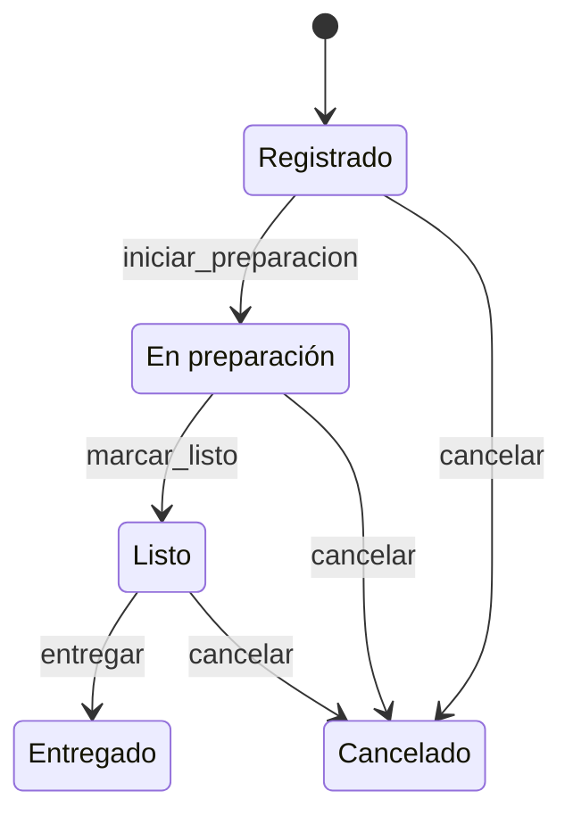

# Sazón Urbano · Proyecto Integrador (PIA)

Componentes de Lógica de Negocios · Equipo 3 · UANL FIME.
Sistema de pedidos del restaurante **Sazón Urbano** con DDD, patrón Specification, máquina de
estados, Domain Events, API REST (FastAPI + OpenAPI), persistencia (SQLAlchemy + PostgreSQL),
pruebas, CI/CD y Docker Compose.

## Arquitectura

```
api/             Rutas REST y traducción de errores a texto claro (FastAPI)
application/     Casos de uso, RBAC, despachador de eventos y manejadores
domain/          Pedido y Platillo (Aggregate Roots), Specifications, máquina de estados, eventos
infrastructure/  SQLAlchemy, repositorios, Unit of Work, carga de CSV, evidencias
```

Las dependencias apuntan hacia el dominio: `domain` no importa nada de las demás capas.
Cada caso de uso abre **una transacción por Aggregate Root**; los eventos se despachan después del
commit y sus manejadores (bitácora de auditoría, descuento de inventario) corren en transacciones
separadas (consistencia eventual, ADR-002).

### Máquina de estados del pedido



### Specifications (`src/domain/specifications.py`)

| Regla compuesta | Composición |
|---|---|
| `puede_procesarse` | ActorActivo **Y** PedidoConLineas **Y** PedidoAutorizado |
| `beneficio_referencia` | ActorPreferente **Y** TotalMinimo(1500) **Y NO** PromocionActiva |
| `puede_autorizar_cancelacion` | Rol Encargado **O** Rol Gerente |
| `puede_venderse` | PedidoConLineas **Y** ExistenciasSuficientes |

## Cómo ejecutarlo

### Con Docker (recomendado)

```bash
cp .env.example .env          # en Windows: copy .env.example .env
docker compose up --build     # base de datos + API
```
API en http://localhost:8000 · Swagger en http://localhost:8000/docs

```bash
docker compose --profile tests run --rm tests   # pruebas contra PostgreSQL
docker compose down -v                          # apagar y borrar datos
```

### Sin Docker (SQLite)

```bash
python -m venv .venv && .venv\Scripts\activate      # Linux/Mac: source .venv/bin/activate
pip install -r requirements.txt
set SEED_ON_START=true                              # Linux/Mac: export SEED_ON_START=true
uvicorn src.api.main:crear_app --factory --reload
```

## Pruebas, calidad y evidencias

```bash
pytest -v --cov=src --cov-report=term-missing --cov-fail-under=80
ruff check src tests scripts
python scripts/ejecutar_casos.py     # 120 casos y 20 transiciones -> evidencias/*.csv
python scripts/exportar_openapi.py   # especificación -> docs/api/openapi.json
```

## Endpoints principales

| Método y ruta | Historia |
|---|---|
| `POST /pedidos` | US-08, US-09 |
| `GET /pedidos`, `GET /pedidos/{id}` | US-01, US-07 |
| `POST /pedidos/{id}/preparacion`, `/listo`, `/entrega` | US-06, US-12 |
| `POST /pedidos/{id}/cancelacion` (Encargado o Gerente) | US-10 |
| `GET /platillos`, `POST /inventario/ajustes` | US-02, US-03, US-04, US-05 |
| `GET /cancelaciones`, `GET /auditoria` | US-11, US-13 |
| `GET /reportes/resumen` | US-14, US-15 |
| `GET /pedidos/{id}/evaluacion` | Specifications del pedido |

Los errores siempre responden JSON con `detail` en español claro (por ejemplo
`409 «No es posible entregar un pedido que está «Registrado»»`), sin rastros técnicos.

## Equivalencias con el paquete de datos

| Paquete | Este proyecto |
|---|---|
| Estado `CREADO` | `Registrado` |
| Estado `ACEPTADO` | No existe en el BRD; `aprobar` = `iniciar_preparacion`, condicionada a `puede_procesarse` |
| `completar` | iniciar preparación, marcar listo y entregar (descuenta inventario) |
| `repetir_aprobacion` / `saltar_estado` | La segunda aprobación y la entrega desde `Registrado` se rechazan |
| `cancelar` | `cancelar` con rol Encargado |

## Variables de entorno

Ver `.env.example`. `DATABASE_URL` se normaliza automáticamente para Render/Railway.

## Despliegue

`render.yaml` define la API (Docker) y su PostgreSQL. Pasos en `docs/`.
