<div class="portada">
<p class="univ">Universidad Autónoma de Nuevo León<br>Facultad de Ingeniería Mecánica y Eléctrica (FIME)</p>
<p class="materia">Componentes de Lógica de Negocios</p>
<h1 class="titulo-portada">Producto Integrador de Aprendizaje</h1>
<p class="subtitulo">Reporte final: BRD, arquitectura, implementación, evidencias y conclusiones</p>
<p class="sistema">Sazón Urbano · Sistema de pedidos del restaurante</p>
<table class="datos-portada">
<tr><td>Equipo</td><td>3</td></tr>
<tr><td>Integrantes</td><td>Cristopher Alan Pulgarin Santa Cruz (2105894)<br>Francisco Sebastián Hernández Terán (2115798)<br>Jesús Orlando Moreno Chávez (2108300)</td></tr>
<tr><td>Docente</td><td>Miguel Ángel Gómez Marroquín</td></tr>
<tr><td>Repositorio</td><td>https://github.com/Tera2332/PIA_Unidad6_CLN</td></tr>
<tr><td>Fecha del reporte</td><td>6 de noviembre de 2026</td></tr>
<tr><td>Fecha de entrega (documentos y repositorio)</td><td>06 de noviembre de 2026</td></tr>
<tr><td>Fecha de presentación y defensa</td><td>09 al 20 de noviembre de 2026</td></tr>
</table>
</div>

<h1 id="indice" class="sin-salto">Índice</h1>

[TOC]

# Resumen ejecutivo

**Sazón Urbano** es un sistema de pedidos para restaurante construido con **Domain-Driven Design**, el patrón **Specification**, una **máquina de estados** del pedido y una **API REST** documentada con OpenAPI (FastAPI). Persiste en SQLAlchemy (SQLite en local, PostgreSQL en Docker Compose y Render), publica **Domain Events** con consistencia eventual, controla acceso por roles para cancelar pedidos y deja una **bitácora de solo anexado**. Incluye una interfaz web para personal no técnico (`src/web/`).

Este reporte se redactó leyendo el código y ejecutando los comandos de verificación el **6 de noviembre de 2026**. Cada dato cuantitativo proviene de una salida real incluida en el Anexo C o de un archivo del proyecto citado en el texto. Lo que no se pudo comprobar se marca como **PENDIENTE DE EVIDENCIA**, y los incumplimientos de la rúbrica están en la sección 7 sin maquillar.

| Indicador | Valor medido | Fuente |
|---|---|---|
| Pruebas automatizadas | **91 aprobadas, 0 fallidas** (13 de integración API, 6 de persistencia, 72 unitarias) | `pytest -v` (Anexo C.2) |
| Cobertura de `src/` | **97,29 %** (1 144 sentencias, 31 sin cubrir); mínimo exigido 80 % | `pytest --cov` (Anexo C.2) |
| Análisis estático | `ruff check src tests scripts`: **All checks passed!** | Anexo C.3 |
| Paquete de datos del PIA | 120 casos de Specification (56 CUMPLE, 64 NO CUMPLE) y 20 transiciones (11 OK, 9 RECHAZADO) | `scripts/ejecutar_casos.py` (Anexo C.4) |
| API | 15 operaciones HTTP, 12 esquemas, OpenAPI 3.1 exportado a `docs/api/openapi.json` | Anexo C.5 y B |
| Capas | `domain` solo importa de `domain`; `application` solo de `application` y `domain` | análisis de imports (§2.1) |
| Escenario en vivo | Flujo completo, 14 rechazos de reglas y errores (403, 404, 409 y 422) y trazabilidad, contra el servidor real | Anexo C.8 |

**Brechas principales** (detalle en la sección 7):

1. **El historial de commits es mínimo y de un solo autor.** El repositorio de GitHub existe, pero tiene 2 commits, ambos de la cuenta `Tera2332`; la carpeta de trabajo evaluada no es un repositorio git. La rúbrica pide historial del equipo. Además, el pipeline CI falló en su primera ejecución (paso de `ruff`) y pasó en la segunda.
2. **No hay despliegue activo ni URL**: existe `render.yaml`, pero no hay evidencia de que se haya desplegado.
3. **Docker no está instalado en la máquina de verificación**: `docker-compose.yml` se revisó de forma estática y no se pudo levantar.
4. Faltan en el repositorio los artefactos de análisis y arquitectura como archivos (`docs/BRD.md`, `docs/architecture/`, BPMN, ADRs). En este reporte se **reconstruyeron desde el código**, no existían en el árbol evaluado.
5. Falta la presentación de apoyo para la defensa.

> **Nota sobre el árbol de pruebas.** El directorio `tests/` no estaba en la carpeta del proyecto al iniciar esta verificación. Se restauró desde `PIA_SazonUrbano_repo.zip` (copia previa del mismo proyecto, que contiene 89 pruebas). La caché de pytest (`.pytest_cache`) registraba 91 pruebas; las dos que faltaban en ese ZIP (`test_listar_clientes_para_la_interfaz` y `test_interfaz_web_se_sirve_en_la_raiz`) se **reescribieron** con los mismos nombres y se agregaron a `tests/integration/test_api.py`. El resultado de 91 pruebas aprobadas corresponde a ese conjunto restaurado.

**Cumplimiento resumido de la rúbrica** (Cumple / Parcial / No cumple; puntos máximos entre paréntesis según el PDF del PIA):

| Criterio de la rúbrica | Estado | Comentario breve |
|---|---|---|
| 1. Análisis · BRD (1,50) | Parcial | BRD reconstruido en §1.1; falta `docs/BRD.md` |
| 1. Análisis · ≥15 US + Gherkin + BPMN + glosario (4,75) | Parcial | 15 historias con Gherkin (§1.2), BPMN en Mermaid (§1.3), glosario (Anexo A); sin archivos fuente ni BPMN 2.0 |
| 2. Arquitectura · DDD (1,50) | Cumple | §2.1 |
| 2. Arquitectura · UML (1,25) | Parcial | Diagramas Mermaid en §2.2; no existen archivos en `docs/architecture/` |
| 2. Arquitectura · Patrones justificados (1,25) | Cumple | §2.3 |
| 2. Arquitectura · SOLID (1,00) | Cumple | §2.4 |
| 2. Arquitectura · ADRs (1,25) | Parcial | Formalizados en §2.5; solo se citan ADR-002 a ADR-005 en el código y no hay archivos |
| 3. Implementación · DDD + Specification + State Machine + API REST (4,25) | Cumple | §3.1, verificado en vivo |
| 3. Implementación · Persistencia + OpenAPI + casos de uso (2,00) | Cumple | §3.2 a §3.4 |
| 4. Calidad · Pruebas ≥80 % | Cumple | 97,29 % medido |
| 4. Calidad · CI/CD activo | Parcial | 2 ejecuciones en GitHub Actions: la primera falló (`ruff`) y la segunda pasó (Anexo C.7); falta la captura del equipo |
| 4. Calidad · Docker Compose DB + App + Tests | No verificable | Definido; Docker no disponible para ejecutarlo |
| 4. Calidad · Variables de entorno + despliegue + Swagger en producción | Parcial | Variables y `/docs` verificados en local; despliegue PENDIENTE |
| 4. Calidad · Demo en vivo y defensa | Preparada | Guion y evidencias en Anexos C y D |

*Trazabilidad con la rúbrica:* esta tabla cubre los cuatro bloques de evaluación del PDF (Análisis, Arquitectura, Implementación, Calidad y defensa).

# 1. Análisis del negocio

## 1.1 Documento de negocio (BRD)

> **Procedencia.** El repositorio no contiene `docs/BRD.md`. Este BRD se **reconstruyó a partir del dominio implementado** (`src/domain/`, `src/application/`) y del paquete de datos (`data/`). Los números de regla `RN-xx` son de este reporte; los identificadores `NB-04`, `NB-05`, `NB-06` y `NB-07` y las historias `US-xx` son los que ya aparecen en comentarios y rutas del código. El BRD original de las Unidades 2 y 3 no está en el árbol evaluado y debe cotejarse con este texto antes de la defensa.

### Problema y objetivo

El restaurante necesita registrar los pedidos de sus clientes y darles seguimiento ordenado desde que se toman hasta que se entregan o cancelan, sin vender productos que no existen, sin permitir que cualquier persona cancele y con un historial confiable de lo ocurrido. El sistema cubre ese ciclo y compara lo vendido contra el inventario restante.

**Objetivos de negocio que el código materializa:**

1. Registrar pedidos con el total correcto y rechazar los que no puedan atenderse, con mensajes claros.
2. Hacer avanzar cada pedido por un flujo de estados controlado, sin saltos ni repeticiones.
3. Controlar el inventario: descontar al entregar, registrar entradas y mermas, y avisar de stock crítico.
4. Restringir la cancelación al personal con autoridad y exigir el motivo.
5. Dejar trazabilidad completa en una bitácora que nunca se modifica.
6. Reportar ventas contra inventario.

### Alcance

| Dentro del alcance (implementado) | Fuera del alcance (no implementado) |
|---|---|
| Registro, consulta y listado de pedidos | Cobro, pagos y facturación |
| Flujo de estados y cancelación con rol | Autenticación real de usuarios (el rol se declara en la solicitud) |
| Inventario por platillo: entradas, mermas, stock crítico | Compras a proveedores y recetas por ingrediente |
| Bitácora de auditoría y consulta de cancelaciones | Multisucursal y reservaciones |
| Reporte de ventas contra inventario | Notificaciones externas (correo, mensajería) |
| Interfaz web para el personal | Aplicación móvil nativa |

### Actores y roles

| Actor | Tipo | Responsabilidad en el sistema | Evidencia |
|---|---|---|---|
| Cliente (`Actor`) | Entidad de negocio | Hace el pedido; puede ser **preferente** o **inactivo** (los inactivos no pueden pedir) | `src/domain/actor.py:5-10` |
| Mesero | Rol | Toma pedidos (usuario por defecto `mesero`) | `src/api/rutas.py:45` |
| Cocina | Rol | Inicia preparación y marca listo (usuario por defecto `cocina`) | `src/api/rutas.py:73,79` |
| Repartidor | Rol | Registra la entrega (usuario por defecto `repartidor`) | `src/api/rutas.py:85` |
| Encargado | Rol con autoridad | Puede cancelar pedidos y ajustar inventario | `src/domain/specifications.py:186-187` |
| Gerente | Rol con autoridad | Puede cancelar pedidos | `src/domain/specifications.py:186-187` |
| Sistema | Actor automático | Publica eventos, escribe la bitácora y descuenta inventario | `src/application/handlers.py:42-86` |

### Reglas de negocio

| ID | Regla | Fuente en el código |
|---|---|---|
| RN-01 | Solo un cliente **activo** puede hacer pedidos; además se vuelve a exigir al iniciar la preparación | `src/application/casos_uso.py:60-61`, `src/domain/specifications.py:101-106` |
| RN-02 | Un pedido debe tener al menos un producto y cada cantidad debe ser un entero mayor a cero | `src/domain/pedido.py:53-60` |
| RN-03 | Un platillo se vende solo si está habilitado y tiene existencias; si no, se responde «Producto no disponible por falta de ingredientes» (historia US-05). No se puede pedir más de lo que hay | `src/domain/catalogo.py:6,19-21,27-31` |
| RN-04 | El total es la suma de precio unitario por cantidad, en MXN con `Decimal` y dos decimales | `src/domain/valores.py:11-39`, `src/domain/pedido.py:24-26,73-78` |
| RN-05 | Los estados son Registrado, En preparación, Listo, Entregado y Cancelado; solo existen las transiciones de la tabla de §2.2 (NB-06) | `src/domain/maquina_estados.py:5-11` |
| RN-06 | Iniciar la preparación exige `puede_procesarse` = cliente activo **Y** pedido con líneas **Y** pedido autorizado | `src/domain/specifications.py:178-179`, `src/application/casos_uso.py:99-107` |
| RN-07 | Cancelar exige rol Encargado o Gerente, un motivo no vacío, y no aplica a pedidos entregados ni ya cancelados | `src/application/seguridad.py:6-13`, `src/domain/pedido.py:93-99`, `src/domain/maquina_estados.py:38-41` |
| RN-08 | Al entregar, el inventario se descuenta en una transacción **separada** (NB-07). Si el descuento falla, el pedido sigue entregado y se registra una incidencia en la bitácora | `src/application/handlers.py:57-86` |
| RN-09 | Cuando las existencias llegan al umbral crítico (`STOCK_CRITICO`, 5 por defecto) se emite una alerta | `src/domain/catalogo.py:23-25,41-42` |
| RN-10 | Se pueden registrar entradas y mermas; la merma exige un motivo | `src/domain/catalogo.py:47-59` |
| RN-11 | Beneficio de referencia = cliente preferente **Y** total de al menos 1 500 MXN **Y NO** promoción activa | `src/domain/specifications.py:175,182-183` |
| RN-12 | Cada acción trazable se guarda en una bitácora de solo anexado (NB-04, NB-05; ADR-005) | `src/application/handlers.py:15-54`, `src/infrastructure/repositorios_sql.py:123-143` |
| RN-13 | Los errores se muestran en español claro y sin rastros técnicos; un fallo inesperado devuelve un mensaje genérico | `src/api/errores.py:20-45`, `tests/integration/test_api.py::test_un_error_inesperado_no_expone_detalles_tecnicos` |

### Flujo principal

1. El mesero elige al cliente y los productos y **registra** el pedido (estado *Registrado*).
2. La cocina **inicia la preparación**; el sistema evalúa `puede_procesarse` (*En preparación*).
3. La cocina **marca el pedido como listo** (*Listo*).
4. El repartidor **entrega** el pedido (*Entregado*) y el sistema descuenta el inventario.
5. En cualquier momento antes de la entrega, un Encargado o Gerente puede **cancelar** con motivo (*Cancelado*).
6. Todo queda en la bitácora y alimenta el reporte de ventas contra inventario.

### Datos de negocio del paquete del PIA

Medidos directamente sobre los CSV de `data/`:

| Concepto | Valor | Archivo |
|---|---|---|
| Clientes | 40 (8 preferentes, 5 inactivos: PED-C007, C014, C021, C028, C035) | `data/actores.csv` |
| Platillos | 20; stock inicial de 10 a 52; precios de 290 a 1 639 MXN; 1 deshabilitado (Pasta 11) | `data/catalogo.csv` |
| Pedidos | 60 (47 sin promoción y autorizados, 7 sin autorizar, 6 con promoción activa); 2 sin ninguna línea de detalle | `data/operaciones.csv`, `data/detalle_operaciones.csv` |
| Líneas de detalle | 117 | `data/detalle_operaciones.csv` |
| Casos de prueba | 120 (60 `validar_operacion` y 60 `evaluar_beneficio`) | `data/casos_prueba.csv` |
| Transiciones de prueba | 20 | `data/transiciones_prueba.csv` |

## 1.2 Historias de usuario con criterios de aceptación en Gherkin

> **Procedencia y estado.** El código y el README referencian las historias **US-01 a US-15** (por ejemplo en `src/api/rutas.py:44-126`), pero sus textos originales no están en el repositorio. Se cuentan **15 historias** (US-01 a US-15), que cumplen el mínimo de la rúbrica. La redacción siguiente se **reconstruyó desde el comportamiento verificado** (pruebas y ejecución en vivo). Las marcadas con † (US-04 y US-09) tienen una asignación inferida, porque el README las agrupa («US-02, US-03, US-04, US-05» y «US-08, US-09»). US-14 y US-15 comparten el mismo endpoint. Hay que cotejarlas con las originales de las Unidades 2 y 3.

```gherkin
# US-01 · Listar pedidos por estado                                     GET /pedidos
Característica: Consultar los pedidos del restaurante
  Escenario: Filtrar por estado
    Dado que existen pedidos en distintos estados
    Cuando el mesero consulta los pedidos con el filtro "Entregado"
    Entonces recibe solo los pedidos entregados
  Escenario: Estado inexistente
    Cuando consulta con el filtro "volando"
    Entonces recibe 422 y el mensaje «El estado «volando» no existe. Usa uno de: REGISTRADO, EN_PREPARACION, LISTO, ENTREGADO, CANCELADO.»

# US-02 · Consultar disponibilidad de platillos                         GET /platillos
Característica: Ver qué se puede ofrecer
  Escenario: Buscar por nombre
    Cuando el mesero busca "Hamburguesa 01"
    Entonces ve el platillo con su precio, stock y si está disponible

# US-03 · Registrar entradas y mermas de inventario                     POST /inventario/ajustes
Característica: Ajustar el inventario
  Escenario: Entrada de mercancía
    Dado que "Pasta 03" tiene 19 unidades
    Cuando el encargado registra una entrada de 10
    Entonces el stock queda en 29
  Escenario: Merma sin motivo
    Cuando registra una merma sin motivo
    Entonces recibe 422 «Para registrar una merma debes indicar el motivo.»
  Escenario: Merma con motivo
    Cuando registra una merma de 2 con motivo "Producto caducado"
    Entonces el stock queda en 27

# US-04 † · Alerta de stock crítico
Característica: Avisar cuando un producto se está acabando
  Escenario: El stock llega al umbral crítico
    Dado que el umbral crítico es 5
    Cuando una entrega deja un platillo con 5 unidades o menos
    Entonces se registra la alerta "STOCK_CRITICO" en la bitácora

# US-05 · No vender productos agotados
Característica: Proteger contra la venta de productos sin existencias
  Escenario: Producto agotado o deshabilitado
    Dado que un platillo está deshabilitado o con stock cero
    Cuando se intenta pedirlo
    Entonces recibe 409 «Producto no disponible por falta de ingredientes»
  Escenario: Stock insuficiente
    Cuando se piden más unidades de las que hay
    Entonces recibe 409 «Solo quedan 11 unidades de «Hamburguesa 01».»

# US-06 · Hacer avanzar el pedido en cocina                              POST /pedidos/{id}/preparacion y /listo
Característica: Seguimiento de la preparación
  Escenario: Iniciar preparación
    Dado un pedido "Registrado" de un cliente activo y autorizado
    Cuando la cocina inicia la preparación
    Entonces el pedido pasa a "En preparación"
  Escenario: Pedido no procesable
    Dado un pedido sin autorización
    Cuando la cocina intenta iniciar la preparación
    Entonces recibe 409 «El pedido no puede procesarse: el pedido no está autorizado.»
  Escenario: Repetir la acción
    Dado un pedido "En preparación"
    Cuando se vuelve a iniciar la preparación
    Entonces recibe 409 «El pedido ya está «En preparación».»

# US-07 · Consultar un pedido y su estado                               GET /pedidos/{id}
Característica: Ver el detalle de un pedido
  Escenario: Pedido existente
    Cuando se consulta un pedido
    Entonces se muestran estado, líneas, total y motivo de cancelación si lo hay
  Escenario: Pedido inexistente
    Cuando se consulta "PED-NO-EXISTE"
    Entonces recibe 404 «El pedido solicitado no existe.»

# US-08 · Registrar un pedido                                           POST /pedidos
Característica: Tomar un pedido
  Escenario: Pedido válido
    Dado un cliente activo y productos disponibles
    Cuando el mesero registra 2 unidades de "PED-P001" y 1 de "PED-P002"
    Entonces recibe 201, el pedido queda "Registrado" y el total es 941.00 MXN
  Escenario: Cliente inactivo
    Cuando el cliente "PED-C007" intenta hacer un pedido
    Entonces recibe 409 «El cliente no está activo y no puede realizar pedidos.»
  Escenario: Datos inválidos
    Cuando la cantidad es 0 o el pedido no tiene productos
    Entonces recibe 422 con un mensaje claro

# US-09 † · Registrar modificaciones por línea
Característica: Personalizar los platillos
  Escenario: Pedido con modificaciones
    Cuando se registra "PED-P001 x2" con la modificación "sin cebolla"
    Entonces la modificación se guarda en el pedido y aparece en la bitácora

# US-10 · Cancelar un pedido con autorización                           POST /pedidos/{id}/cancelacion
Característica: Cancelación controlada
  Escenario: Rol sin permiso
    Cuando un Mesero intenta cancelar
    Entonces recibe 403 «Solo el Encargado o el Gerente pueden autorizar la cancelación de un pedido.»
  Escenario: Cancelación sin motivo
    Cuando un Encargado cancela con el motivo vacío
    Entonces recibe 422 «Para cancelar un pedido debes indicar el motivo.»
  Escenario: Cancelación autorizada
    Cuando un Encargado cancela con el motivo "El cliente ya no quiso esperar"
    Entonces el pedido queda "Cancelado" con ese motivo
  Escenario: Pedido entregado o ya cancelado
    Cuando se intenta cancelar un pedido entregado
    Entonces recibe 409 «Un pedido entregado ya no se puede cancelar.»

# US-11 · Consultar cancelaciones                                       GET /cancelaciones
Característica: Revisar qué se canceló y por qué
  Escenario: Listado de cancelaciones
    Cuando el encargado consulta las cancelaciones
    Entonces ve pedido, rol que autorizó y motivo

# US-12 · Entregar y descontar inventario                               POST /pedidos/{id}/entrega
Característica: Cierre del pedido
  Escenario: Entrega
    Dado un pedido "Listo"
    Cuando el repartidor registra la entrega
    Entonces el pedido queda "Entregado" y el stock de cada platillo baja según las cantidades
  Escenario: Saltar un estado
    Dado un pedido "Registrado"
    Cuando se intenta entregar
    Entonces recibe 409 «No es posible entregar un pedido que está «Registrado».»

# US-13 · Historial de acciones                                         GET /auditoria
Característica: Trazabilidad
  Escenario: Bitácora de un pedido
    Cuando se consulta la auditoría del pedido
    Entonces aparecen REGISTRAR_PEDIDO, INICIAR_PREPARACION, MARCAR_LISTO y ENTREGAR_PEDIDO con usuario y fecha
  Escenario: La bitácora no se modifica
    Dado el repositorio de auditoría
    Entonces solo ofrece agregar y consultar, nunca actualizar ni borrar

# US-14 · Reporte de ventas                                             GET /reportes/resumen
Característica: Resumen de ventas
  Escenario: Ventas del día
    Cuando el gerente consulta el resumen
    Entonces ve los pedidos entregados, el total vendido en MXN y los pedidos por estado

# US-15 · Ventas contra inventario                                      GET /reportes/resumen
Característica: Comparar lo vendido con lo que queda
  Escenario: Inventario con unidades vendidas
    Cuando el gerente consulta el resumen
    Entonces cada platillo muestra su stock, las unidades vendidas y si está en stock crítico
```

*Trazabilidad con la rúbrica:* cumple el mínimo de ≥15 historias con criterios Gherkin del criterio «Análisis 2». El estado del artefacto como archivo del repositorio está en la sección 7 (B-02).

## 1.3 BPMN: proceso del pedido de extremo a extremo

> **Procedencia.** No existe un archivo BPMN 2.0 en el repositorio. El diagrama siguiente modela el proceso con carriles por rol y se construyó a partir de la máquina de estados real (`src/domain/maquina_estados.py:5-11`) y de los casos de uso. Es la versión gráfica en Mermaid; la exportación a BPMN 2.0 está registrada como brecha (B-03).

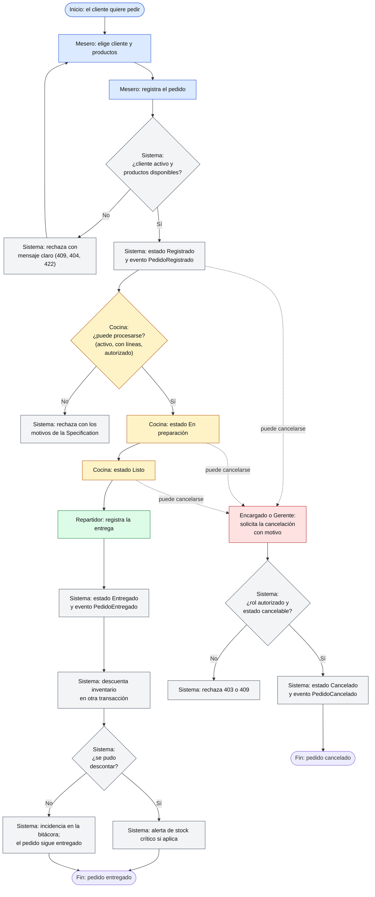

Leyenda de carriles por color: azul = Mesero, amarillo = Cocina, verde = Repartidor, rojo = Encargado o Gerente, gris = Sistema. Las líneas punteadas indican que la cancelación puede solicitarse desde los estados *Registrado*, *En preparación* y *Listo*.


*Todas las acciones anteriores escriben un registro en la bitácora (RN-12).*

## 1.4 Glosario de dominio

El glosario completo, extraído de `src/domain/` y de los encabezados de `data/*.csv`, está en el **Anexo A**.

## 1.5 Equivalencias con el paquete de datos del PIA

El paquete de datos usa nombres genéricos. La tabla del README (líneas 111-119) y las columnas de los CSV se relacionan así con este proyecto:

| Paquete del PIA | Este proyecto | Observación |
|---|---|---|
| `actor_id`, `data/actores.csv` | `Actor` (cliente) | Atributos `es_preferente`, `activo`, `ciudad` |
| `recurso_id`, `capacidad_o_stock`, `data/catalogo.csv` | `Platillo` y su `stock` | El inventario se modela por platillo |
| `operacion_id`, `data/operaciones.csv` | `Pedido` | `referencia`, `promocion_activa`, `autorizado` |
| `data/detalle_operaciones.csv` | `LineaPedido` | `cantidad` y precio del catálogo |
| Estado `CREADO` | `Registrado` | Estado inicial al cargar el paquete (`src/infrastructure/seed.py:44`) |
| Estado `ACEPTADO` | No existe en el BRD | `aprobar` equivale a `iniciar_preparacion`, condicionada a `puede_procesarse` |
| `completar` | Iniciar preparación, marcar listo y entregar | Descuenta inventario al entregar |
| `repetir_aprobacion`, `saltar_estado` | Rechazos por la máquina de estados | La segunda aprobación y la entrega desde *Registrado* se rechazan |
| `cancelar` | `cancelar` con rol Encargado | Con motivo obligatorio |
| `validar_operacion` | Specification `puede_procesarse` | Casos `PED-Txxx` |
| `evaluar_beneficio` | Specification `beneficio_referencia` | Casos `PED-Bxxx` |

*Trazabilidad con la rúbrica:* esta sección y el Anexo A cubren «Análisis 1» (BRD) y «Análisis 2» (historias, BPMN, glosario). Las limitaciones de forma (archivos fuente, BPMN 2.0) están en la sección 7.

# 2. Arquitectura

## 2.1 Modelo DDD

El dominio vive en `src/domain/` y **no depende de ninguna otra capa**: los imports medidos del código son los siguientes.

| Capa | Importa de |
|---|---|
| `src/domain` | `domain` únicamente |
| `src/application` | `application`, `domain` |
| `src/infrastructure` | `application`, `domain`, `infrastructure` |
| `src/api` | `api`, `application`, `domain`, `infrastructure` |

*(Salida de `Select-String` sobre los `import` de cada carpeta; la capa `api` importa `infrastructure` solo para componer la aplicación en `main.py`.)*

| Elemento DDD | Clase | Ubicación | Rol |
|---|---|---|---|
| Aggregate Root | `Pedido` | `src/domain/pedido.py:29` | Consistencia del pedido, sus líneas y su estado |
| Aggregate Root | `Platillo` | `src/domain/catalogo.py:9` | Consistencia de las existencias |
| Base de agregados | `RaizAgregado` | `src/domain/base.py:8` | Acumula Domain Events hasta que se despachan |
| Entidad | `Actor` | `src/domain/actor.py:5` | Cliente (preferente, activo, ciudad) |
| Value Object | `LineaPedido` | `src/domain/pedido.py:18` | Inmutable (`frozen=True`), con `subtotal` |
| Value Object | `Dinero` | `src/domain/valores.py:12` | Inmutable, `Decimal` con dos decimales, MXN, no negativo |
| Value Object / enum | `EstadoPedido` | `src/domain/valores.py:42` | Los cinco estados |
| Registro inmutable | `RegistroAuditoria` | `src/domain/auditoria.py:6` | Solo anexado (`frozen=True`) |
| Domain Events | `PedidoRegistrado`, `PedidoEnPreparacion`, `PedidoListo`, `PedidoEntregado`, `PedidoCancelado`, `StockCriticoAlcanzado`, `InventarioAjustado` | `src/domain/eventos.py:13-68` | Hechos del negocio, inmutables |
| Servicio de dominio | `MaquinaEstados` | `src/domain/maquina_estados.py:26` | Única fuente de transiciones válidas |
| Especificaciones | `Especificacion` y derivadas | `src/domain/specifications.py:16-191` | Reglas combinables |
| Errores de dominio | `ErrorDeNegocio` y 7 derivadas | `src/domain/errores.py:4-33` | Texto claro para el cliente |
| Servicios de aplicación | `RegistrarPedido`, `IniciarPreparacion`, `MarcarListo`, `EntregarPedido`, `CancelarPedido`, `AjustarInventario` y consultas | `src/application/casos_uso.py:49-243` | Orquestan; las reglas viven en el dominio (ADR-003) |
| Manejadores de eventos | `RegistroDeAuditoria`, `DescuentoDeInventario` | `src/application/handlers.py:42,57` | Reaccionan a eventos en transacción propia |

## 2.2 Diagramas UML y de arquitectura

> **Procedencia.** `docs/architecture/` no existe en el repositorio. Los diagramas se generaron a partir del código; las clases, atributos y relaciones corresponden a los archivos citados.

### Arquitectura por capas

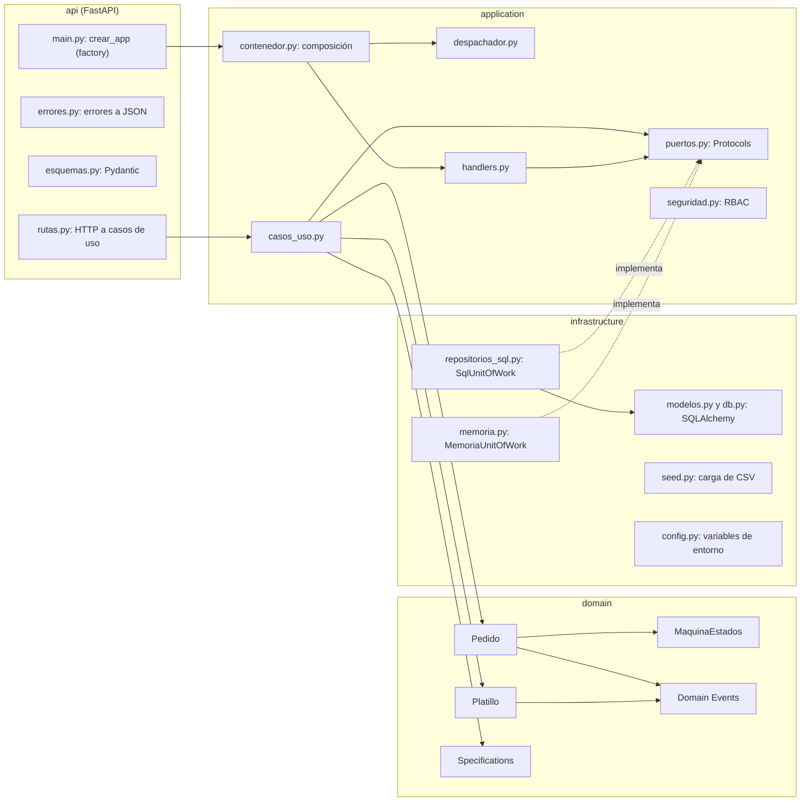

### Modelo de clases del dominio

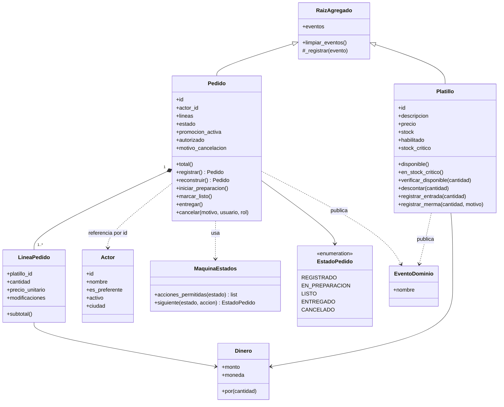

### Máquina de estados del pedido

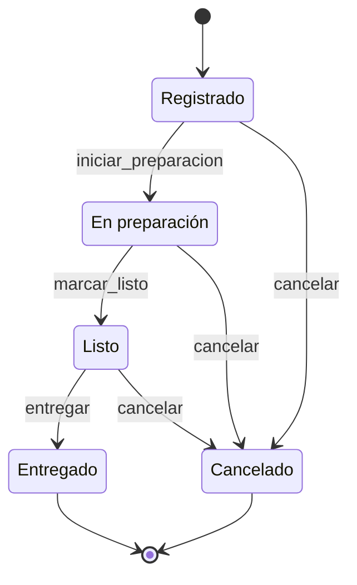

Tabla de transiciones (`src/domain/maquina_estados.py:5-11`): desde *Registrado* se puede iniciar preparación o cancelar; desde *En preparación*, marcar listo o cancelar; desde *Listo*, entregar o cancelar; *Entregado* y *Cancelado* son terminales sin acciones.

### Secuencia: registrar un pedido

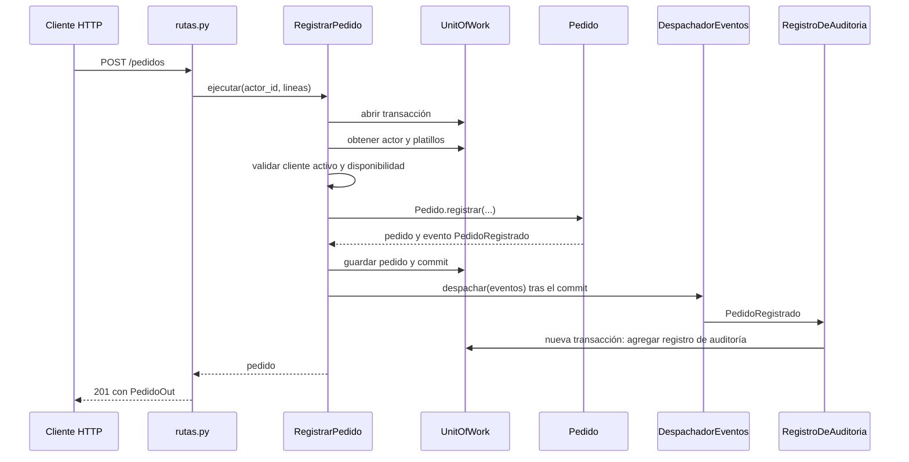

### Secuencia: entregar un pedido y descontar inventario (consistencia eventual)

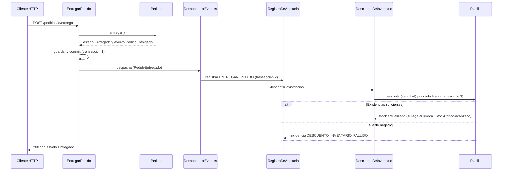

### Modelo de datos (SQLAlchemy)

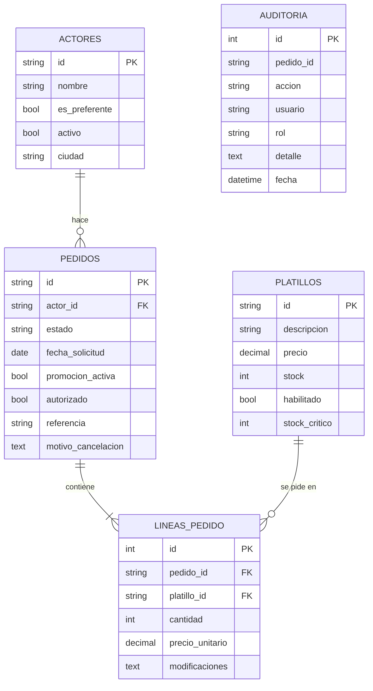

*La tabla `AUDITORIA` no tiene llave foránea a propósito: es de solo anexado y también registra eventos sin pedido (stock crítico, ajustes de inventario) (`src/infrastructure/modelos.py:59-70`).*

## 2.3 Patrones de diseño aplicados y su justificación

**Repository.** Problema: la lógica de negocio no debe conocer SQL ni filas de tabla. Solución: los puertos `PedidoRepositorio`, `PlatilloRepositorio`, `ActorRepositorio` y `AuditoriaRepositorio` (`src/application/puertos.py:5-28`) se implementan con SQLAlchemy (`src/infrastructure/repositorios_sql.py:36-143`) y en memoria (`src/infrastructure/memoria.py:19-75`). Los repositorios convierten filas en objetos del dominio (`repositorios_sql.py:20-33`).

**Unit of Work.** Problema: garantizar que cada operación sea atómica. Solución: `SqlUnitOfWork` (`repositorios_sql.py:146-171`) abre una sesión por bloque `with` y hace *rollback* si no hay `commit` explícito. `MemoriaUnitOfWork` (`memoria.py:78-100`) restaura una instantánea en las mismas condiciones. La prueba `test_unit_of_work_restaura_el_estado_si_hay_error_o_falta_commit` verifica el comportamiento.

**Specification.** Problema: reglas de negocio combinables y explicables sin condicionales dispersos. Solución: `Especificacion` define `es_satisfecha_por`, y los operadores `&`, `|` y `~` (`src/domain/specifications.py:16-43`) componen reglas que, además, explican por qué fallan (`motivos_de_falla`, `explicar`). Las reglas compuestas son `puede_procesarse`, `beneficio_referencia`, `puede_autorizar_cancelacion` y `puede_venderse` (`specifications.py:178-191`).

| Regla compuesta | Composición | Uso real |
|---|---|---|
| `puede_procesarse` | `ActorActivo & PedidoConLineas & PedidoAutorizado` | `IniciarPreparacion._verificar` (`casos_uso.py:102-107`) |
| `beneficio_referencia` | `ActorPreferente & TotalMinimo(1500) & ~PromocionActiva` | `EvaluarPedido` (`casos_uso.py:173-186`) y los 60 casos `evaluar_beneficio` |
| `puede_autorizar_cancelacion` | `RolEn("Encargado") \| RolEn("Gerente")` | `ControlAccesoRBAC` (`seguridad.py:8`) |
| `puede_venderse` | `PedidoConLineas & ExistenciasSuficientes` | Definida y probada (`test_specifications.py`); **no está conectada a un caso de uso**, la validación de existencias se hace con `Platillo.verificar_disponible` (ver B-13) |

**State Machine.** Problema: evitar estados imposibles y mensajes de error inconsistentes. Solución: `TRANSICIONES` es una tabla estado → acción → estado, y `MaquinaEstados.siguiente` devuelve el destino o lanza `TransicionInvalida` con un mensaje apto para el cliente (`maquina_estados.py:5-46`). `Pedido` no cambia de estado por otra vía (`pedido.py:80-99`).

**Domain Events.** Problema: desacoplar los efectos secundarios (bitácora, inventario) de la operación principal. Solución: los agregados registran eventos (`base.py:8-22`); el caso de uso los despacha **después del commit** (`casos_uso.py:43-45`); `DespachadorEventos` los entrega a sus suscriptores y aísla las fallas de cada uno (`despachador.py:7-27`). Es la base de la consistencia eventual (ADR-002).

**Factory (`crear_app`).** Problema: poder construir la aplicación con distintas dependencias. Solución: `crear_app(uow_factory=None, configuracion=None)` (`src/api/main.py:28-52`) arma la aplicación con base de datos real o con un `uow_factory` inyectado. Las pruebas y `scripts/exportar_openapi.py` la usan con almacenamiento en memoria, y `uvicorn --factory` la invoca en producción.

**DTO / modelo de lectura.** Problema: no exponer objetos de dominio por la API. Solución: `pedido_a_dict`, `platillo_a_dict` y `registro_a_dict` (`src/application/dtos.py:6-51`) y los esquemas Pydantic (`src/api/esquemas.py`) separan el modelo de dominio del de lectura.

**Composition Root.** `construir_aplicacion` conecta casos de uso, despachador y manejadores en un solo lugar (`src/application/contenedor.py:46-67`).

**RBAC por interceptor.** `ControlAccesoRBAC` verifica el rol *antes* de abrir la transacción del dominio (`casos_uso.py:124`; `seguridad.py:6-13`).

## 2.4 Principios SOLID con evidencia

| Principio | Evidencia en el código |
|---|---|
| **S** · Responsabilidad única | `Platillo` solo gobierna existencias (`catalogo.py`) y `Pedido` solo el ciclo del pedido (`pedido.py`). `RegistroDeAuditoria` y `DescuentoDeInventario` son manejadores separados (`handlers.py:42,57`). `rutas.py` solo traduce HTTP a casos de uso y no contiene reglas (docstring en `rutas.py:1`). |
| **O** · Abierto/cerrado | Se agrega una regla de negocio creando una subclase de `Especificacion` sin tocar las existentes (`specifications.py:16-43`). Un nuevo efecto secundario se agrega con `despachador.suscribir(...)` sin modificar los casos de uso (`despachador.py:13-17`). Las transiciones son datos en `TRANSICIONES` (`maquina_estados.py:5-11`). |
| **L** · Sustitución de Liskov | `EspecificacionY`, `EspecificacionO` y `EspecificacionNo` sustituyen a `Especificacion` (`specifications.py:45,63,83`). `SqlUnitOfWork` y `MemoriaUnitOfWork` son intercambiables: las pruebas unitarias usan el segundo y las de integración el primero, con los mismos casos de uso. |
| **I** · Segregación de interfaces | Un `Protocol` pequeño por repositorio y uno para el UoW (`puertos.py:5-39`) en vez de una interfaz grande. Los manejadores y consultas solo reciben `uow_factory`. `AuditoriaRepositorio` solo expone `agregar` y `listar` (`puertos.py:24-28`). |
| **D** · Inversión de dependencias | Los casos de uso dependen de `uow_factory` (un invocable) y de los puertos, no de SQLAlchemy (`casos_uso.py:38-41`). `domain` no importa de ninguna otra capa y `application` solo de `domain` (tabla de §2.1). La implementación concreta se inyecta en `crear_app` (`main.py:28-43`) y se compone en `contenedor.py:46-67`. |

*Trazabilidad con la rúbrica:* §2.1 a §2.4 cubren «Arquitectura 1» (DDD), «2» (UML), «3» (patrones) y «4» (SOLID). La rúbrica exige además que la arquitectura corresponda al caso asignado; los diagramas anteriores se derivaron del código del sistema y no son genéricos.

## 2.5 Decisiones de arquitectura (ADR)

> **Procedencia.** El código cita **ADR-002, ADR-003, ADR-004 y ADR-005** en sus comentarios. No existe ningún archivo ADR en el repositorio. A continuación se **formalizan** esas cuatro decisiones y se agregan las que el código permite sustentar. La numeración **ADR-001 y ADR-006 a ADR-009 es propuesta en este reporte**. Las alternativas descartadas las plantea el redactor de este reporte y deben confirmarse con el equipo.

**ADR-001 · Una transacción por Aggregate Root** (propuesta de numeración; declarada en el README)

| Campo | Contenido |
|---|---|
| Contexto | `Pedido` y `Platillo` son agregados distintos; una entrega afecta a ambos. |
| Decisión | Cada caso de uso abre **una** transacción sobre **un** agregado (`casos_uso.py:56-77`); el otro agregado se actualiza en una transacción propia por medio de eventos. |
| Alternativas | Una transacción global que bloquee ambos agregados; un servicio de dominio que modifique los dos a la vez. |
| Consecuencias | Los agregados quedan pequeños y las transacciones cortas. A cambio, el inventario se actualiza después del pedido (ver ADR-002). |

**ADR-002 · Consistencia eventual con Domain Events** (`eventos.py:1`, `handlers.py:1`)

| Campo | Contenido |
|---|---|
| Contexto | Entregar un pedido debe descontar inventario y escribir la bitácora, sin que una falla secundaria deshaga la entrega. |
| Decisión | Los eventos se despachan **después del commit** y cada manejador usa su transacción. Si el descuento falla, se registra `DESCUENTO_INVENTARIO_FALLIDO` y el pedido sigue entregado (`handlers.py:76-83`). |
| Alternativas | Transacción distribuida única; mensajería externa con outbox. |
| Consecuencias | Resiliencia y bajo acoplamiento. Riesgos: si el proceso se detiene entre el commit y el despacho se pierde el evento (no hay *outbox*), y el stock se valida al registrar pero se descuenta al entregar, por lo que dos pedidos pueden aceptarse con el mismo stock (B-12). |

**ADR-003 · Los casos de uso orquestan; las reglas viven en el dominio** (`casos_uso.py:1`)

| Campo | Contenido |
|---|---|
| Contexto | Evitar que la lógica de negocio se disperse entre rutas y servicios. |
| Decisión | `casos_uso.py` coordina repositorios y despacho; las reglas están en `Pedido`, `Platillo`, `MaquinaEstados` y las Specifications. |
| Alternativas | Servicios gruesos con las reglas; lógica en los controladores. |
| Consecuencias | El dominio se prueba sin base de datos ni HTTP (72 pruebas unitarias). Más clases y más indirección. |

**ADR-004 · Control de acceso por roles en la capa de aplicación** (`seguridad.py:1`)

| Campo | Contenido |
|---|---|
| Contexto | Solo Encargado y Gerente cancelan pedidos; el dominio no debe conocer sesiones. |
| Decisión | `ControlAccesoRBAC` evalúa la Specification `puede_autorizar_cancelacion` antes de abrir la transacción (`casos_uso.py:124`). El rol llega en la solicitud (`CancelarIn.rol`). |
| Alternativas | Autenticación con JWT y roles en el token; verificar el rol dentro del agregado. |
| Consecuencias | Regla reutilizable y probada. **Limitación:** el rol lo declara el cliente; no hay autenticación, por lo que no es un control de seguridad real (B-11). |

**ADR-005 · Bitácora de solo anexado** (`auditoria.py:7`, `puertos.py:25`, `modelos.py:60`)

| Campo | Contenido |
|---|---|
| Contexto | Se exige trazabilidad de quién hizo qué y cuándo. |
| Decisión | `RegistroAuditoria` es inmutable y el repositorio solo ofrece `agregar` y `listar`; la tabla no tiene claves foráneas. |
| Alternativas | Columnas de «última modificación» en cada tabla; *event sourcing* completo. |
| Consecuencias | Historial confiable y sencillo. La integridad depende de que nadie use SQL directo sobre la tabla. |

**ADR-006 · SQLite en local y PostgreSQL en contenedores y producción** (propuesta)

| Campo | Contenido |
|---|---|
| Contexto | Se necesita arrancar sin instalar nada y a la vez cumplir con una base de datos real en Docker. |
| Decisión | `DATABASE_URL` por variable de entorno con valor por defecto `sqlite:///./sazon.db` (`config.py:14-16`). Docker Compose y Render usan PostgreSQL. `normalizar_url` convierte `postgres://` y `postgresql://` en `postgresql+psycopg2://` (`config.py:6-11`). |
| Alternativas | Solo PostgreSQL; solo SQLite. |
| Consecuencias | Arranque inmediato y pruebas rápidas. La misma suite puede correr contra PostgreSQL con `TEST_DATABASE_URL` (`tests/conftest.py:10`). En esta verificación **no se ejecutó contra PostgreSQL** (B-08). |

**ADR-007 · Contenerización con Docker Compose para DB, App y Tests** (propuesta)

| Campo | Contenido |
|---|---|
| Contexto | El PIA exige un entorno reproducible. |
| Decisión | Servicios `db` (PostgreSQL 16 con *healthcheck*), `app` y `tests` (perfil `tests`) en `docker-compose.yml:4-40`; `docker/init-db.sql` crea la base `sazon_test`. |
| Alternativas | Instrucciones manuales; solo `Dockerfile`. |
| Consecuencias | Un comando levanta todo. La imagen incluye dependencias de desarrollo porque comparte `requirements.txt`. |

**ADR-008 · Aplicación como factoría (`--factory`)** (propuesta)

| Campo | Contenido |
|---|---|
| Contexto | Se quiere inyectar dependencias distintas en pruebas, scripts y producción. |
| Decisión | `uvicorn src.api.main:crear_app --factory` (`Dockerfile:13`, `iniciar.bat`). |
| Alternativas | Objeto `app` global creado al importar. |
| Consecuencias | No hay efectos secundarios al importar el módulo y se prueba con almacenamiento en memoria. |

**ADR-009 · Errores de negocio en español claro** (propuesta)

| Campo | Contenido |
|---|---|
| Contexto | El personal del restaurante no es técnico (historias US-05 y US-10). |
| Decisión | Jerarquía `ErrorDeNegocio` con `codigo` y mensaje apto para mostrarse; `registrar_manejadores` la traduce a HTTP 403, 404, 409 o 422 con `{detail, codigo}`; el error inesperado devuelve un mensaje genérico y no filtra detalles (`api/errores.py:11-45`). |
| Alternativas | Mensajes técnicos en inglés; códigos numéricos. |
| Consecuencias | Mensajes entendibles e interfaz simple. Los mensajes están embebidos en el dominio, lo que complicaría la internacionalización. |

## 2.6 Estructura del repositorio frente a la mínima exigida

| Elemento exigido por el PDF | Estado | Evidencia |
|---|---|---|
| `docs/BRD.md` | **No existe** | El BRD está en §1.1 de este reporte (B-01) |
| `docs/architecture/` (ADRs, diagramas) | **No existe** | Contenido en §2.2 y §2.5 de este reporte (B-04, B-05) |
| `docs/api/` (OpenAPI) | **Cumple** | `docs/api/openapi.json` generado con `python scripts/exportar_openapi.py` (36 993 bytes) |
| `src/domain/` | Cumple | 10 módulos |
| `src/application/` | Cumple | 7 módulos |
| `src/infrastructure/` | Cumple | 7 módulos |
| `src/api/` | Cumple | 4 módulos |
| `tests/` (unitarias e integración) | Cumple (restaurado) | `tests/unit/` y `tests/integration/`; ver la nota del resumen ejecutivo |
| `.github/workflows/` | Cumple | `ci.yml`; 2 ejecuciones en GitHub, 1 fallida y 1 exitosa (B-07) |
| `docker-compose.yml` | Cumple (definido) | No levantado en esta verificación (B-08) |
| `.env.example` sin secretos | Cumple | Contiene solo `cambia-esta-contrasena` como marcador |
| `README.md` técnico | Parcial | Cubre arquitectura, ejecución y pruebas; la línea 127 remite a «Pasos en `docs/`» y esa carpeta no contiene pasos de despliegue (B-14); faltan URLs de repositorio y despliegue |
| Historial de commits | **Parcial** | 2 commits de un solo autor en GitHub (Anexo C.7); la carpeta local no es un repositorio git (B-06) |

*Trazabilidad con la rúbrica:* esta sección cubre los renglones «Arquitectura 5 a 13» y la estructura mínima del repositorio.


# 3. Implementación

## 3.1 Componentes obligatorios con evidencia

| Componente exigido | Dónde está | Evidencia verificada |
|---|---|---|
| **DDD** | `src/domain/` (agregados, Value Objects, eventos), `src/application/` (casos de uso y puertos), `src/infrastructure/` (adaptadores) | §2.1; 91 pruebas aprobadas; capas verificadas por imports |
| **Specification** | `src/domain/specifications.py:16-191` con operadores `&`, `\|`, `~`, explicación de resultados y motivos de falla | 11 pruebas en `tests/unit/test_specifications.py`; 120 casos del paquete ejecutados (56 CUMPLE, 64 NO CUMPLE) |
| **State Machine** | `src/domain/maquina_estados.py:5-46` | 31 pruebas en `tests/unit/test_dominio.py` (6 transiciones válidas y 7 inválidas parametrizadas); 20 transiciones del paquete (11 OK, 9 RECHAZADO); en vivo: 409 al saltar de *Registrado* a *Entregado* |
| **API REST** | `src/api/rutas.py:32-128` (15 operaciones) | 13 pruebas de integración con `TestClient`; ejecución real con `uvicorn` (Anexo C.8) |

### Reglas de ejemplo ejecutadas en vivo

La evaluación de las Specifications de un pedido real (`GET /pedidos/PED-818CFD0F/evaluacion`) devolvió:

```json
{"puede_procesarse": true, "beneficio_referencia": false,
 "motivos_beneficio_referencia": ["el cliente no es preferente", "el total es menor a 1500.00 MXN"]}
```

El pedido no recibe el beneficio porque el cliente `PED-C001` no es preferente y el total es 941.00 MXN, menor al mínimo de 1 500 MXN (`specifications.py:175`).

## 3.2 Persistencia

- **SQLAlchemy 2** con modelos declarativos en `src/infrastructure/modelos.py:11-70`: tablas `actores`, `platillos`, `pedidos`, `lineas_pedido` y `auditoria` (diagrama en §2.2).
- **Motor** (`src/infrastructure/db.py:11-17`): SQLite recibe `check_same_thread=False` y, si es en memoria, `StaticPool`; para otras bases se usa `pool_pre_ping=True`.
- **Tablas**: `crear_tablas` las crea al arrancar (`db.py:24-27`). No hay migraciones; el esquema se crea con `create_all`.
- **Datos iniciales**: con `SEED_ON_START=true`, `cargar_datos` carga los CSV de `data/` y es **idempotente** (si ya hay actores no recarga) (`src/infrastructure/seed.py:17-21`, `main.py:39-41`). Lee con `utf-8-sig` y rutas relativas a `DATA_DIR` (por defecto `data`).
- **Configuración** (`src/infrastructure/config.py`): `Configuracion.desde_entorno()` lee `DATABASE_URL`, `STOCK_CRITICO`, `SEED_ON_START` y `DATA_DIR`. `normalizar_url` convierte `postgres://` y `postgresql://` (formato de Render y Railway) en `postgresql+psycopg2://`.
- **Local**: `sqlite:///./sazon.db`. **Docker Compose y Render**: PostgreSQL.

## 3.3 Documentación OpenAPI y Swagger

FastAPI genera OpenAPI 3.1 (título «Sazón Urbano – API de pedidos», versión 1.0.0). Swagger UI queda activo en `/docs` y la especificación en `/openapi.json`; no hay configuración que los desactive, por lo que también estarán activos en producción (`main.py:42`). Las operaciones se organizan en **seis etiquetas**: *Sistema* (1 operación), *Pedidos* (5), *Estados* (4), *Inventario* (2), *Trazabilidad* (2) y *Reportes* (1), según `docs/api/openapi.json`. Cada operación indica su historia de usuario en el resumen y declara los errores 403, 404, 409 y 422 con el esquema `ErrorOut` (`rutas.py:20-25`).

La especificación se exporta sin base de datos con `python scripts/exportar_openapi.py`, que construye la aplicación con almacenamiento en memoria (`scripts/exportar_openapi.py:13-16`). El listado completo de operaciones y esquemas está en el **Anexo B**.

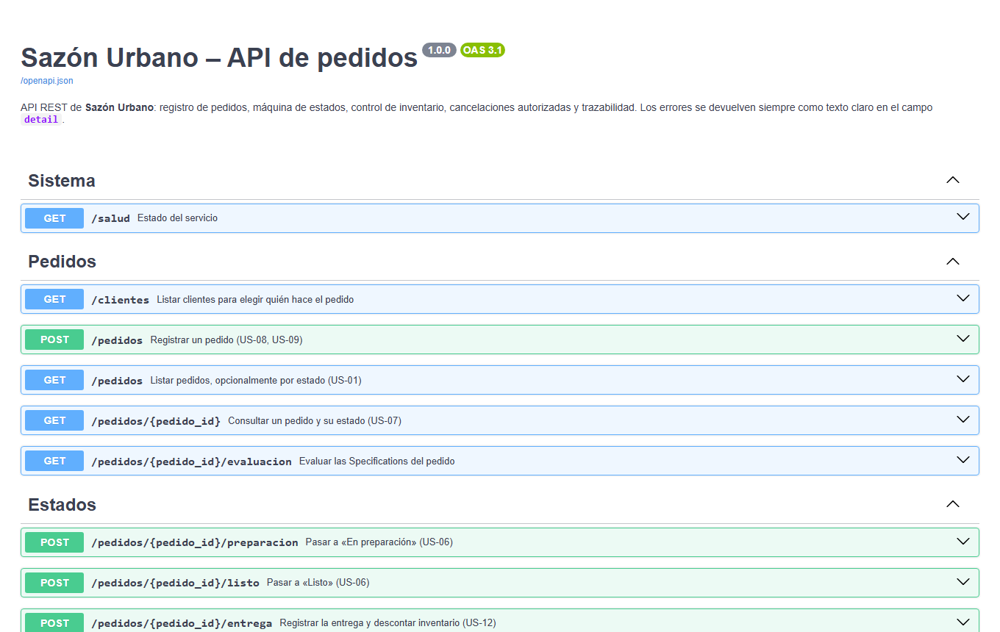{ .captura }

Traducción de errores de negocio a HTTP (`src/api/errores.py:11-19`):

| Error de dominio | Código HTTP | Código en el cuerpo |
|---|---|---|
| `DatosInvalidos` y validación de Pydantic | 422 | `DATOS_INVALIDOS` |
| `ReglaNoCumplida`, `TransicionInvalida`, `ProductoNoDisponible`, `StockInsuficiente` | 409 | `REGLA_NO_CUMPLIDA`, `TRANSICION_INVALIDA`, `PRODUCTO_NO_DISPONIBLE`, `STOCK_INSUFICIENTE` |
| `AccesoDenegado` | 403 | `ACCESO_DENEGADO` |
| `NoEncontrado` | 404 | `NO_ENCONTRADO` |
| Error inesperado | 500 | `ERROR_INTERNO` (mensaje genérico) |

## 3.4 Casos de uso principales, ejecutados en vivo

Se arrancó el servidor real con `uvicorn` sobre una base SQLite nueva con `SEED_ON_START=true` y se ejecutó un guion con `httpx` (Anexo C.8). Resultados verificados:

| Caso de uso | Solicitud | Resultado observado |
|---|---|---|
| Registrar pedido | `POST /pedidos` (2 × PED-P001, 1 × PED-P002) | 201, `Registrado`, total **941.00** |
| Avanzar estados | `/preparacion`, `/listo`, `/entrega` | 200 con `En preparación`, `Listo`, `Entregado` |
| Descontar inventario | Stock de PED-P001 antes y después de entregar | **13 → 11** (2 vendidas) |
| Saltar estado | Entregar un pedido *Registrado* | 409 «No es posible entregar un pedido que está «Registrado».» |
| Repetir acción | Iniciar preparación dos veces | 409 «El pedido ya está «En preparación».» |
| Cancelar sin autoridad | Rol `Mesero` | 403 «Solo el Encargado o el Gerente pueden autorizar la cancelación de un pedido.» |
| Cancelar sin motivo | Rol `Encargado` y motivo vacío | 422 «Para cancelar un pedido debes indicar el motivo.» |
| Cancelar con autoridad | Rol `Encargado` y motivo | 200, `Cancelado` |
| Cancelar dos veces / entregado | — | 409 «El pedido ya fue cancelado anteriormente.» y «Un pedido entregado ya no se puede cancelar.» |
| Cliente inactivo | `PED-C007` | 409 «El cliente no está activo y no puede realizar pedidos.» |
| Stock insuficiente | 9 999 unidades | 409 «Solo quedan 11 unidades de «Hamburguesa 01».» |
| Platillo inexistente | `NO-EXISTE` | 404 «El platillo «NO-EXISTE» no existe.» |
| Datos inválidos | Cantidad 0; pedido sin productos | 422 con mensajes claros |
| Inventario | Entrada de 10; merma sin motivo; merma de 2 con motivo | stock 29; 422; stock 27 |
| Bitácora | `GET /auditoria?pedido_id=...` | 4 registros: REGISTRAR_PEDIDO, INICIAR_PREPARACION, MARCAR_LISTO, ENTREGAR_PEDIDO |
| Cancelaciones | `GET /cancelaciones` | 1 registro con rol `Encargado` y su motivo |
| Resumen | `GET /reportes/resumen` | 1 entregado por **941.00 MXN**; 60 registrados; 1 cancelado; PED-P001 con 2 unidades vendidas y stock 11 |

## 3.5 Interfaz web para el personal

`src/web/` contiene una aplicación de una sola página (`index.html`, `app.js`, `estilos.css`) sin dependencias ni compilación, servida por la propia API (`main.py:45-49`). Está pensada para personas sin conocimientos técnicos: usa nombres en lugar de claves, fechas y pesos legibles y explica los errores. El selector «Estás trabajando como» define el rol (Mesero, Cocina, Encargado o Gerente); solo Encargado y Gerente pueden cancelar (`app.js`: `ROLES_QUE_CANCELAN`).

| Sección | Qué permite hacer |
|---|---|
| Inicio | Resumen en texto de ventas, pedidos por etapa y productos que requieren atención |
| Nuevo pedido | Elegir cliente, agregar productos al carrito, indicaciones y confirmar |
| Pedidos | Buscar, filtrar por estado, avanzar al siguiente paso, ver detalle y cancelar |
| Inventario | Ver existencias, registrar entradas y dar de baja productos (merma) |
| Historial | Bitácora de lo ocurrido y consulta de cancelaciones |

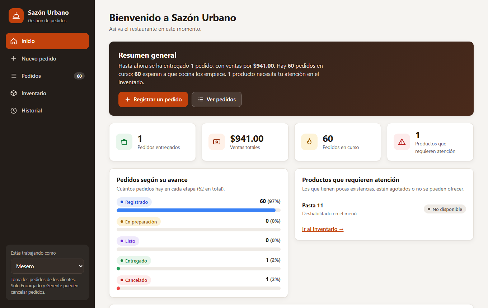{ .captura }

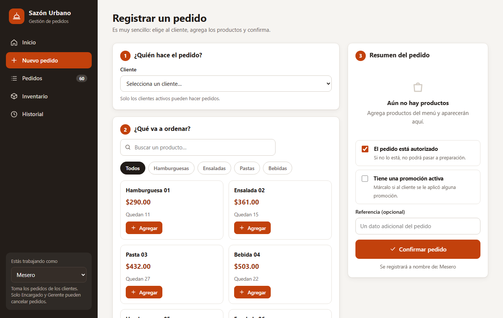{ .captura }

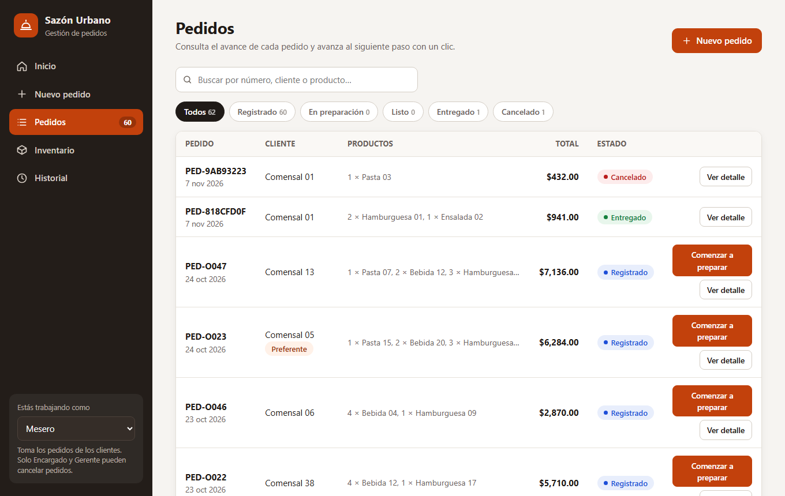{ .captura }

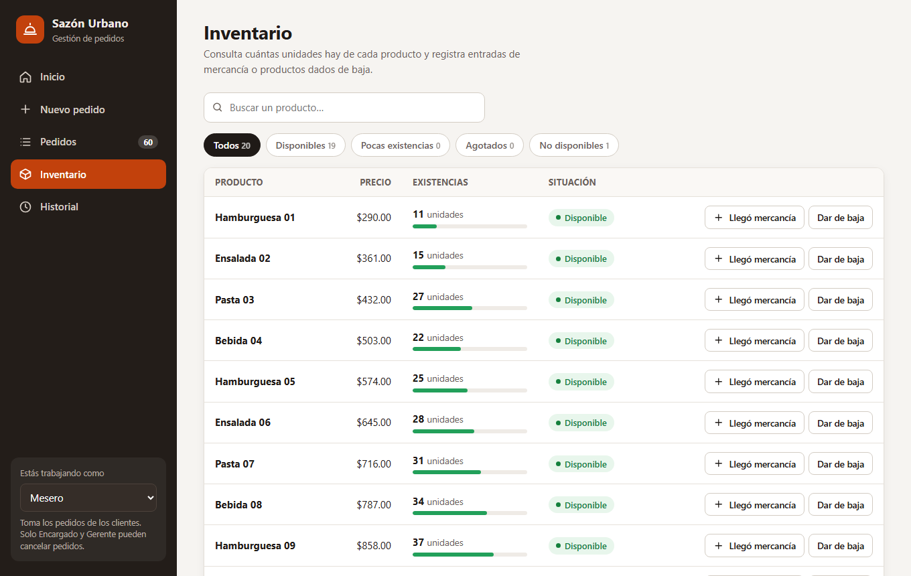{ .captura }

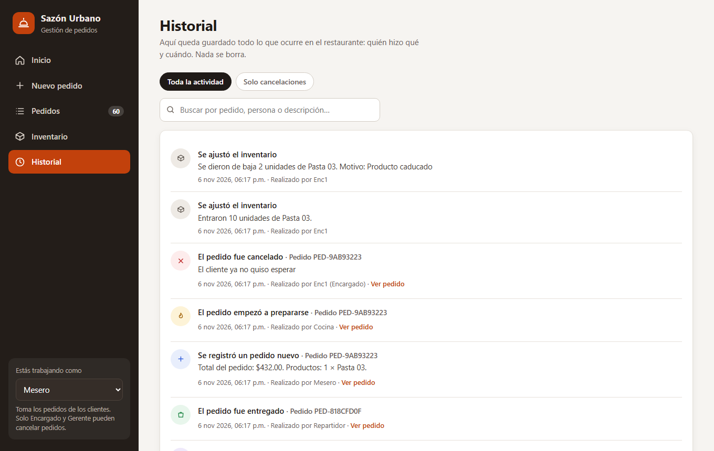{ .captura }

*Las capturas se tomaron con Edge en modo headless contra el servidor real, sobre la base de datos de la ejecución en vivo (1 pedido entregado, 1 cancelado).*

*Trazabilidad con la rúbrica:* §3.1 cubre «Implementación 1» (DDD, Specification, State Machine y API REST); §3.2 a §3.4 cubren «Implementación 2» (persistencia, OpenAPI y funcionamiento de los casos de uso principales).

# 4. Calidad y pruebas

## 4.1 Suite de pruebas y cobertura

Comando ejecutado: `pytest -v --cov=src --cov-report=term-missing --cov-fail-under=80`, con Python 3.15.2, pytest 9.2.0 y pytest-cov 7.1.0. La suite usa SQLite en memoria; con `TEST_DATABASE_URL` puede apuntar a PostgreSQL (`tests/conftest.py:10`).

**Resultado: 91 pruebas aprobadas, 0 fallidas. Cobertura total 97,29 % (1 144 sentencias, 31 sin cubrir). El mínimo exigido (80 %) se cumple.**

| Archivo de pruebas | Tipo | Pruebas | Qué verifica |
|---|---|---|---|
| `tests/unit/test_dominio.py` | Unitaria | 31 | `Dinero`, agregados `Pedido` y `Platillo`, transiciones válidas e inválidas, eventos |
| `tests/unit/test_specifications.py` | Unitaria | 11 | Hojas, composiciones `&` `\|` `~`, límite de 1 500 MXN, explicación de reglas |
| `tests/unit/test_casos_uso.py` | Unitaria | 23 | Casos de uso con memoria: registro y sus rechazos, RBAC, cancelación, inventario, bitácora, aislamiento de fallas |
| `tests/unit/test_config.py` | Unitaria | 2 | Variables de entorno y normalización de URL |
| `tests/unit/test_paquete_csv.py` | Unitaria | 5 | Carga del paquete, 120 casos, 20 transiciones |
| `tests/integration/test_api.py` | Integración | 13 | API completa con base de datos: flujos, errores, interfaz web |
| `tests/integration/test_persistencia.py` | Integración | 6 | Repositorios SQL, UoW con rollback, idempotencia de la carga |
| **Total** | | **91** | 72 unitarias y 19 de integración |

Cobertura por módulo (salida de `pytest --cov`; solo se detallan los que no están al 100 %):

| Módulo | Cobertura | Líneas sin cubrir | Explicación |
|---|---|---|---|
| `src/api/main.py` | 75 % | 31-41 | Rama de arranque con base de datos real y carga inicial; las pruebas inyectan `uow_factory`. **Sí se ejercitó en la ejecución en vivo** (Anexo C.8), pero no en las pruebas |
| `src/application/puertos.py` | 0 % | 2-31 | Solo declara `Protocol` (sin comportamiento) |
| `src/application/handlers.py` | 94 % | 39, 51, 71 | Ramas defensivas |
| `src/domain/specifications.py` | 99 % | 80 | `explicar` de `EspecificacionO` |
| `src/infrastructure/db.py` | 86 % | 17, 25-27 | Rama de bases no SQLite y `crear_tablas` (usado en la ejecución en vivo) |
| `src/infrastructure/evidencias.py` | 89 % | 30, 59, 88-93 | Ramas de error y escritura de CSV (usadas por el script) |
| `src/infrastructure/repositorios_sql.py` | 99 % | 171 | `rollback` explícito |

Las pruebas relevantes para la defensa incluyen `test_descuento_fallido_no_revierte_el_pedido_y_deja_incidencia` (compensación de ADR-002), `test_despachador_aisla_las_fallas_de_los_manejadores`, `test_cancelar_requiere_encargado_o_gerente`, `test_beneficio_en_el_limite_de_1500` (1 499.99, 1 500 y 1 500.01), `test_sin_commit_todo_se_revierte` y `test_un_error_inesperado_no_expone_detalles_tecnicos`.

**Análisis estático:** `ruff check src tests scripts` → «All checks passed!» (Anexo C.3; reglas E4, E7, E9 y F, línea máxima de 110, en `pyproject.toml`).

**Advertencia de la ejecución:** `StarletteDeprecationWarning` indica que `starlette.testclient` con `httpx` está obsoleto (se sugiere `httpx2`). No afecta los resultados.

## 4.2 Resultados de los scripts del paquete del PIA

`python scripts/ejecutar_casos.py` ejecutó los casos con las Specifications reales y escribió dos CSV en `evidencias/`:

```text
Casos: 120 {'CUMPLE': 56, 'NO CUMPLE': 64}
Transiciones: 20 {'OK': 11, 'RECHAZADO': 9}
```

**120 casos** (`evidencias/casos_prueba_resultados.csv`):

| Tipo de prueba | Casos | CUMPLE | NO CUMPLE | Specification |
|---|---|---|---|---|
| `validar_operacion` (`PED-T001` a `PED-T060`) | 60 | 47 | 13 | `puede_procesarse` |
| `evaluar_beneficio` (`PED-B001` a `PED-B060`) | 60 | 9 | 51 | `beneficio_referencia` |
| **Total** | **120** | **56** | **64** | |

Motivos de los 13 rechazos de `validar_operacion`: pedido no autorizado (6), cliente inactivo (4), pedido sin productos (2) y cliente inactivo más no autorizado (1). Los 9 casos de beneficio que cumplen corresponden a los pedidos `PED-O008`, `O023`, `O028`, `O033`, `O038`, `O043`, `O048`, `O053` y `O058` (cliente preferente, total de al menos 1 500 MXN y sin promoción). En los 51 que no cumplen, la falta de condición de cliente preferente aparece en 48, el total menor a 1 500 MXN en 8 y la promoción activa en 6; algunos casos fallan por más de un motivo.

**20 transiciones** (`evidencias/transiciones_prueba_resultados.csv`):

| Acción sugerida | Casos | Resultado | Estado final observado |
|---|---|---|---|
| `aprobar` | 4 | 4 OK | En preparación |
| `completar` | 4 | 3 OK, 1 RECHAZADO (`PED-S016`: pedido no autorizado) | Entregado (3) o Registrado (1) |
| `cancelar` | 4 | 4 OK | Cancelado |
| `repetir_aprobacion` | 4 | 4 RECHAZADO (2 `TransicionInvalida` y 2 `ReglaNoCumplida`) | En preparación (2) o Registrado (2) |
| `saltar_estado` | 4 | 4 RECHAZADO (`TransicionInvalida`) | Registrado |

Excepciones observadas: `TransicionInvalida` 6, `ReglaNoCumplida` 3 y ninguna en los 11 casos exitosos. Cada fila registra la secuencia de eventos (por ejemplo `PedidoEnPreparacion > PedidoListo > PedidoEntregado`). La suite verifica estos resultados en `tests/unit/test_paquete_csv.py`.

## 4.3 Pipeline CI/CD (`.github/workflows/ci.yml`)

- **Disparador:** `on: [push, pull_request]`.
- **Job `calidad-y-pruebas`** (`ubuntu-latest`): `actions/checkout@v4`; `actions/setup-python@v5` con Python **3.11** y caché de pip; `pip install -r requirements.txt`; `ruff check src tests scripts`; `pytest -v --cov=src --cov-report=term-missing --cov-report=xml --cov-fail-under=80` (falla si la cobertura baja de 80 %); `python scripts/ejecutar_casos.py`; `python scripts/exportar_openapi.py`; y `actions/upload-artifact@v4` con `coverage.xml`, `evidencias/` y `docs/api/openapi.json`.
- **Job `docker-compose`** (necesita al anterior): `docker compose --profile tests run --rm tests` (pruebas contra PostgreSQL) y, siempre, `docker compose down -v`.
- **Alcance:** es un flujo de **integración continua**. No hay un paso de despliegue en el workflow: el despliegue dependería de conectar Render con el repositorio (**PENDIENTE**).

> **Estado:** el pipeline se ejecutó dos veces en GitHub Actions (consulta a la API pública de GitHub, Anexo C.7). La [primera ejecución](https://github.com/Tera2332/PIA_Unidad6_CLN/actions/runs/42314619829) (commit `9731206`) **falló** en el paso «Análisis estático (ruff)» y el job `docker-compose` se omitió. La [segunda](https://github.com/Tera2332/PIA_Unidad6_CLN/actions/runs/42320505624) (commit `87cd8e7`) terminó con éxito. No se revisó el registro de la ejecución fallida, por lo que su causa exacta queda **PENDIENTE DE EVIDENCIA** (B-07). Las pruebas de este reporte se ejecutaron en local con Python 3.15.2, mientras que el pipeline y el Dockerfile usan Python 3.11 (B-15).

## 4.4 Docker Compose para DB, App y Tests

`docker-compose.yml` define:

| Servicio | Imagen o construcción | Puntos clave |
|---|---|---|
| `db` | `postgres:16-alpine` | Credenciales por variables con valores por defecto; volumen `pgdata`; `init-db.sql` crea `sazon_test`; *healthcheck* con `pg_isready` (5 s, 12 reintentos) |
| `app` | `build: .` | `DATABASE_URL` hacia `db`, `SEED_ON_START` y `STOCK_CRITICO`; puerto `8000:8000`; arranca cuando `db` está saludable |
| `tests` | `build: .` con perfil `tests` | `TEST_DATABASE_URL` hacia `sazon_test`; comando `pytest --cov=src --cov-report=term-missing --cov-fail-under=80`; arranca cuando `db` está saludable |

Uso: `docker compose up --build` (base de datos y API) y `docker compose --profile tests run --rm tests` (pruebas contra PostgreSQL).

> **PENDIENTE DE EVIDENCIA.** Docker no está instalado en la máquina donde se preparó este reporte, por lo que no se pudo ejecutar `docker compose config` ni `docker compose up --build`. El error textual registrado fue: `docker : El término 'docker' no se reconoce como nombre de un cmdlet, función, archivo de script o programa ejecutable.` El archivo se revisó de forma estática. Antes de la defensa hay que ejecutar ambos comandos en una máquina con Docker y guardar la salida (B-08).

## 4.5 Variables de entorno y 12-Factor App

La configuración se separa del código con variables de entorno (factor III de 12-Factor App). `.env.example` incluye solo marcadores, sin secretos reales (`POSTGRES_PASSWORD=cambia-esta-contrasena`), y `.gitignore` y `.dockerignore` excluyen `.env`, `*.db` y `.venv`.

| Variable | Valor por defecto | Quién la usa |
|---|---|---|
| `DATABASE_URL` | `sqlite:///./sazon.db` | `config.py:14-16`; Compose y Render la fijan hacia PostgreSQL |
| `SEED_ON_START` | `false` en el código; `true` en `.env.example`, Compose y Render | Carga los CSV al arrancar |
| `STOCK_CRITICO` | `5` | Umbral de alerta de stock |
| `DATA_DIR` | `data` | Carpeta de los CSV |
| `POSTGRES_USER`, `POSTGRES_PASSWORD`, `POSTGRES_DB` | `sazon` en `docker-compose.yml` | Servicio `db` |
| `TEST_DATABASE_URL` | SQLite en memoria | `tests/conftest.py:10` |
| `PORT` | `8000` | El `CMD` del Dockerfile lo respeta para Render |

Otros factores: procesos sin estado (el estado vive en la base de datos), registros hacia salida estándar (uvicorn) y construcción reproducible con Docker.

*Trazabilidad con la rúbrica:* §4.1 a §4.5 cubren los seis puntos de «Calidad + defensa» salvo la demostración y defensa (Anexo D.2). Los puntos no verificables están en la sección 7.

# 5. Producción y despliegue

## 5.1 Dockerfile

`Dockerfile` (13 líneas): imagen `python:3.11-slim`; `PYTHONDONTWRITEBYTECODE=1` y `PYTHONUNBUFFERED=1`; copia `requirements.txt` antes del código para aprovechar la caché de capas; expone el 8000; y arranca con:

```text
CMD ["sh", "-c", "uvicorn src.api.main:crear_app --factory --host 0.0.0.0 --port ${PORT:-8000}"]
```

`${PORT:-8000}` respeta el puerto que asigna Render y usa 8000 en local (`Dockerfile:12-13`).

## 5.2 Render y plataformas equivalentes

`render.yaml` es un *Blueprint* que declara un servicio web con `runtime: docker` en plan gratuito, `healthCheckPath: /salud`, `DATABASE_URL` tomada de la base `sazon-db` (`fromDatabase`), `SEED_ON_START=true` y `STOCK_CRITICO=5`, y una base PostgreSQL gratuita (`databaseName: sazon`). El `normalizar_url` del código adapta la cadena de conexión que entrega Render. El endpoint `/salud` devuelve `{"estado": "ok"}` y se probó en vivo (200).

**Pasos de despliegue previstos:** el repositorio ya está en GitHub; en Render, *New → Blueprint* y elegir el repositorio; esperar la construcción; y abrir `<URL DEL DESPLIEGUE>/docs` para la demostración con Swagger UI. **Viabilidad:** el despliegue es técnicamente posible con lo que hay en el repositorio (`Dockerfile`, `render.yaml`, `psycopg2-binary` en `requirements.txt`, `normalizar_url` y `${PORT:-8000}`), pero no se ha probado.

> **PENDIENTE DE EVIDENCIA.** No hay URL ni captura de un despliegue activo. El plan gratuito de Render duerme el servicio tras un periodo sin tráfico, por lo que conviene abrirlo antes de la presentación (B-09).

## 5.3 Ejecución local en otra PC con `iniciar.bat`

El proyecto incluye un lanzador `iniciar.bat` para equipos Windows sin Docker:

1. **Requisito:** Python 3.11 o superior instalado con «Add python.exe to PATH» (verificar con `python --version`).
2. **Extraer** el ZIP en una ruta corta, sin acentos ni espacios (por ejemplo `C:\pia`). `iniciar.bat`, `requirements.txt`, `data\` y `src\` deben quedar en la misma carpeta.
3. **Doble clic en `iniciar.bat`.** La primera vez crea `.venv`, instala las dependencias y abre el navegador en `http://localhost:8000`. Las siguientes veces arranca en segundos. La ventana de comandos es el servidor: cerrarla o pulsar Ctrl+C lo detiene.
4. **Verificar los datos:** `Invoke-RestMethod http://localhost:8000/reportes/resumen` debe devolver los números del resumen. Si la interfaz sale vacía, la carpeta `data\` no llegó o quedó anidada.
5. **Acceso desde otro dispositivo en la red:** el servidor escucha en `0.0.0.0:8000`; se entra con `http://<IP-DE-LA-PC>:8000`. La primera vez Windows pregunta por el firewall: permitir en redes **privadas**.
6. **Datos locales:** cada PC tiene su propio `sazon.db`; para compartir datos hay que usar PostgreSQL (Compose o `DATABASE_URL`).

Verificación realizada: se copió el proyecto **sin `.venv` ni `sazon.db`** a una carpeta temporal y se ejecutó `iniciar.bat`. Creó el entorno, instaló las dependencias, arrancó, cargó los 40 clientes y 20 platillos y respondió `/reportes/resumen` con los datos. En esa verificación se corrigió un error del lanzador: `%PY%` se expandía antes de asignarse dentro de un bloque `if (...)`. Se reestructuró con `goto`, y el script también reinstala si encuentra un `.venv` incompleto.

## 5.4 Placeholders para entrega

| Dato | Valor |
|---|---|
| URL del repositorio GitHub | https://github.com/Tera2332/PIA_Unidad6_CLN |
| URL del despliegue | `<URL DEL DESPLIEGUE>` |
| Swagger UI en producción | `<URL DEL DESPLIEGUE>/docs` |

# 6. Matriz de trazabilidad

La matriz enlaza cada regla con su historia, el artefacto de análisis, el componente de dominio, el caso de uso, el endpoint y la prueba que la verifica. Las referencias de análisis apuntan a las secciones de este reporte (Gherkin en §1.2 y BPMN en §1.3; reglas `RN-xx` en §1.1). Las pruebas se citan como `archivo::prueba`.

| Regla o requisito | Historia | Análisis | Dominio (`archivo:línea`) | Caso de uso (`casos_uso.py`) | Endpoint | Prueba |
|---|---|---|---|---|---|---|
| RN-02, RN-04 · Registrar un pedido con total | US-08 | Gherkin US-08; BPMN: «Registrar pedido» | `pedido.py:50-71`, `valores.py:12-39` | `RegistrarPedido` (49-79) | `POST /pedidos` | `test_casos_uso::test_registrar_pedido_guarda_audita_y_calcula_total`; `test_api::test_registrar_pedido_devuelve_201_y_total` |
| RN-01 · Cliente activo | US-08 | Gherkin US-08 (cliente inactivo) | `specifications.py:101-106` | `RegistrarPedido` (60-61) | `POST /pedidos` | `test_casos_uso::test_registrar_pedido_rechazos_con_mensaje_claro[C3-...]`; `test_api::test_reglas_de_registro_con_mensajes_claros` |
| RN-02 · Cantidades y pedido sin líneas | US-08 | Gherkin US-08 (datos inválidos) | `pedido.py:53-60` | `RegistrarPedido` | `POST /pedidos` | `test_dominio::test_registrar_rechaza_cantidades_invalidas[0, -1, 1.5, True]`; `test_registrar_rechaza_pedido_sin_productos` |
| Modificaciones por línea | US-09 † | Gherkin US-09 | `pedido.py:18-26,63-67` | `RegistrarPedido` (70-72) | `POST /pedidos` | `test_casos_uso::test_registrar_guarda_modificaciones_en_la_bitacora` |
| RN-03 · Producto agotado o stock insuficiente | US-05 | Gherkin US-05 | `catalogo.py:6,19-31` | `RegistrarPedido` (69) | `POST /pedidos` | `test_dominio::test_platillo_agotado_o_deshabilitado_usa_el_mensaje_de_la_historia_us05`; `test_platillo_stock_insuficiente` |
| Listar pedidos por estado | US-01 | Gherkin US-01 | `valores.py:42-47` | `ListarPedidos` (167-170) | `GET /pedidos` | `test_api::test_consultas_filtros_y_evaluacion`; `test_casos_uso::test_parsear_estado` |
| Consultar un pedido | US-07 | Gherkin US-07 | `pedido.py:29-42` | `ConsultarPedido` (161-164) | `GET /pedidos/{id}` | `test_api::test_consultas_filtros_y_evaluacion` |
| RN-05 · Máquina de estados | US-06, US-12 | BPMN completo; diagrama de estados | `maquina_estados.py:5-46`, `pedido.py:80-99` | `_CambioDeEstado` (82-96) | `POST /pedidos/{id}/preparacion`, `/listo`, `/entrega` | `test_dominio::test_transiciones_validas[6]`, `test_transiciones_invalidas_con_mensaje_para_el_cliente[7]`; `test_api::test_transiciones_invalidas_responden_409` |
| RN-06 · `puede_procesarse` | US-06 | Gherkin US-06 (pedido no procesable) | `specifications.py:178-179` | `IniciarPreparacion` (99-107) | `POST /pedidos/{id}/preparacion` | `test_specifications::test_puede_procesarse_es_un_and_de_tres_reglas`; `test_api::test_iniciar_preparacion_aplica_las_specifications`; 60 casos `validar_operacion` |
| RN-11 · `beneficio_referencia` | (paquete PIA) | Casos `PED-Bxxx` | `specifications.py:175,182-183` | `EvaluarPedido` (173-186) | `GET /pedidos/{id}/evaluacion` | `test_specifications::test_beneficio_en_el_limite_de_1500[3]`, `test_beneficio_usa_not_promocion_y_and_preferente`; 60 casos `evaluar_beneficio` |
| RN-07 · Cancelación con rol y motivo | US-10 | Gherkin US-10; BPMN: carril Encargado | `specifications.py:186-187`, `pedido.py:93-99` | `CancelarPedido` (118-131); `seguridad.py:6-13` | `POST /pedidos/{id}/cancelacion` | `test_casos_uso::test_cancelar_requiere_encargado_o_gerente`, `test_cancelar_exige_motivo_y_no_aplica_a_entregados`; `test_api::test_cancelacion_solo_para_encargado_o_gerente`; 4 transiciones `cancelar` |
| Consultar cancelaciones | US-11 | Gherkin US-11 | `auditoria.py:6-14` | `ConsultarCancelaciones` (206-209) | `GET /cancelaciones` | `test_casos_uso::test_consultas`; `test_api::test_cancelacion_solo_para_encargado_o_gerente` |
| RN-08, NB-07 · Entrega y descuento de inventario | US-12 | Gherkin US-12; BPMN: «Descontar inventario» | `pedido.py:88-91`, `eventos.py:37-41`, `catalogo.py:33-45` | `EntregarPedido`; `DescuentoDeInventario` (`handlers.py:57-86`) | `POST /pedidos/{id}/entrega` | `test_casos_uso::test_flujo_completo_descuenta_inventario_y_deja_bitacora`, `test_descuento_fallido_no_revierte_el_pedido_y_deja_incidencia`; `test_api::test_flujo_completo_descuenta_inventario_y_deja_bitacora` |
| RN-09 · Stock crítico | US-04 † | Gherkin US-04 | `catalogo.py:23-25,41-42`, `eventos.py:54-58` | `DescuentoDeInventario` | `GET /platillos` (campo `stock_critico`) | `test_casos_uso::test_alerta_de_stock_critico_queda_en_la_bitacora`; `test_dominio::test_descontar_alerta_cuando_el_stock_llega_al_critico` |
| RN-10 · Entradas y mermas | US-03 | Gherkin US-03 | `catalogo.py:47-59` | `AjustarInventario` (134-152) | `POST /inventario/ajustes` | `test_dominio::test_entrada_y_merma`; `test_casos_uso::test_ajustes_de_inventario_y_bitacora`; `test_api::test_ajustes_de_inventario_y_reporte` |
| Disponibilidad de platillos | US-02 | Gherkin US-02 | `catalogo.py:19-25` | `ConsultarDisponibilidad` (189-195) | `GET /platillos` | `test_api::test_consultas_filtros_y_evaluacion` |
| RN-12, NB-04/05 · Bitácora de solo anexado | US-13 | Gherkin US-13 | `auditoria.py:6-14` | `RegistroDeAuditoria` (`handlers.py:42-54`); `ConsultarAuditoria` (212-215) | `GET /auditoria` | `test_persistencia::test_auditoria_solo_agrega_y_filtra`; `test_casos_uso::test_registrar_pedido_guarda_audita_y_calcula_total` |
| Reporte de ventas contra inventario | US-14, US-15 | Gherkin US-14 y US-15 | `valores.py:12-39` | `ReporteResumen` (218-243) | `GET /reportes/resumen` | `test_casos_uso::test_reporte_resumen_compara_ventas_con_inventario`; `test_api::test_ajustes_de_inventario_y_reporte` |
| ADR-001 · Una transacción por agregado | — | ADR-001 | `base.py:8-22` | Todos los comandos (`with uow_factory()`) | — | `test_persistencia::test_sin_commit_todo_se_revierte`; `test_casos_uso::test_unit_of_work_restaura_el_estado_si_hay_error_o_falta_commit` |
| ADR-002 · Consistencia eventual | — | ADR-002 | `eventos.py:1-68` | `_CasoDeUso._publicar` (43-45); `despachador.py:7-27` | — | `test_casos_uso::test_despachador_aisla_las_fallas_de_los_manejadores` |
| RN-13, ADR-009 · Errores claros | US-05, US-10 | ADR-009 | `errores.py:4-33` | — | Todos | `test_api::test_validacion_de_datos_responde_en_espanol`, `test_un_error_inesperado_no_expone_detalles_tecnicos` |
| Persistencia y configuración | — | ADR-006 | `config.py:6-30`, `modelos.py`, `repositorios_sql.py` | `seed.py:17-52` | — | `test_persistencia::test_carga_del_paquete_es_idempotente`, `test_guardar_y_recuperar_un_pedido_conserva_todo`; `test_config::test_normaliza_las_urls_de_postgres` |
| Interfaz web | — | §3.5 | — | — | `GET /`, `GET /clientes`, `/interfaz/*` | `test_api::test_interfaz_web_se_sirve_en_la_raiz`, `test_listar_clientes_para_la_interfaz` |
| Paquete de datos del PIA | — | §1.5 y §4.2 | `specifications.py` | `evidencias.py:21-84` | — | `test_paquete_csv::test_los_120_casos_producen_resultado_y_evidencia`, `test_las_20_transiciones_se_ejecutan_con_el_resultado_esperado` |

Las pruebas marcadas con `[n]` son parametrizadas (por ejemplo `[6]` indica seis variantes). † indica historia con asignación inferida.

*Trazabilidad con la rúbrica:* esta matriz atiende la trazabilidad obligatoria del PDF («análisis, arquitectura, código y pruebas»). Su limitación es que las historias y reglas del análisis se reconstruyeron en este reporte, por lo que debe validarse que coincidan con el BRD y las historias originales de las Unidades 2 y 3 (B-01 y B-02).

# 7. Brechas detectadas

Requisitos de la rúbrica que el proyecto **no cumple hoy** o que no se pudieron verificar, ordenados por impacto. No se maquilló ninguno.

| ID | Brecha | Criterio afectado | Impacto | Acción para cerrarla |
|---|---|---|---|---|
| **B‑06** | **Historial de commits mínimo y de un solo autor.** El repositorio de GitHub tiene 2 commits (`PROYECTO` y `Reemplazado`), ambos de la cuenta `Tera2332`. La carpeta de trabajo evaluada no es un repositorio git (`git log --oneline` falla). Además, el contenido de GitHub **no incluye** `src/web/` (interfaz), `iniciar.bat`, `docs/` ni `docs/api/openapi.json`, que sí existen en la carpeta local | Requisito de arquitectura 12; entregable «Repositorio GitHub» | **Alto**: el PDF indica que no se acepta un programa aislado sin historial del equipo | Clonar el repositorio, copiar encima la versión actual, y subir commits separados por integrante y por avance antes de la entrega |
| **B‑07** | El pipeline CI/CD se ejecutó 2 veces: la primera **falló** en `ruff` y la segunda pasó. Solo se verificó con la API de GitHub, sin captura del equipo | Calidad 2 | Medio | Guardar la captura de la ejecución exitosa y volver a verificarla tras subir la versión completa |
| **B‑08** | Docker Compose no se pudo validar: Docker no está instalado en la máquina de verificación. La suite tampoco se ejecutó contra PostgreSQL | Calidad 3 | Alto | Ejecutar `docker compose config`, `docker compose up --build` y `docker compose --profile tests run --rm tests` en una máquina con Docker y guardar la salida |
| **B‑09** | No hay despliegue activo ni URL; Swagger UI en producción sin verificar | Calidad 4 | Alto | Desplegar en Render con `render.yaml`, probar `/salud` y `/docs`, y completar las URLs |
| **B‑10** | Falta la presentación de apoyo para la defensa | Entregables | Medio | Elaborarla con los Anexos C y D y las capturas |
| **B‑01** | No existe `docs/BRD.md`; el BRD está solo en este reporte y fue reconstruido del código | Análisis 1 (1,50 pts) | Medio a alto | Cotejar §1.1 con el BRD de las Unidades 2 y 3 y guardarlo en `docs/BRD.md` |
| **B‑02** | Las historias de usuario y el Gherkin no están como archivo del repositorio; los textos originales no están a la vista. Las asignaciones de US-04 y US-09 están inferidas, y US-14 y US-15 comparten un mismo endpoint | Análisis 2 (4,75 pts) | Medio a alto | Cotejar con las originales y guardarlas en `docs/` (por ejemplo `docs/historias-usuario.md` y archivos `.feature`) |
| **B‑03** | No hay un BPMN 2.0 como archivo; solo el diagrama Mermaid de §1.3 | Análisis 2 | Medio | Modelarlo en Camunda Modeler o bpmn.io y guardarlo en `docs/` |
| **B‑04** | Los diagramas UML y de arquitectura no existen como archivos en `docs/architecture/` | Arquitectura 2 (1,25 pts) y requisito 7 | Medio | Guardar los diagramas de §2.2 en `docs/architecture/` |
| **B‑05** | Los ADR solo existen como comentarios en el código (ADR-002 a ADR-005); no hay archivos | Arquitectura 5 (1,25 pts) | Medio | Crear `docs/architecture/adr/ADR-001.md` y siguientes con el contenido de §2.5, confirmadas por el equipo |
| **B‑11** | No hay autenticación: el rol llega en el cuerpo de la solicitud y el usuario en el parámetro `usuario`. El RBAC no es un control de seguridad real | Calidad / defensa técnica | Medio | Documentarlo como limitación de alcance (ADR-004) o incorporar autenticación con tokens |
| **B‑12** | Riesgos de consistencia: el stock se valida al registrar pero se descuenta al entregar (dos pedidos pueden aceptarse con el mismo stock), y un cierre del proceso entre el commit y el despacho pierde el evento (no hay *outbox*) | Defensa técnica | Bajo a medio | Documentarlo como consecuencia de ADR-002; opcionalmente reservar stock al registrar |
| **B‑13** | La Specification `puede_venderse` está definida y probada, pero no está conectada a ningún caso de uso; la validación de existencias usa `Platillo.verificar_disponible` | Coherencia diseño-código | Bajo | Conectarla en `RegistrarPedido` o retirarla del diseño para evitar preguntas en la defensa |
| **B‑14** | El README remite a `docs/` para los pasos de despliegue, y esa carpeta no los contiene; faltan las URLs del repositorio y del despliegue | Requisito 9 | Bajo | Completar el README con los pasos y las URLs |
| **B‑15** | Entorno de verificación distinto del de CI y Docker: las pruebas se ejecutaron con Python 3.15.2, mientras que el workflow y el Dockerfile usan 3.11. Además, `tests/` no estaba en la carpeta de trabajo y se restauró desde un ZIP previo, con dos pruebas reescritas | Calidad 1 | Bajo a medio | Confirmar que la ejecución exitosa de GitHub Actions usa Python 3.11 y registrar la restauración de `tests/` en el historial de git |
| **B‑16** | Cobertura no total: `puertos.py` 0 % (solo `Protocol`) y la rama de arranque de `main.py` (31-41) sin prueba automatizada; Swagger UI carga sus recursos desde un CDN, por lo que `/docs` requiere internet | Calidad 1 | Bajo | Agregar una prueba de arranque con `SEED_ON_START` y una base temporal; si se requiere operación sin internet, servir los recursos de Swagger localmente |

*Trazabilidad con la rúbrica:* los renglones de la tabla se corresponden con los criterios «Análisis 1 y 2», «Arquitectura 2, 5, 6, 7, 9, 12», «Calidad 2, 3 y 4» y con los entregables listados al final del PDF.

# 8. Conclusiones

1. **El dominio quedó aislado y verificable.** `domain` solo importa de sí mismo y `application` solo de `application` y `domain` (§2.1). Por eso 72 de las 91 pruebas son unitarias, no necesitan base de datos y cubren el dominio al 99-100 %.
2. **Specification y la máquina de estados concentran las reglas.** Con ellas se explican los 120 casos y las 20 transiciones del paquete (56/64 y 11/9) y los mensajes de rechazo llegan sin cambios hasta la API (§4.2, §3.4). Esto simplifica la defensa: cada regla tiene un único lugar donde vive.
3. **La consistencia eventual funcionó y tiene costo conocido.** Entregar un pedido bajó el stock de 13 a 11 en otra transacción, y la prueba de fallo del descuento confirma que no se pierde el pedido (§3.4, ADR-002). A cambio se aceptan los riesgos de B-12, que deben presentarse como decisión consciente y no como defecto oculto.
4. **La bitácora de solo anexado da trazabilidad sencilla.** Cuatro registros reconstruyeron la vida de un pedido con usuario y fecha (§3.4) sin columnas de auditoría en cada tabla (ADR-005).
5. **La separación de configuración permitió ejecutar el mismo código en SQLite, en memoria y, por diseño, en PostgreSQL.** La misma fábrica `crear_app` sirvió para pruebas, para exportar OpenAPI y para producción (§2.3, ADR-006 y ADR-008).
6. **La calidad medida supera el mínimo, pero la evidencia de proceso es la parte débil.** La cobertura (97,29 %) y el análisis estático están en regla; lo que falta son los artefactos que se verifican fuera del código: repositorio con historial, pipeline ejecutado, Docker validado, despliegue y presentación (sección 7).

**Limitaciones conocidas:** sin autenticación real (B-11), sin migraciones de esquema (se usa `create_all`), sin pagos ni facturación (§1.1), datos locales por equipo cuando se usa SQLite y `/docs` dependiente de un CDN (B-16).

**Trabajo futuro, por prioridad:** (1) subir a GitHub la versión completa con commits por integrante; (2) ejecutar CI y Docker Compose y guardar las evidencias; (3) desplegar en Render; (4) convertir los anexos en archivos de `docs/` (BRD, historias, BPMN, ADRs, UML); (5) autenticación con tokens y reserva de stock al registrar; (6) migraciones con Alembic.

*Trazabilidad con la rúbrica:* las conclusiones se apoyan en las secciones 2, 3, 4 y 7; no introducen datos nuevos.

# Paquete de entrega

El PDF del PIA pide subir los entregables en la plataforma antes de agendar la defensa. Si la plataforma solicita un archivo comprimido, se incluye en ZIP o RAR y se coloca en el README la URL del repositorio y del sistema desplegado.

| Entregable | Estado | Ubicación |
|---|---|---|
| Reporte final PDF (este documento) | Listo | `docs/reporte/Reporte_Final_PIA.pdf` |
| Repositorio GitHub (código, docs, tests, CI/CD, Docker, README) | **Parcial** (B-06) | https://github.com/Tera2332/PIA_Unidad6_CLN |
| URL del despliegue funcional | **Pendiente** (B-09) | `<URL DEL DESPLIEGUE>` |
| Presentación de apoyo para la defensa | **Pendiente** (B-10) | `<ARCHIVO DE LA PRESENTACIÓN>` |
| Acceso al repositorio para el docente | Repositorio público (`private=False` según la API de GitHub) | Docente: Miguel Ángel Gómez Marroquín |

**Historial de commits (GitHub API, consultada el 6 de noviembre de 2026):**

```text
87cd8e7 Tera2332 Reemplazado
9731206 Tera2332 PROYECTO
```

En la carpeta local, `git log --oneline` devuelve «fatal: not a git repository».

**Fechas:** entrega de documentos y repositorio el **06 de noviembre de 2026**; presentación y defensa del **9 al 20 de noviembre de 2026**. El PDF indica que no se aceptan proyectos después de la fecha de entrega.

# Anexo A. Glosario de dominio

Extraído de `src/domain/` y de los encabezados de `data/*.csv`.

| Término | Definición | Fuente |
|---|---|---|
| **Pedido** | Solicitud de un cliente con una o más líneas y un estado. Es un Aggregate Root | `pedido.py:29` |
| **Línea de pedido** | Platillo, cantidad, precio unitario y modificaciones. Su subtotal es precio por cantidad | `pedido.py:18` |
| **Platillo** | Producto del menú con precio, existencias y habilitación. Es un Aggregate Root | `catalogo.py:9` |
| **Actor / Cliente** | Persona que pide; puede ser *preferente* o *inactivo* | `actor.py:5` |
| **Dinero** | Importe en MXN con dos decimales, no negativo e inmutable | `valores.py:12` |
| **Estado del pedido** | Registrado, En preparación, Listo, Entregado o Cancelado | `valores.py:42` |
| **Máquina de estados** | Regla única de las transiciones válidas del pedido | `maquina_estados.py:26` |
| **Specification (Especificación)** | Regla de negocio combinable con Y, O y NO que explica su resultado | `specifications.py:16` |
| **Contexto** | Datos (pedido, cliente, catálogo, rol) con los que se evalúa una Specification | `specifications.py:9` |
| **Aggregate Root (Raíz de agregado)** | Entidad que protege la consistencia de su grupo y publica eventos | `base.py:8` |
| **Domain Event (Evento de dominio)** | Hecho ocurrido en el negocio, inmutable (por ejemplo `PedidoEntregado`) | `eventos.py:6-68` |
| **Despachador de eventos** | Entrega los eventos a sus manejadores después del commit | `despachador.py:7` |
| **Manejador de evento** | Reacciona a un evento en su propia transacción (auditoría, descuento) | `handlers.py:42,57` |
| **Unit of Work** | Una transacción por bloque `with`; sin commit se revierte | `repositorios_sql.py:146` |
| **Repositorio** | Acceso a los agregados sin exponer la base de datos | `puertos.py:5-28` |
| **Puerto** | Interfaz (`Protocol`) que la aplicación exige y la infraestructura implementa | `puertos.py:1` |
| **Caso de uso** | Operación del sistema que orquesta repositorios y dominio | `casos_uso.py` |
| **RBAC** | Control de acceso por rol; solo Encargado y Gerente cancelan | `seguridad.py:6` |
| **Encargado / Gerente** | Roles con autoridad para cancelar pedidos | `specifications.py:186-187` |
| **Mesero, Cocina, Repartidor** | Roles operativos (usuarios por defecto en la API) | `rutas.py:45,73,85` |
| **Auditoría (bitácora)** | Registro de solo anexado de quién hizo qué y cuándo | `auditoria.py:6` |
| **Stock crítico** | Existencias iguales o menores al umbral (`STOCK_CRITICO`, 5 por defecto) | `catalogo.py:23-25` |
| **Merma** | Baja de producto por pérdida o caducidad; exige motivo | `catalogo.py:53-59` |
| **Entrada** | Ingreso de mercancía al inventario | `catalogo.py:47-51` |
| **Beneficio de referencia** | Regla: cliente preferente, total de al menos 1 500 MXN y sin promoción | `specifications.py:182-183` |
| **Promoción activa** | Indicador del pedido que excluye el beneficio de referencia | `pedido.py:30` |
| **Consistencia eventual** | Los efectos secundarios ocurren tras el commit, en otra transacción (ADR-002) | `handlers.py:1` |
| **Factory (`crear_app`)** | Función que construye la aplicación con sus dependencias | `main.py:28` |
| **`operacion_id`, `actor_id`, `recurso_id`** | Identificadores del paquete del PIA: pedido, cliente y platillo | `data/*.csv` |
| **`capacidad_o_stock`** | Existencias iniciales del platillo en el paquete | `data/catalogo.csv` |
| **`es_preferente`, `activo`** | Banderas del cliente (1 o 0) | `data/actores.csv` |
| **`promocion_activa`, `autorizado`** | Banderas del pedido (1 o 0) | `data/operaciones.csv` |
| **`CREADO`** | Estado inicial del paquete; equivale a *Registrado* | `seed.py:44` |
| **`tipo_prueba`** | `validar_operacion` o `evaluar_beneficio` en `casos_prueba.csv` | `data/casos_prueba.csv` |
| **`accion_sugerida`** | Acción de `transiciones_prueba.csv`: aprobar, completar, cancelar, repetir_aprobacion, saltar_estado | `data/transiciones_prueba.csv` |
| **MXN** | Pesos mexicanos, la única moneda del sistema | `valores.py:11-39` |

# Anexo B. Especificación OpenAPI

Generada con `python scripts/exportar_openapi.py` en `docs/api/openapi.json` (OpenAPI 3.1, título «Sazón Urbano – API de pedidos», versión 1.0.0).

| Método | Ruta | Etiqueta | Resumen | Respuestas |
|---|---|---|---|---|
| `GET` | `/salud` | Sistema | Estado del servicio | 200 |
| `GET` | `/clientes` | Pedidos | Listar clientes para elegir quién hace el pedido | 200 |
| `POST` | `/pedidos` | Pedidos | Registrar un pedido (US-08, US-09) | 201, 403, 404, 409, 422 |
| `GET` | `/pedidos` | Pedidos | Listar pedidos, opcionalmente por estado (US-01) | 200, 403, 404, 409, 422 |
| `GET` | `/pedidos/{pedido_id}` | Pedidos | Consultar un pedido y su estado (US-07) | 200, 403, 404, 409, 422 |
| `GET` | `/pedidos/{pedido_id}/evaluacion` | Pedidos | Evaluar las Specifications del pedido | 200, 403, 404, 409, 422 |
| `POST` | `/pedidos/{pedido_id}/preparacion` | Estados | Pasar a «En preparación» (US-06) | 200, 403, 404, 409, 422 |
| `POST` | `/pedidos/{pedido_id}/listo` | Estados | Pasar a «Listo» (US-06) | 200, 403, 404, 409, 422 |
| `POST` | `/pedidos/{pedido_id}/entrega` | Estados | Registrar la entrega y descontar inventario (US-12) | 200, 403, 404, 409, 422 |
| `POST` | `/pedidos/{pedido_id}/cancelacion` | Estados | Cancelar un pedido (US-10) | 200, 403, 404, 409, 422 |
| `GET` | `/platillos` | Inventario | Consultar disponibilidad de platillos (US-02) | 200, 422 |
| `POST` | `/inventario/ajustes` | Inventario | Registrar una entrada o una merma (US-03) | 200, 403, 404, 409, 422 |
| `GET` | `/cancelaciones` | Trazabilidad | Consultar cancelaciones (US-11) | 200 |
| `GET` | `/auditoria` | Trazabilidad | Historial de acciones, opcionalmente por pedido (US-13) | 200, 422 |
| `GET` | `/reportes/resumen` | Reportes | Ventas contra inventario (US-14, US-15) | 200 |

**15 operaciones** y **12 esquemas**: `AjusteIn`, `CancelarIn`, `ClienteOut`, `ErrorOut`, `HTTPValidationError`, `LineaIn`, `LineaOut`, `PedidoIn`, `PedidoOut`, `PlatilloOut`, `RegistroOut`, `ValidationError`.


# Anexo C. Evidencias: salidas de comandos y capturas

Las salidas se pegan sin modificar. Fecha de ejecución: 6 de noviembre de 2026.

## C.1 Entorno

```text
Python 3.15.2

coverage          7.17.2
fastapi           0.162.0
httpx             0.28.1
psycopg2-binary   2.9.13
pydantic          2.14.3
pydantic_core     2.50.4
pytest            9.2.0
pytest-cov        7.1.0
ruff              0.17.4
SQLAlchemy        2.1.8
uvicorn           0.54.0
```

Entorno del contenedor (Dockerfile línea 1): `python:3.11-slim`. Python 3.11 es también la versión del workflow de CI.

## C.2 `pytest -v --cov=src --cov-report=term-missing --cov-fail-under=80`

```text
============================= test session starts =============================
platform win32 -- Python 3.15.2, pytest-9.2.0, pluggy-1.7.0 -- C:\Users\david\Downloads\pia\.venv\Scripts\python.exe
cachedir: .pytest_cache
rootdir: C:\Users\david\Downloads\pia
configfile: pyproject.toml
testpaths: tests
plugins: anyio-4.16.0, cov-7.1.0
collecting ... collected 91 items

tests/integration/test_api.py::test_salud_y_documentacion_openapi PASSED [  1%]
tests/integration/test_api.py::test_registrar_pedido_devuelve_201_y_total PASSED [  2%]
tests/integration/test_api.py::test_validacion_de_datos_responde_en_espanol PASSED [  3%]
tests/integration/test_api.py::test_reglas_de_registro_con_mensajes_claros PASSED [  4%]
tests/integration/test_api.py::test_flujo_completo_descuenta_inventario_y_deja_bitacora PASSED [  5%]
tests/integration/test_api.py::test_transiciones_invalidas_responden_409 PASSED [  6%]
tests/integration/test_api.py::test_cancelacion_solo_para_encargado_o_gerente PASSED [  7%]
tests/integration/test_api.py::test_iniciar_preparacion_aplica_las_specifications PASSED [  8%]
tests/integration/test_api.py::test_consultas_filtros_y_evaluacion PASSED [  9%]
tests/integration/test_api.py::test_ajustes_de_inventario_y_reporte PASSED [ 10%]
tests/integration/test_api.py::test_un_error_inesperado_no_expone_detalles_tecnicos PASSED [ 12%]
tests/integration/test_api.py::test_listar_clientes_para_la_interfaz PASSED [ 13%]
tests/integration/test_api.py::test_interfaz_web_se_sirve_en_la_raiz PASSED [ 14%]
tests/integration/test_persistencia.py::test_guardar_y_recuperar_un_pedido_conserva_todo PASSED [ 15%]
tests/integration/test_persistencia.py::test_sin_commit_todo_se_revierte PASSED [ 16%]
tests/integration/test_persistencia.py::test_actualizar_pedido_y_platillo PASSED [ 17%]
tests/integration/test_persistencia.py::test_auditoria_solo_agrega_y_filtra PASSED [ 18%]
tests/integration/test_persistencia.py::test_carga_del_paquete_es_idempotente PASSED [ 19%]
tests/integration/test_persistencia.py::test_casos_de_uso_con_base_de_datos_real PASSED [ 20%]
tests/unit/test_casos_uso.py::test_registrar_pedido_guarda_audita_y_calcula_total PASSED [ 21%]
tests/unit/test_casos_uso.py::test_registrar_guarda_modificaciones_en_la_bitacora PASSED [ 23%]
tests/unit/test_casos_uso.py::test_registrar_pedido_rechazos_con_mensaje_claro[C9-pares0-NoEncontrado-cliente indicado no existe] PASSED [ 24%]
tests/unit/test_casos_uso.py::test_registrar_pedido_rechazos_con_mensaje_claro[C3-pares1-ReglaNoCumplida-no est\xe1 activo] PASSED [ 25%]
tests/unit/test_casos_uso.py::test_registrar_pedido_rechazos_con_mensaje_claro[C1-pares2-NoEncontrado-platillo \xabP9\xbb no existe] PASSED [ 26%]
tests/unit/test_casos_uso.py::test_registrar_pedido_rechazos_con_mensaje_claro[C1-pares3-ProductoNoDisponible-Producto no disponible por falta de ingredientes] PASSED [ 27%]
tests/unit/test_casos_uso.py::test_registrar_pedido_rechazos_con_mensaje_claro[C1-pares4-ProductoNoDisponible-Producto no disponible por falta de ingredientes] PASSED [ 28%]
tests/unit/test_casos_uso.py::test_registrar_pedido_rechazos_con_mensaje_claro[C1-pares5-StockInsuficiente-Solo quedan 6 unidades] PASSED [ 29%]
tests/unit/test_casos_uso.py::test_registrar_pedido_rechazos_con_mensaje_claro[C1-pares6-DatosInvalidos-entero mayor a cero] PASSED [ 30%]
tests/unit/test_casos_uso.py::test_registrar_pedido_rechazos_con_mensaje_claro[C1-pares7-DatosInvalidos-al menos un producto] PASSED [ 31%]
tests/unit/test_casos_uso.py::test_flujo_completo_descuenta_inventario_y_deja_bitacora PASSED [ 32%]
tests/unit/test_casos_uso.py::test_alerta_de_stock_critico_queda_en_la_bitacora PASSED [ 34%]
tests/unit/test_casos_uso.py::test_descuento_fallido_no_revierte_el_pedido_y_deja_incidencia PASSED [ 35%]
tests/unit/test_casos_uso.py::test_iniciar_preparacion_exige_las_specifications PASSED [ 36%]
tests/unit/test_casos_uso.py::test_transiciones_invalidas_por_caso_de_uso PASSED [ 37%]
tests/unit/test_casos_uso.py::test_cancelar_requiere_encargado_o_gerente PASSED [ 38%]
tests/unit/test_casos_uso.py::test_cancelar_exige_motivo_y_no_aplica_a_entregados PASSED [ 39%]
tests/unit/test_casos_uso.py::test_ajustes_de_inventario_y_bitacora PASSED [ 40%]
tests/unit/test_casos_uso.py::test_consultas PASSED                      [ 41%]
tests/unit/test_casos_uso.py::test_reporte_resumen_compara_ventas_con_inventario PASSED [ 42%]
tests/unit/test_casos_uso.py::test_parsear_estado PASSED                 [ 43%]
tests/unit/test_casos_uso.py::test_unit_of_work_restaura_el_estado_si_hay_error_o_falta_commit PASSED [ 45%]
tests/unit/test_casos_uso.py::test_despachador_aisla_las_fallas_de_los_manejadores PASSED [ 46%]
tests/unit/test_config.py::test_normaliza_las_urls_de_postgres PASSED    [ 47%]
tests/unit/test_config.py::test_configuracion_desde_variables_de_entorno PASSED [ 48%]
tests/unit/test_dominio.py::test_dinero_redondea_a_centavos PASSED       [ 49%]
tests/unit/test_dominio.py::test_dinero_no_acepta_negativos_ni_texto PASSED [ 50%]
tests/unit/test_dominio.py::test_dinero_suma_y_compara PASSED            [ 51%]
tests/unit/test_dominio.py::test_transiciones_validas[Registrado-iniciar_preparacion-En preparaci\xf3n] PASSED [ 52%]
tests/unit/test_dominio.py::test_transiciones_validas[En preparaci\xf3n-marcar_listo-Listo] PASSED [ 53%]
tests/unit/test_dominio.py::test_transiciones_validas[Listo-entregar-Entregado] PASSED [ 54%]
tests/unit/test_dominio.py::test_transiciones_validas[Registrado-cancelar-Cancelado] PASSED [ 56%]
tests/unit/test_dominio.py::test_transiciones_validas[En preparaci\xf3n-cancelar-Cancelado] PASSED [ 57%]
tests/unit/test_dominio.py::test_transiciones_validas[Listo-cancelar-Cancelado] PASSED [ 58%]
tests/unit/test_dominio.py::test_transiciones_invalidas_con_mensaje_para_el_cliente[Registrado-entregar-No es posible entregar un pedido que est\xe1 \xabRegistrado\xbb] PASSED [ 59%]
tests/unit/test_dominio.py::test_transiciones_invalidas_con_mensaje_para_el_cliente[Registrado-marcar_listo-No es posible marcar como listo] PASSED [ 60%]
tests/unit/test_dominio.py::test_transiciones_invalidas_con_mensaje_para_el_cliente[En preparaci\xf3n-iniciar_preparacion-ya est\xe1 \xabEn preparaci\xf3n\xbb] PASSED [ 61%]
tests/unit/test_dominio.py::test_transiciones_invalidas_con_mensaje_para_el_cliente[Entregado-entregar-ya est\xe1 \xabEntregado\xbb] PASSED [ 62%]
tests/unit/test_dominio.py::test_transiciones_invalidas_con_mensaje_para_el_cliente[Entregado-cancelar-ya no se puede cancelar] PASSED [ 63%]
tests/unit/test_dominio.py::test_transiciones_invalidas_con_mensaje_para_el_cliente[Cancelado-cancelar-ya fue cancelado] PASSED [ 64%]
tests/unit/test_dominio.py::test_transiciones_invalidas_con_mensaje_para_el_cliente[Cancelado-iniciar_preparacion-No es posible iniciar la preparaci\xf3n] PASSED [ 65%]
tests/unit/test_dominio.py::test_accion_inexistente_y_acciones_permitidas PASSED [ 67%]
tests/unit/test_dominio.py::test_registrar_pedido_calcula_total_y_emite_evento PASSED [ 68%]
tests/unit/test_dominio.py::test_registrar_rechaza_cantidades_invalidas[0] PASSED [ 69%]
tests/unit/test_dominio.py::test_registrar_rechaza_cantidades_invalidas[-1] PASSED [ 70%]
tests/unit/test_dominio.py::test_registrar_rechaza_cantidades_invalidas[True] PASSED [ 71%]
tests/unit/test_dominio.py::test_registrar_rechaza_cantidades_invalidas[1.5] PASSED [ 72%]
tests/unit/test_dominio.py::test_registrar_rechaza_pedido_sin_productos PASSED [ 73%]
tests/unit/test_dominio.py::test_flujo_completo_emite_un_evento_por_paso PASSED [ 74%]
tests/unit/test_dominio.py::test_cancelar_exige_motivo_y_registra_evento PASSED [ 75%]
tests/unit/test_dominio.py::test_reconstruir_permite_pedido_vacio_sin_eventos PASSED [ 76%]
tests/unit/test_dominio.py::test_platillo_agotado_o_deshabilitado_usa_el_mensaje_de_la_historia_us05 PASSED [ 78%]
tests/unit/test_dominio.py::test_platillo_stock_insuficiente PASSED      [ 79%]
tests/unit/test_dominio.py::test_descontar_alerta_cuando_el_stock_llega_al_critico PASSED [ 80%]
tests/unit/test_dominio.py::test_descontar_no_permite_mas_de_lo_que_hay_ni_cantidades_invalidas PASSED [ 81%]
tests/unit/test_dominio.py::test_entrada_y_merma PASSED                  [ 82%]
tests/unit/test_paquete_csv.py::test_carga_el_paquete_completo PASSED    [ 83%]
tests/unit/test_paquete_csv.py::test_los_120_casos_producen_resultado_y_evidencia PASSED [ 84%]
tests/unit/test_paquete_csv.py::test_operaciones_sin_detalle_no_se_pueden_procesar PASSED [ 85%]
tests/unit/test_paquete_csv.py::test_coherencia_entre_resultado_y_motivos PASSED [ 86%]
tests/unit/test_paquete_csv.py::test_las_20_transiciones_se_ejecutan_con_el_resultado_esperado PASSED [ 87%]
tests/unit/test_specifications.py::test_hojas_individuales PASSED        [ 89%]
tests/unit/test_specifications.py::test_puede_procesarse_es_un_and_de_tres_reglas PASSED [ 90%]
tests/unit/test_specifications.py::test_beneficio_en_el_limite_de_1500[1499.99-False] PASSED [ 91%]
tests/unit/test_specifications.py::test_beneficio_en_el_limite_de_1500[1500-True] PASSED [ 92%]
tests/unit/test_specifications.py::test_beneficio_en_el_limite_de_1500[1500.01-True] PASSED [ 93%]
tests/unit/test_specifications.py::test_beneficio_usa_not_promocion_y_and_preferente PASSED [ 94%]
tests/unit/test_specifications.py::test_or_de_roles_para_cancelar PASSED [ 95%]
tests/unit/test_specifications.py::test_operadores_y_metodos_son_equivalentes PASSED [ 96%]
tests/unit/test_specifications.py::test_explicar_lista_cada_condicion PASSED [ 97%]
tests/unit/test_specifications.py::test_descripciones_compuestas_y_total_minimo PASSED [ 98%]
tests/unit/test_specifications.py::test_existencias_suficientes_y_puede_venderse PASSED [100%]

============================== warnings summary ===============================
.venv\Lib\site-packages\fastapi\testclient.py:1
  C:\Users\david\Downloads\pia\.venv\Lib\site-packages\fastapi\testclient.py:1: StarletteDeprecationWarning: Using `httpx` with `starlette.testclient` is deprecated; install `httpx2` instead.
    from starlette.testclient import TestClient as TestClient  # noqa

-- Docs: https://docs.pytest.org/en/stable/how-to/capture-warnings.html
=============================== tests coverage ================================
_______________ coverage: platform win32, python 3.15.2-final-0 _______________

Name                                     Stmts   Miss  Cover   Missing
----------------------------------------------------------------------
src\__init__.py                              0      0   100%
src\api\__init__.py                          0      0   100%
src\api\errores.py                          26      0   100%
src\api\esquemas.py                         31      0   100%
src\api\main.py                             36      9    75%   31-41
src\api\rutas.py                            59      0   100%
src\application\__init__.py                  0      0   100%
src\application\casos_uso.py               157      0   100%
src\application\contenedor.py               14      0   100%
src\application\despachador.py              19      0   100%
src\application\dtos.py                     17      0   100%
src\application\handlers.py                 53      3    94%   39, 51, 71
src\application\puertos.py                   6      6     0%   2-31
src\application\seguridad.py                 8      0   100%
src\domain\__init__.py                       0      0   100%
src\domain\actor.py                          6      0   100%
src\domain\auditoria.py                      4      0   100%
src\domain\base.py                          13      0   100%
src\domain\catalogo.py                      46      0   100%
src\domain\errores.py                       16      0   100%
src\domain\eventos.py                       20      0   100%
src\domain\maquina_estados.py               23      0   100%
src\domain\pedido.py                        64      0   100%
src\domain\specifications.py               123      1    99%   80
src\domain\valores.py                       32      0   100%
src\infrastructure\__init__.py               0      0   100%
src\infrastructure\config.py                16      0   100%
src\infrastructure\db.py                    21      3    86%   17, 25-27
src\infrastructure\evidencias.py            75      8    89%   30, 59, 88-93
src\infrastructure\memoria.py               70      0   100%
src\infrastructure\modelos.py               49      0   100%
src\infrastructure\repositorios_sql.py     109      1    99%   171
src\infrastructure\seed.py                  31      0   100%
----------------------------------------------------------------------
TOTAL                                     1144     31    97%
Coverage XML written to file coverage.xml
Required test coverage of 80% reached. Total coverage: 97.29%
======================== 91 passed, 1 warning in 4.66s ========================
```

## C.3 `ruff check src tests scripts`

```text
All checks passed!
```

## C.4 `python scripts/ejecutar_casos.py`

```text
Casos: 120 {'CUMPLE': 56, 'NO CUMPLE': 64}
Transiciones: 20 {'OK': 11, 'RECHAZADO': 9}
```

Resultados completos en `evidencias/casos_prueba_resultados.csv` (120 filas) y `evidencias/transiciones_prueba_resultados.csv` (20 filas); resumen en §4.2.

## C.5 `python scripts/exportar_openapi.py`

```text
OpenAPI generado en C:\Users\david\Downloads\pia\docs\api\openapi.json
```

## C.6 `docker compose config`

```text
docker : El término 'docker' no se reconoce como nombre de un cmdlet, función, archivo de script o programa ejecutable.
Compruebe si escribió correctamente el nombre o, si incluyó una ruta de acceso, compruebe que dicha ruta es correcta
e inténtelo de nuevo.
    + CategoryInfo          : ObjectNotFound: (docker:String) [], CommandNotFoundException
    + FullyQualifiedErrorId : CommandNotFoundException
```

`docker compose up --build` no se pudo ejecutar por la misma causa (B-08).

## C.7 Historial y CI en GitHub

Carpeta local, `git log --oneline`:

```text
fatal: not a git repository (or any of the parent directories): .git
```

Repositorio https://github.com/Tera2332/PIA_Unidad6_CLN, consulta a `api.github.com` (repositorio público, `private=False`):

```text
commits (2):
87cd8e7 Tera2332 Reemplazado   2026-11-07T00:48:40Z
9731206 Tera2332 PROYECTO      2026-11-06T23:51:28Z

GitHub Actions, workflow CI (2 ejecuciones):
42320505624  commit 87cd8e7  success
42314619829  commit 9731206  failure
  job calidad-y-pruebas => failure (paso fallido: Análisis estático (ruff))
  job docker-compose    => skipped
```

Las horas están en UTC (23:51Z equivale a las 17:51 de la Ciudad de México y Monterrey). El árbol del repositorio incluye `src/`, `tests/`, `data/`, `Dockerfile`, `docker-compose.yml`, `render.yaml` y `.github/workflows/ci.yml`; no incluye `src/web/`, `iniciar.bat` ni `docs/`.

## C.8 Ejecución en vivo de la API

Servidor: `uvicorn src.api.main:crear_app --factory` con `DATABASE_URL` hacia una base SQLite nueva, `SEED_ON_START=true` y `STOCK_CRITICO=5`, en el puerto 8010. Guion con `httpx` contra ese servidor:

```text
[200] GET /salud  # salud
[200] GET /reportes/resumen  # resumen inicial
      -> por_estado: {"Registrado": 60, "En preparación": 0, "Listo": 0, "Entregado": 0, "Cancelado": 0}
      -> ventas: {"pedidos_entregados": 0, "total_mxn": "0.00"}
      -> clientes: 40 (activo ejemplo PED-C001, inactivo ejemplo PED-C007)
      -> PED-P001 stock antes: 13

--- Flujo feliz: registrar, preparar, listo, entregar ---
[201] POST /pedidos  # registrar pedido
      -> {"id": "PED-818CFD0F", "estado": "Registrado", "total": "941.00"}
[200] GET /pedidos/PED-818CFD0F/evaluacion  # evaluar specifications
      -> {"puede_procesarse": true, "beneficio_referencia": false, "motivos_beneficio_referencia": ["el cliente no es preferente", "el total es menor a 1500.00 MXN"]}
[200] POST /pedidos/PED-818CFD0F/preparacion  # iniciar preparacion
      -> {"estado": "En preparación"}
[200] POST /pedidos/PED-818CFD0F/listo  # marcar listo
      -> {"estado": "Listo"}
[200] POST /pedidos/PED-818CFD0F/entrega  # entregar
      -> {"estado": "Entregado"}
      -> PED-P001 stock despues de entregar: 11 (antes 13, vendidas 2)

--- Reglas y errores ---
[409] POST /pedidos/PED-9AB93223/entrega  # saltar estado (entregar un Registrado)
      -> {"detail": "No es posible entregar un pedido que está «Registrado».", "codigo": "TRANSICION_INVALIDA"}
[200] POST /pedidos/PED-9AB93223/preparacion  # repetir preparacion
      -> {"estado": "En preparación"}
[409] POST /pedidos/PED-9AB93223/preparacion  # repetir preparacion (2a vez)
      -> {"detail": "El pedido ya está «En preparación».", "codigo": "TRANSICION_INVALIDA"}
[403] POST /pedidos/PED-9AB93223/cancelacion  # cancelar con rol Mesero
      -> {"detail": "Solo el Encargado o el Gerente pueden autorizar la cancelación de un pedido.", "codigo": "ACCESO_DENEGADO"}
[422] POST /pedidos/PED-9AB93223/cancelacion  # cancelar sin motivo (Encargado)
      -> {"detail": "Para cancelar un pedido debes indicar el motivo.", "codigo": "DATOS_INVALIDOS"}
[200] POST /pedidos/PED-9AB93223/cancelacion  # cancelar con Encargado
      -> {"estado": "Cancelado", "motivo_cancelacion": "El cliente ya no quiso esperar"}
[409] POST /pedidos/PED-9AB93223/cancelacion  # cancelar de nuevo
      -> {"detail": "El pedido ya fue cancelado anteriormente.", "codigo": "TRANSICION_INVALIDA"}
[409] POST /pedidos/PED-818CFD0F/cancelacion  # cancelar un pedido entregado
      -> {"detail": "Un pedido entregado ya no se puede cancelar.", "codigo": "TRANSICION_INVALIDA"}
[409] POST /pedidos  # cliente inactivo
      -> {"detail": "El cliente no está activo y no puede realizar pedidos.", "codigo": "REGLA_NO_CUMPLIDA"}
[409] POST /pedidos  # stock insuficiente
      -> {"detail": "Solo quedan 11 unidades de «Hamburguesa 01».", "codigo": "STOCK_INSUFICIENTE"}
[404] POST /pedidos  # platillo inexistente
      -> {"detail": "El platillo «NO-EXISTE» no existe.", "codigo": "NO_ENCONTRADO"}
[422] POST /pedidos  # cantidad invalida
      -> {"detail": "La cantidad de «PED-P003» debe ser un número entero mayor a cero.", "codigo": "DATOS_INVALIDOS"}
[422] POST /pedidos  # pedido sin productos
      -> {"detail": "El pedido debe incluir al menos un producto.", "codigo": "DATOS_INVALIDOS"}
[404] GET /pedidos/PED-NO-EXISTE  # pedido inexistente
      -> {"detail": "El pedido solicitado no existe.", "codigo": "NO_ENCONTRADO"}
[422] GET /pedidos?estado=volando  # estado de filtro invalido
      -> {"detail": "El estado «volando» no existe. Usa uno de: REGISTRADO, EN_PREPARACION, LISTO, ENTREGADO, CANCELADO.", "codigo": "DATOS_INVALIDOS"}

--- Inventario ---
[200] POST /inventario/ajustes  # entrada de 10
      -> {"id": "PED-P003", "stock": 29}
[422] POST /inventario/ajustes  # merma sin motivo
      -> {"detail": "Para registrar una merma debes indicar el motivo.", "codigo": "DATOS_INVALIDOS"}
[200] POST /inventario/ajustes  # merma con motivo
      -> {"id": "PED-P003", "stock": 27}

--- Trazabilidad ---
[200] GET /auditoria?pedido_id=PED-818CFD0F  # 4 registros
      -> REGISTRAR_PEDIDO     usuario=mesero     Total 941.00 MXN. PED-P001 x2 (sin cebolla); PED-P002 x1
      -> INICIAR_PREPARACION  usuario=cocina     El pedido pasó a «En preparación».
      -> MARCAR_LISTO         usuario=cocina     El pedido pasó a «Listo».
      -> ENTREGAR_PEDIDO      usuario=repartidor El pedido fue entregado.
[200] GET /cancelaciones  # 1 registros
      -> PED-9AB93223 rol=Encargado motivo=El cliente ya no quiso esperar
[200] GET /reportes/resumen  # resumen final
      -> por_estado: {"Registrado": 60, "En preparación": 0, "Listo": 0, "Entregado": 1, "Cancelado": 1}
      -> ventas: {"pedidos_entregados": 1, "total_mxn": "941.00"}
      -> vendidas: [["PED-P001", 2, 11], ["PED-P002", 1, 15]]

--- Interfaz y documentacion ---
[200] GET /  # text/html; charset=utf-8, 2106 bytes
[200] GET /docs  # text/html; charset=utf-8, 1031 bytes
[200] GET /openapi.json  # application/json, 17307 bytes
[200] GET /interfaz/app.js  # text/javascript; charset=utf-8, 58460 bytes
```

Arranque del servidor (salida de uvicorn):

```text
INFO:     127.0.0.1:64587 - "GET /salud HTTP/1.1" 200 OK
INFO:     127.0.0.1:64590 - "GET /salud HTTP/1.1" 200 OK
INFO:     127.0.0.1:64590 - "GET /reportes/resumen HTTP/1.1" 200 OK
INFO:     127.0.0.1:64590 - "GET /clientes HTTP/1.1" 200 OK
INFO:     127.0.0.1:64590 - "GET /platillos?q=Hamburguesa%2001 HTTP/1.1" 200 OK
INFO:     127.0.0.1:64590 - "POST /pedidos HTTP/1.1" 201 Created
INFO:     127.0.0.1:64590 - "GET /pedidos/PED-818CFD0F/evaluacion HTTP/1.1" 200 OK
INFO:     127.0.0.1:64590 - "POST /pedidos/PED-818CFD0F/preparacion HTTP/1.1" 200 OK
INFO:     127.0.0.1:64590 - "POST /pedidos/PED-818CFD0F/listo HTTP/1.1" 200 OK
INFO:     127.0.0.1:64590 - "POST /pedidos/PED-818CFD0F/entrega HTTP/1.1" 200 OK
INFO:     127.0.0.1:64590 - "GET /platillos?q=Hamburguesa%2001 HTTP/1.1" 200 OK
INFO:     127.0.0.1:64590 - "POST /pedidos HTTP/1.1" 201 Created
INFO:     127.0.0.1:64590 - "POST /pedidos/PED-9AB93223/entrega HTTP/1.1" 409 Conflict
INFO:     127.0.0.1:64590 - "POST /pedidos/PED-9AB93223/preparacion HTTP/1.1" 200 OK
INFO:     127.0.0.1:64590 - "POST /pedidos/PED-9AB93223/preparacion HTTP/1.1" 409 Conflict
INFO:     127.0.0.1:64590 - "POST /pedidos/PED-9AB93223/cancelacion HTTP/1.1" 403 Forbidden
INFO:     127.0.0.1:64590 - "POST /pedidos/PED-9AB93223/cancelacion HTTP/1.1" 422 Unprocessable Content
INFO:     127.0.0.1:64590 - "POST /pedidos/PED-9AB93223/cancelacion HTTP/1.1" 200 OK
INFO:     127.0.0.1:64590 - "POST /pedidos/PED-9AB93223/cancelacion HTTP/1.1" 409 Conflict
INFO:     127.0.0.1:64590 - "POST /pedidos/PED-818CFD0F/cancelacion HTTP/1.1" 409 Conflict
INFO:     127.0.0.1:64590 - "POST /pedidos HTTP/1.1" 409 Conflict
INFO:     127.0.0.1:64590 - "POST /pedidos HTTP/1.1" 409 Conflict
INFO:     127.0.0.1:64590 - "POST /pedidos HTTP/1.1" 404 Not Found
INFO:     127.0.0.1:64590 - "POST /pedidos HTTP/1.1" 422 Unprocessable Content
INFO:     127.0.0.1:64590 - "POST /pedidos HTTP/1.1" 422 Unprocessable Content
INFO:     127.0.0.1:64590 - "GET /pedidos/PED-NO-EXISTE HTTP/1.1" 404 Not Found
INFO:     127.0.0.1:64590 - "GET /pedidos?estado=volando HTTP/1.1" 422 Unprocessable Content
INFO:     127.0.0.1:64590 - "POST /inventario/ajustes HTTP/1.1" 200 OK
INFO:     127.0.0.1:64590 - "POST /inventario/ajustes HTTP/1.1" 422 Unprocessable Content
INFO:     127.0.0.1:64590 - "POST /inventario/ajustes HTTP/1.1" 200 OK
INFO:     127.0.0.1:64590 - "GET /auditoria?pedido_id=PED-818CFD0F HTTP/1.1" 200 OK
INFO:     127.0.0.1:64590 - "GET /cancelaciones HTTP/1.1" 200 OK
INFO:     127.0.0.1:64590 - "GET /reportes/resumen HTTP/1.1" 200 OK
INFO:     127.0.0.1:64590 - "GET / HTTP/1.1" 200 OK
INFO:     127.0.0.1:64590 - "GET /docs HTTP/1.1" 200 OK
INFO:     127.0.0.1:64590 - "GET /openapi.json HTTP/1.1" 200 OK
INFO:     127.0.0.1:64590 - "GET /interfaz/app.js HTTP/1.1" 200 OK
INFO:     127.0.0.1:64587 - "GET /reportes/resumen HTTP/1.1" 200 OK
```

Verificación con PowerShell, como se pide en la guía de ejecución:

```text
PS> Invoke-RestMethod http://localhost:8000/reportes/resumen
```

El resumen devolvió `ventas`, `pedidos_por_estado` y el `inventario` de los 20 platillos; el fragmento de ventas de la ejecución en vivo fue `{"pedidos_entregados":1,"total_mxn":"941.00"}`.

## C.9 Capturas

Las capturas de Swagger UI y de las cinco pantallas de la interfaz están en §3.3 y §3.5 (archivos en `docs/reporte/img/`).

# Anexo D. Instrucciones de reproducción

## D.1 Paso a paso

**Opción 1: Windows sin Docker (`iniciar.bat`).** Ver §5.3.

**Opción 2: manual con SQLite.**

```text
python -m venv .venv
.venv\Scripts\activate
pip install -r requirements.txt
set SEED_ON_START=true
uvicorn src.api.main:crear_app --factory
```

Abrir `http://localhost:8000` (interfaz) y `http://localhost:8000/docs` (Swagger).

**Opción 3: Docker Compose con PostgreSQL** (requiere Docker; no verificada en este reporte, B-08).

```text
copy .env.example .env
docker compose up --build
docker compose --profile tests run --rm tests
docker compose down -v
```

**Pruebas, calidad y evidencias:**

```text
pytest -v --cov=src --cov-report=term-missing --cov-fail-under=80
ruff check src tests scripts
python scripts/ejecutar_casos.py
python scripts/exportar_openapi.py
```

## D.2 Guion sugerido para la demostración en vivo

1. Abrir la interfaz en `/`, mostrar el resumen de Inicio y el rol «Mesero».
2. **Registrar un pedido** (2 × Hamburguesa 01 y 1 × Ensalada 02, con la nota «sin cebolla»): total 941.00.
3. Mostrar en Swagger `GET /pedidos/{id}/evaluacion`: `puede_procesarse` verdadero y `beneficio_referencia` falso con sus motivos (Specifications).
4. Hacer avanzar el pedido: preparación, listo y entrega; mostrar que el stock de Hamburguesa 01 baja de 13 a 11 (consistencia eventual).
5. **Mostrar las reglas:** entregar un pedido *Registrado* (409), repetir la preparación (409) y cancelar con rol Mesero (403) frente a Encargado (200).
6. Pedir con un cliente inactivo (`PED-C007`) y con más unidades que el stock (409).
7. Abrir Historial: la bitácora de solo anexado y las cancelaciones.
8. Cerrar con `GET /reportes/resumen` y con la ejecución de `pytest` (91 pruebas, 97,29 %) y de `scripts/ejecutar_casos.py` (120 casos y 20 transiciones).

**Preguntas técnicas previsibles de la defensa y dónde están las respuestas:** por qué una transacción por agregado (ADR-001); qué pasa si falla el descuento de inventario (ADR-002, prueba `test_descuento_fallido_no_revierte_el_pedido_y_deja_incidencia`); por qué el rol viaja en la solicitud (ADR-004, B-11); qué diferencia hay entre Specification y un `if` (§2.3); cómo se evita sobreventa (B-12); y cómo se conectan SQLite y PostgreSQL (ADR-006).
