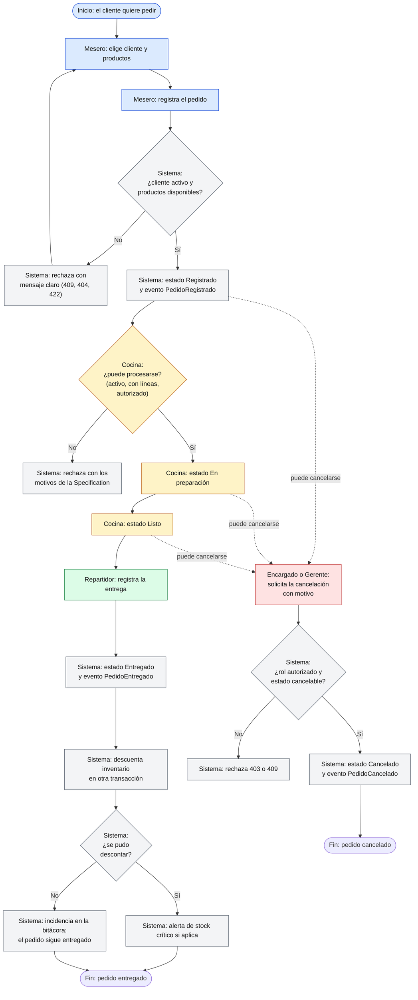
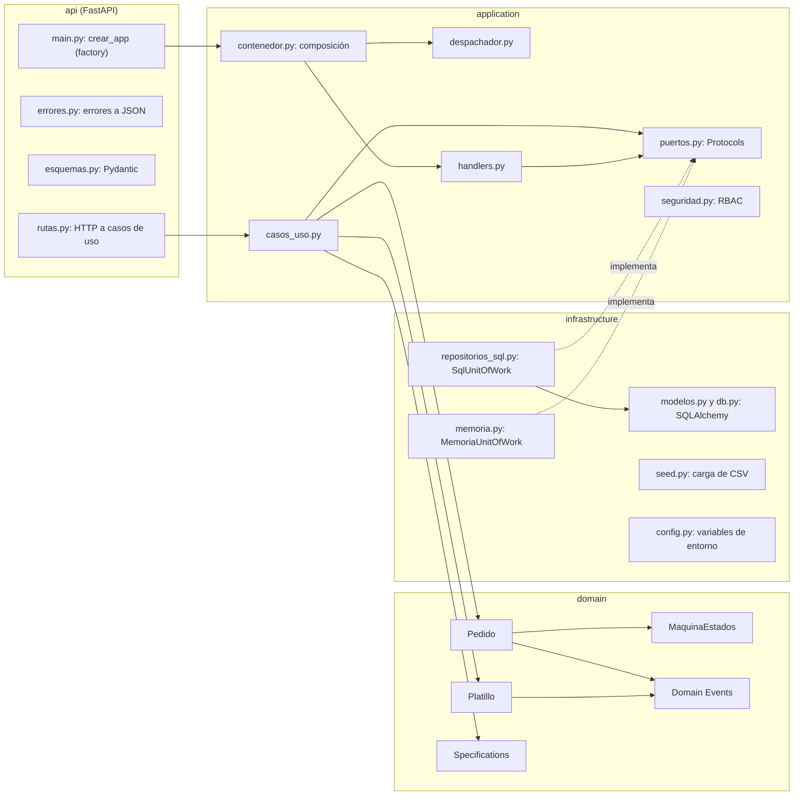
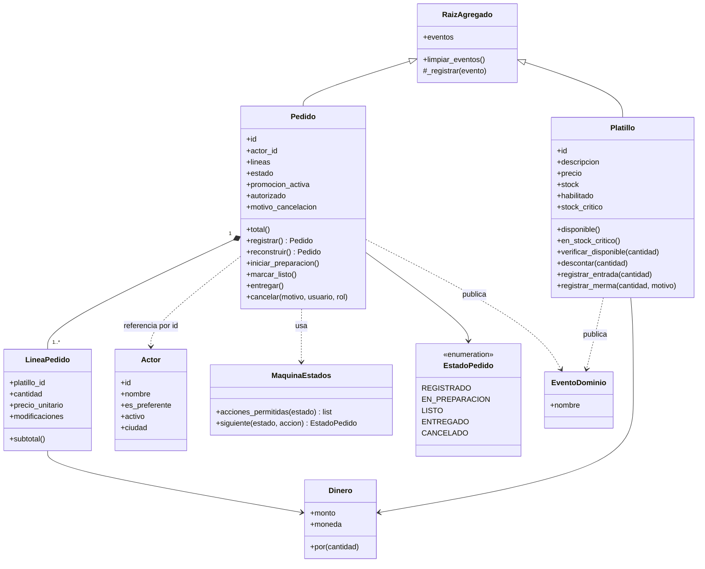
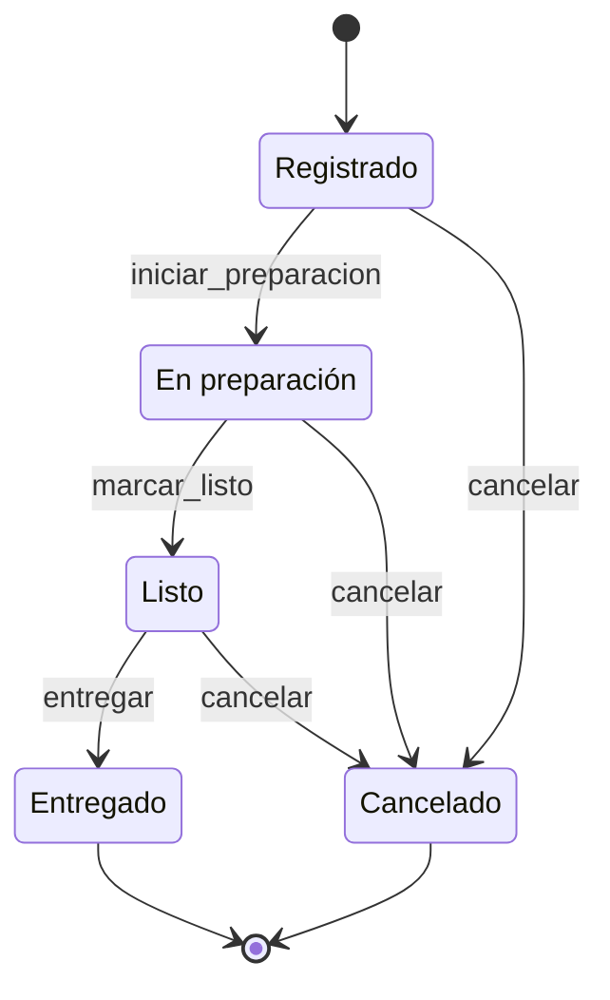
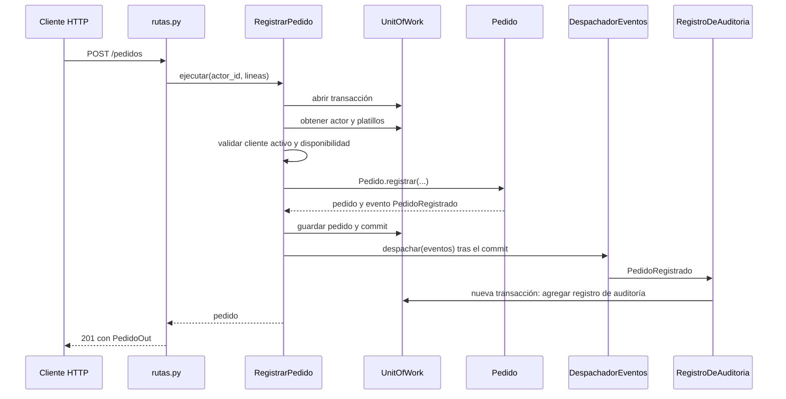
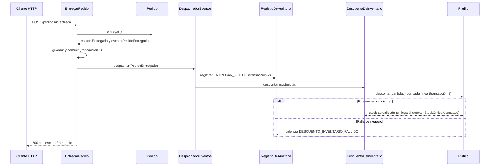
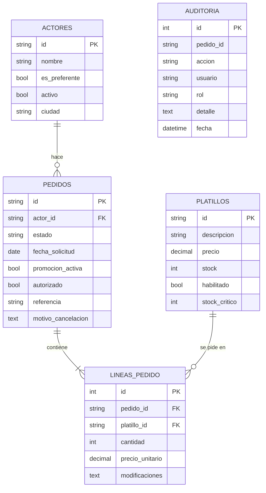

<div class="portada">
<p class="univ">Universidad Autónoma de Nuevo León<br>Facultad de Ingeniería Mecánica y Eléctrica (FIME)</p>
<p class="materia">Componentes de Lógica de Negocios</p>
<h1 class="titulo-portada">Producto Integrador de Aprendizaje</h1>
<p class="subtitulo">Reporte final: BRD, arquitectura, implementación, evidencias y conclusiones</p>
<p class="sistema">Sazón Urbano · Sistema de pedidos del restaurante</p>
<table class="datos-portada">
<tr><td>Equipo</td><td>3</td></tr>
<tr><td>Integrantes</td><td>Cristopher Alan Pulgarin Santa Cruz (2105894)<br>Francisco Sebastián Hernández Terán (2115798)<br>Jesús Orlando Moreno Chávez (2108300)</td></tr>
<tr><td>Docente</td><td>Miguel Ángel Gómez Marroquín</td></tr>
<tr><td>Repositorio</td><td>https://github.com/Tera2332/PIA_Unidad6_CLN</td></tr>
<tr><td>Fecha del reporte</td><td>6 de noviembre de 2026</td></tr>
<tr><td>Fecha de entrega (documentos y repositorio)</td><td>06 de noviembre de 2026</td></tr>
<tr><td>Fecha de presentación y defensa</td><td>09 al 20 de noviembre de 2026</td></tr>
</table>
</div>

<h1 id="indice" class="sin-salto">Índice</h1>

[TOC]

# Resumen ejecutivo

**Sazón Urbano** es un sistema de pedidos para restaurante construido con **Domain-Driven Design**, el patrón **Specification**, una **máquina de estados** del pedido y una **API REST** documentada con OpenAPI (FastAPI). Persiste en SQLAlchemy (SQLite en local, PostgreSQL en Docker Compose y Render), publica **Domain Events** con consistencia eventual, controla acceso por roles para cancelar pedidos y deja una **bitácora de solo anexado**. Incluye una interfaz web para personal no técnico (`src/web/`).

Este reporte se redactó leyendo el código y ejecutando los comandos de verificación el **6 de noviembre de 2026**. Cada dato cuantitativo proviene de una salida real incluida en el Anexo C o de un archivo del proyecto citado en el texto. Lo que no se pudo comprobar se marca como **PENDIENTE DE EVIDENCIA**, y los incumplimientos de la rúbrica están en la sección 7 sin maquillar.

| Indicador | Valor medido | Fuente |
|---|---|---|
| Pruebas automatizadas | **91 aprobadas, 0 fallidas** (13 de integración API, 6 de persistencia, 72 unitarias) | `pytest -v` (Anexo C.2) |
| Cobertura de `src/` | **97,29 %** (1 144 sentencias, 31 sin cubrir); mínimo exigido 80 % | `pytest --cov` (Anexo C.2) |
| Análisis estático | `ruff check src tests scripts`: **All checks passed!** | Anexo C.3 |
| Paquete de datos del PIA | 120 casos de Specification (56 CUMPLE, 64 NO CUMPLE) y 20 transiciones (11 OK, 9 RECHAZADO) | `scripts/ejecutar_casos.py` (Anexo C.4) |
| API | 15 operaciones HTTP, 12 esquemas, OpenAPI 3.1 exportado a `docs/api/openapi.json` | Anexo C.5 y B |
| Capas | `domain` solo importa de `domain`; `application` solo de `application` y `domain` | análisis de imports (§2.1) |
| Escenario en vivo | Flujo completo, 14 rechazos de reglas y errores (403, 404, 409 y 422) y trazabilidad, contra el servidor real | Anexo C.8 |

**Brechas principales** (detalle en la sección 7):

1. **El historial de commits es mínimo y de un solo autor.** El repositorio de GitHub existe, pero tiene 2 commits, ambos de la cuenta `Tera2332`; la carpeta de trabajo evaluada no es un repositorio git. La rúbrica pide historial del equipo. Además, el pipeline CI falló en su primera ejecución (paso de `ruff`) y pasó en la segunda.
2. **No hay despliegue activo ni URL**: existe `render.yaml`, pero no hay evidencia de que se haya desplegado.
3. **Docker no está instalado en la máquina de verificación**: `docker-compose.yml` se revisó de forma estática y no se pudo levantar.
4. Faltan en el repositorio los artefactos de análisis y arquitectura como archivos (`docs/BRD.md`, `docs/architecture/`, BPMN, ADRs). En este reporte se **reconstruyeron desde el código**, no existían en el árbol evaluado.
5. Falta la presentación de apoyo para la defensa.

> **Nota sobre el árbol de pruebas.** El directorio `tests/` no estaba en la carpeta del proyecto al iniciar esta verificación. Se restauró desde `PIA_SazonUrbano_repo.zip` (copia previa del mismo proyecto, que contiene 89 pruebas). La caché de pytest (`.pytest_cache`) registraba 91 pruebas; las dos que faltaban en ese ZIP (`test_listar_clientes_para_la_interfaz` y `test_interfaz_web_se_sirve_en_la_raiz`) se **reescribieron** con los mismos nombres y se agregaron a `tests/integration/test_api.py`. El resultado de 91 pruebas aprobadas corresponde a ese conjunto restaurado.

**Cumplimiento resumido de la rúbrica** (Cumple / Parcial / No cumple; puntos máximos entre paréntesis según el PDF del PIA):

| Criterio de la rúbrica | Estado | Comentario breve |
|---|---|---|
| 1. Análisis · BRD (1,50) | Parcial | BRD reconstruido en §1.1; falta `docs/BRD.md` |
| 1. Análisis · ≥15 US + Gherkin + BPMN + glosario (4,75) | Parcial | 15 historias con Gherkin (§1.2), BPMN en Mermaid (§1.3), glosario (Anexo A); sin archivos fuente ni BPMN 2.0 |
| 2. Arquitectura · DDD (1,50) | Cumple | §2.1 |
| 2. Arquitectura · UML (1,25) | Parcial | Diagramas Mermaid en §2.2; no existen archivos en `docs/architecture/` |
| 2. Arquitectura · Patrones justificados (1,25) | Cumple | §2.3 |
| 2. Arquitectura · SOLID (1,00) | Cumple | §2.4 |
| 2. Arquitectura · ADRs (1,25) | Parcial | Formalizados en §2.5; solo se citan ADR-002 a ADR-005 en el código y no hay archivos |
| 3. Implementación · DDD + Specification + State Machine + API REST (4,25) | Cumple | §3.1, verificado en vivo |
| 3. Implementación · Persistencia + OpenAPI + casos de uso (2,00) | Cumple | §3.2 a §3.4 |
| 4. Calidad · Pruebas ≥80 % | Cumple | 97,29 % medido |
| 4. Calidad · CI/CD activo | Parcial | 2 ejecuciones en GitHub Actions: la primera falló (`ruff`) y la segunda pasó (Anexo C.7); falta la captura del equipo |
| 4. Calidad · Docker Compose DB + App + Tests | No verificable | Definido; Docker no disponible para ejecutarlo |
| 4. Calidad · Variables de entorno + despliegue + Swagger en producción | Parcial | Variables y `/docs` verificados en local; despliegue PENDIENTE |
| 4. Calidad · Demo en vivo y defensa | Preparada | Guion y evidencias en Anexos C y D |

*Trazabilidad con la rúbrica:* esta tabla cubre los cuatro bloques de evaluación del PDF (Análisis, Arquitectura, Implementación, Calidad y defensa).

# 1. Análisis del negocio

## 1.1 Documento de negocio (BRD)

> **Procedencia.** El repositorio no contiene `docs/BRD.md`. Este BRD se **reconstruyó a partir del dominio implementado** (`src/domain/`, `src/application/`) y del paquete de datos (`data/`). Los números de regla `RN-xx` son de este reporte; los identificadores `NB-04`, `NB-05`, `NB-06` y `NB-07` y las historias `US-xx` son los que ya aparecen en comentarios y rutas del código. El BRD original de las Unidades 2 y 3 no está en el árbol evaluado y debe cotejarse con este texto antes de la defensa.

### Problema y objetivo

El restaurante necesita registrar los pedidos de sus clientes y darles seguimiento ordenado desde que se toman hasta que se entregan o cancelan, sin vender productos que no existen, sin permitir que cualquier persona cancele y con un historial confiable de lo ocurrido. El sistema cubre ese ciclo y compara lo vendido contra el inventario restante.

**Objetivos de negocio que el código materializa:**

1. Registrar pedidos con el total correcto y rechazar los que no puedan atenderse, con mensajes claros.
2. Hacer avanzar cada pedido por un flujo de estados controlado, sin saltos ni repeticiones.
3. Controlar el inventario: descontar al entregar, registrar entradas y mermas, y avisar de stock crítico.
4. Restringir la cancelación al personal con autoridad y exigir el motivo.
5. Dejar trazabilidad completa en una bitácora que nunca se modifica.
6. Reportar ventas contra inventario.

### Alcance

| Dentro del alcance (implementado) | Fuera del alcance (no implementado) |
|---|---|
| Registro, consulta y listado de pedidos | Cobro, pagos y facturación |
| Flujo de estados y cancelación con rol | Autenticación real de usuarios (el rol se declara en la solicitud) |
| Inventario por platillo: entradas, mermas, stock crítico | Compras a proveedores y recetas por ingrediente |
| Bitácora de auditoría y consulta de cancelaciones | Multisucursal y reservaciones |
| Reporte de ventas contra inventario | Notificaciones externas (correo, mensajería) |
| Interfaz web para el personal | Aplicación móvil nativa |

### Actores y roles

| Actor | Tipo | Responsabilidad en el sistema | Evidencia |
|---|---|---|---|
| Cliente (`Actor`) | Entidad de negocio | Hace el pedido; puede ser **preferente** o **inactivo** (los inactivos no pueden pedir) | `src/domain/actor.py:5-10` |
| Mesero | Rol | Toma pedidos (usuario por defecto `mesero`) | `src/api/rutas.py:45` |
| Cocina | Rol | Inicia preparación y marca listo (usuario por defecto `cocina`) | `src/api/rutas.py:73,79` |
| Repartidor | Rol | Registra la entrega (usuario por defecto `repartidor`) | `src/api/rutas.py:85` |
| Encargado | Rol con autoridad | Puede cancelar pedidos y ajustar inventario | `src/domain/specifications.py:186-187` |
| Gerente | Rol con autoridad | Puede cancelar pedidos | `src/domain/specifications.py:186-187` |
| Sistema | Actor automático | Publica eventos, escribe la bitácora y descuenta inventario | `src/application/handlers.py:42-86` |

### Reglas de negocio

| ID | Regla | Fuente en el código |
|---|---|---|
| RN-01 | Solo un cliente **activo** puede hacer pedidos; además se vuelve a exigir al iniciar la preparación | `src/application/casos_uso.py:60-61`, `src/domain/specifications.py:101-106` |
| RN-02 | Un pedido debe tener al menos un producto y cada cantidad debe ser un entero mayor a cero | `src/domain/pedido.py:53-60` |
| RN-03 | Un platillo se vende solo si está habilitado y tiene existencias; si no, se responde «Producto no disponible por falta de ingredientes» (historia US-05). No se puede pedir más de lo que hay | `src/domain/catalogo.py:6,19-21,27-31` |
| RN-04 | El total es la suma de precio unitario por cantidad, en MXN con `Decimal` y dos decimales | `src/domain/valores.py:11-39`, `src/domain/pedido.py:24-26,73-78` |
| RN-05 | Los estados son Registrado, En preparación, Listo, Entregado y Cancelado; solo existen las transiciones de la tabla de §2.2 (NB-06) | `src/domain/maquina_estados.py:5-11` |
| RN-06 | Iniciar la preparación exige `puede_procesarse` = cliente activo **Y** pedido con líneas **Y** pedido autorizado | `src/domain/specifications.py:178-179`, `src/application/casos_uso.py:99-107` |
| RN-07 | Cancelar exige rol Encargado o Gerente, un motivo no vacío, y no aplica a pedidos entregados ni ya cancelados | `src/application/seguridad.py:6-13`, `src/domain/pedido.py:93-99`, `src/domain/maquina_estados.py:38-41` |
| RN-08 | Al entregar, el inventario se descuenta en una transacción **separada** (NB-07). Si el descuento falla, el pedido sigue entregado y se registra una incidencia en la bitácora | `src/application/handlers.py:57-86` |
| RN-09 | Cuando las existencias llegan al umbral crítico (`STOCK_CRITICO`, 5 por defecto) se emite una alerta | `src/domain/catalogo.py:23-25,41-42` |
| RN-10 | Se pueden registrar entradas y mermas; la merma exige un motivo | `src/domain/catalogo.py:47-59` |
| RN-11 | Beneficio de referencia = cliente preferente **Y** total de al menos 1 500 MXN **Y NO** promoción activa | `src/domain/specifications.py:175,182-183` |
| RN-12 | Cada acción trazable se guarda en una bitácora de solo anexado (NB-04, NB-05; ADR-005) | `src/application/handlers.py:15-54`, `src/infrastructure/repositorios_sql.py:123-143` |
| RN-13 | Los errores se muestran en español claro y sin rastros técnicos; un fallo inesperado devuelve un mensaje genérico | `src/api/errores.py:20-45`, `tests/integration/test_api.py::test_un_error_inesperado_no_expone_detalles_tecnicos` |

### Flujo principal

1. El mesero elige al cliente y los productos y **registra** el pedido (estado *Registrado*).
2. La cocina **inicia la preparación**; el sistema evalúa `puede_procesarse` (*En preparación*).
3. La cocina **marca el pedido como listo** (*Listo*).
4. El repartidor **entrega** el pedido (*Entregado*) y el sistema descuenta el inventario.
5. En cualquier momento antes de la entrega, un Encargado o Gerente puede **cancelar** con motivo (*Cancelado*).
6. Todo queda en la bitácora y alimenta el reporte de ventas contra inventario.

### Datos de negocio del paquete del PIA

Medidos directamente sobre los CSV de `data/`:

| Concepto | Valor | Archivo |
|---|---|---|
| Clientes | 40 (8 preferentes, 5 inactivos: PED-C007, C014, C021, C028, C035) | `data/actores.csv` |
| Platillos | 20; stock inicial de 10 a 52; precios de 290 a 1 639 MXN; 1 deshabilitado (Pasta 11) | `data/catalogo.csv` |
| Pedidos | 60 (47 sin promoción y autorizados, 7 sin autorizar, 6 con promoción activa); 2 sin ninguna línea de detalle | `data/operaciones.csv`, `data/detalle_operaciones.csv` |
| Líneas de detalle | 117 | `data/detalle_operaciones.csv` |
| Casos de prueba | 120 (60 `validar_operacion` y 60 `evaluar_beneficio`) | `data/casos_prueba.csv` |
| Transiciones de prueba | 20 | `data/transiciones_prueba.csv` |

## 1.2 Historias de usuario con criterios de aceptación en Gherkin

> **Procedencia y estado.** El código y el README referencian las historias **US-01 a US-15** (por ejemplo en `src/api/rutas.py:44-126`), pero sus textos originales no están en el repositorio. Se cuentan **15 historias** (US-01 a US-15), que cumplen el mínimo de la rúbrica. La redacción siguiente se **reconstruyó desde el comportamiento verificado** (pruebas y ejecución en vivo). Las marcadas con † (US-04 y US-09) tienen una asignación inferida, porque el README las agrupa («US-02, US-03, US-04, US-05» y «US-08, US-09»). US-14 y US-15 comparten el mismo endpoint. Hay que cotejarlas con las originales de las Unidades 2 y 3.

```gherkin
# US-01 · Listar pedidos por estado                                     GET /pedidos
Característica: Consultar los pedidos del restaurante
  Escenario: Filtrar por estado
    Dado que existen pedidos en distintos estados
    Cuando el mesero consulta los pedidos con el filtro "Entregado"
    Entonces recibe solo los pedidos entregados
  Escenario: Estado inexistente
    Cuando consulta con el filtro "volando"
    Entonces recibe 422 y el mensaje «El estado «volando» no existe. Usa uno de: REGISTRADO, EN_PREPARACION, LISTO, ENTREGADO, CANCELADO.»

# US-02 · Consultar disponibilidad de platillos                         GET /platillos
Característica: Ver qué se puede ofrecer
  Escenario: Buscar por nombre
    Cuando el mesero busca "Hamburguesa 01"
    Entonces ve el platillo con su precio, stock y si está disponible

# US-03 · Registrar entradas y mermas de inventario                     POST /inventario/ajustes
Característica: Ajustar el inventario
  Escenario: Entrada de mercancía
    Dado que "Pasta 03" tiene 19 unidades
    Cuando el encargado registra una entrada de 10
    Entonces el stock queda en 29
  Escenario: Merma sin motivo
    Cuando registra una merma sin motivo
    Entonces recibe 422 «Para registrar una merma debes indicar el motivo.»
  Escenario: Merma con motivo
    Cuando registra una merma de 2 con motivo "Producto caducado"
    Entonces el stock queda en 27

# US-04 † · Alerta de stock crítico
Característica: Avisar cuando un producto se está acabando
  Escenario: El stock llega al umbral crítico
    Dado que el umbral crítico es 5
    Cuando una entrega deja un platillo con 5 unidades o menos
    Entonces se registra la alerta "STOCK_CRITICO" en la bitácora

# US-05 · No vender productos agotados
Característica: Proteger contra la venta de productos sin existencias
  Escenario: Producto agotado o deshabilitado
    Dado que un platillo está deshabilitado o con stock cero
    Cuando se intenta pedirlo
    Entonces recibe 409 «Producto no disponible por falta de ingredientes»
  Escenario: Stock insuficiente
    Cuando se piden más unidades de las que hay
    Entonces recibe 409 «Solo quedan 11 unidades de «Hamburguesa 01».»

# US-06 · Hacer avanzar el pedido en cocina                              POST /pedidos/{id}/preparacion y /listo
Característica: Seguimiento de la preparación
  Escenario: Iniciar preparación
    Dado un pedido "Registrado" de un cliente activo y autorizado
    Cuando la cocina inicia la preparación
    Entonces el pedido pasa a "En preparación"
  Escenario: Pedido no procesable
    Dado un pedido sin autorización
    Cuando la cocina intenta iniciar la preparación
    Entonces recibe 409 «El pedido no puede procesarse: el pedido no está autorizado.»
  Escenario: Repetir la acción
    Dado un pedido "En preparación"
    Cuando se vuelve a iniciar la preparación
    Entonces recibe 409 «El pedido ya está «En preparación».»

# US-07 · Consultar un pedido y su estado                               GET /pedidos/{id}
Característica: Ver el detalle de un pedido
  Escenario: Pedido existente
    Cuando se consulta un pedido
    Entonces se muestran estado, líneas, total y motivo de cancelación si lo hay
  Escenario: Pedido inexistente
    Cuando se consulta "PED-NO-EXISTE"
    Entonces recibe 404 «El pedido solicitado no existe.»

# US-08 · Registrar un pedido                                           POST /pedidos
Característica: Tomar un pedido
  Escenario: Pedido válido
    Dado un cliente activo y productos disponibles
    Cuando el mesero registra 2 unidades de "PED-P001" y 1 de "PED-P002"
    Entonces recibe 201, el pedido queda "Registrado" y el total es 941.00 MXN
  Escenario: Cliente inactivo
    Cuando el cliente "PED-C007" intenta hacer un pedido
    Entonces recibe 409 «El cliente no está activo y no puede realizar pedidos.»
  Escenario: Datos inválidos
    Cuando la cantidad es 0 o el pedido no tiene productos
    Entonces recibe 422 con un mensaje claro

# US-09 † · Registrar modificaciones por línea
Característica: Personalizar los platillos
  Escenario: Pedido con modificaciones
    Cuando se registra "PED-P001 x2" con la modificación "sin cebolla"
    Entonces la modificación se guarda en el pedido y aparece en la bitácora

# US-10 · Cancelar un pedido con autorización                           POST /pedidos/{id}/cancelacion
Característica: Cancelación controlada
  Escenario: Rol sin permiso
    Cuando un Mesero intenta cancelar
    Entonces recibe 403 «Solo el Encargado o el Gerente pueden autorizar la cancelación de un pedido.»
  Escenario: Cancelación sin motivo
    Cuando un Encargado cancela con el motivo vacío
    Entonces recibe 422 «Para cancelar un pedido debes indicar el motivo.»
  Escenario: Cancelación autorizada
    Cuando un Encargado cancela con el motivo "El cliente ya no quiso esperar"
    Entonces el pedido queda "Cancelado" con ese motivo
  Escenario: Pedido entregado o ya cancelado
    Cuando se intenta cancelar un pedido entregado
    Entonces recibe 409 «Un pedido entregado ya no se puede cancelar.»

# US-11 · Consultar cancelaciones                                       GET /cancelaciones
Característica: Revisar qué se canceló y por qué
  Escenario: Listado de cancelaciones
    Cuando el encargado consulta las cancelaciones
    Entonces ve pedido, rol que autorizó y motivo

# US-12 · Entregar y descontar inventario                               POST /pedidos/{id}/entrega
Característica: Cierre del pedido
  Escenario: Entrega
    Dado un pedido "Listo"
    Cuando el repartidor registra la entrega
    Entonces el pedido queda "Entregado" y el stock de cada platillo baja según las cantidades
  Escenario: Saltar un estado
    Dado un pedido "Registrado"
    Cuando se intenta entregar
    Entonces recibe 409 «No es posible entregar un pedido que está «Registrado».»

# US-13 · Historial de acciones                                         GET /auditoria
Característica: Trazabilidad
  Escenario: Bitácora de un pedido
    Cuando se consulta la auditoría del pedido
    Entonces aparecen REGISTRAR_PEDIDO, INICIAR_PREPARACION, MARCAR_LISTO y ENTREGAR_PEDIDO con usuario y fecha
  Escenario: La bitácora no se modifica
    Dado el repositorio de auditoría
    Entonces solo ofrece agregar y consultar, nunca actualizar ni borrar

# US-14 · Reporte de ventas                                             GET /reportes/resumen
Característica: Resumen de ventas
  Escenario: Ventas del día
    Cuando el gerente consulta el resumen
    Entonces ve los pedidos entregados, el total vendido en MXN y los pedidos por estado

# US-15 · Ventas contra inventario                                      GET /reportes/resumen
Característica: Comparar lo vendido con lo que queda
  Escenario: Inventario con unidades vendidas
    Cuando el gerente consulta el resumen
    Entonces cada platillo muestra su stock, las unidades vendidas y si está en stock crítico
```

*Trazabilidad con la rúbrica:* cumple el mínimo de ≥15 historias con criterios Gherkin del criterio «Análisis 2». El estado del artefacto como archivo del repositorio está en la sección 7 (B-02).

## 1.3 BPMN: proceso del pedido de extremo a extremo

> **Procedencia.** No existe un archivo BPMN 2.0 en el repositorio. El diagrama siguiente modela el proceso con carriles por rol y se construyó a partir de la máquina de estados real (`src/domain/maquina_estados.py:5-11`) y de los casos de uso. Es la versión gráfica en Mermaid; la exportación a BPMN 2.0 está registrada como brecha (B-03).



Leyenda de carriles por color: azul = Mesero, amarillo = Cocina, verde = Repartidor, rojo = Encargado o Gerente, gris = Sistema. Las líneas punteadas indican que la cancelación puede solicitarse desde los estados *Registrado*, *En preparación* y *Listo*.


*Todas las acciones anteriores escriben un registro en la bitácora (RN-12).*

## 1.4 Glosario de dominio

El glosario completo, extraído de `src/domain/` y de los encabezados de `data/*.csv`, está en el **Anexo A**.

## 1.5 Equivalencias con el paquete de datos del PIA

El paquete de datos usa nombres genéricos. La tabla del README (líneas 111-119) y las columnas de los CSV se relacionan así con este proyecto:

| Paquete del PIA | Este proyecto | Observación |
|---|---|---|
| `actor_id`, `data/actores.csv` | `Actor` (cliente) | Atributos `es_preferente`, `activo`, `ciudad` |
| `recurso_id`, `capacidad_o_stock`, `data/catalogo.csv` | `Platillo` y su `stock` | El inventario se modela por platillo |
| `operacion_id`, `data/operaciones.csv` | `Pedido` | `referencia`, `promocion_activa`, `autorizado` |
| `data/detalle_operaciones.csv` | `LineaPedido` | `cantidad` y precio del catálogo |
| Estado `CREADO` | `Registrado` | Estado inicial al cargar el paquete (`src/infrastructure/seed.py:44`) |
| Estado `ACEPTADO` | No existe en el BRD | `aprobar` equivale a `iniciar_preparacion`, condicionada a `puede_procesarse` |
| `completar` | Iniciar preparación, marcar listo y entregar | Descuenta inventario al entregar |
| `repetir_aprobacion`, `saltar_estado` | Rechazos por la máquina de estados | La segunda aprobación y la entrega desde *Registrado* se rechazan |
| `cancelar` | `cancelar` con rol Encargado | Con motivo obligatorio |
| `validar_operacion` | Specification `puede_procesarse` | Casos `PED-Txxx` |
| `evaluar_beneficio` | Specification `beneficio_referencia` | Casos `PED-Bxxx` |

*Trazabilidad con la rúbrica:* esta sección y el Anexo A cubren «Análisis 1» (BRD) y «Análisis 2» (historias, BPMN, glosario). Las limitaciones de forma (archivos fuente, BPMN 2.0) están en la sección 7.

# 2. Arquitectura

## 2.1 Modelo DDD

El dominio vive en `src/domain/` y **no depende de ninguna otra capa**: los imports medidos del código son los siguientes.

| Capa | Importa de |
|---|---|
| `src/domain` | `domain` únicamente |
| `src/application` | `application`, `domain` |
| `src/infrastructure` | `application`, `domain`, `infrastructure` |
| `src/api` | `api`, `application`, `domain`, `infrastructure` |

*(Salida de `Select-String` sobre los `import` de cada carpeta; la capa `api` importa `infrastructure` solo para componer la aplicación en `main.py`.)*

| Elemento DDD | Clase | Ubicación | Rol |
|---|---|---|---|
| Aggregate Root | `Pedido` | `src/domain/pedido.py:29` | Consistencia del pedido, sus líneas y su estado |
| Aggregate Root | `Platillo` | `src/domain/catalogo.py:9` | Consistencia de las existencias |
| Base de agregados | `RaizAgregado` | `src/domain/base.py:8` | Acumula Domain Events hasta que se despachan |
| Entidad | `Actor` | `src/domain/actor.py:5` | Cliente (preferente, activo, ciudad) |
| Value Object | `LineaPedido` | `src/domain/pedido.py:18` | Inmutable (`frozen=True`), con `subtotal` |
| Value Object | `Dinero` | `src/domain/valores.py:12` | Inmutable, `Decimal` con dos decimales, MXN, no negativo |
| Value Object / enum | `EstadoPedido` | `src/domain/valores.py:42` | Los cinco estados |
| Registro inmutable | `RegistroAuditoria` | `src/domain/auditoria.py:6` | Solo anexado (`frozen=True`) |
| Domain Events | `PedidoRegistrado`, `PedidoEnPreparacion`, `PedidoListo`, `PedidoEntregado`, `PedidoCancelado`, `StockCriticoAlcanzado`, `InventarioAjustado` | `src/domain/eventos.py:13-68` | Hechos del negocio, inmutables |
| Servicio de dominio | `MaquinaEstados` | `src/domain/maquina_estados.py:26` | Única fuente de transiciones válidas |
| Especificaciones | `Especificacion` y derivadas | `src/domain/specifications.py:16-191` | Reglas combinables |
| Errores de dominio | `ErrorDeNegocio` y 7 derivadas | `src/domain/errores.py:4-33` | Texto claro para el cliente |
| Servicios de aplicación | `RegistrarPedido`, `IniciarPreparacion`, `MarcarListo`, `EntregarPedido`, `CancelarPedido`, `AjustarInventario` y consultas | `src/application/casos_uso.py:49-243` | Orquestan; las reglas viven en el dominio (ADR-003) |
| Manejadores de eventos | `RegistroDeAuditoria`, `DescuentoDeInventario` | `src/application/handlers.py:42,57` | Reaccionan a eventos en transacción propia |

## 2.2 Diagramas UML y de arquitectura

> **Procedencia.** `docs/architecture/` no existe en el repositorio. Los diagramas se generaron a partir del código; las clases, atributos y relaciones corresponden a los archivos citados.

### Arquitectura por capas



### Modelo de clases del dominio



### Máquina de estados del pedido



Tabla de transiciones (`src/domain/maquina_estados.py:5-11`): desde *Registrado* se puede iniciar preparación o cancelar; desde *En preparación*, marcar listo o cancelar; desde *Listo*, entregar o cancelar; *Entregado* y *Cancelado* son terminales sin acciones.

### Secuencia: registrar un pedido



### Secuencia: entregar un pedido y descontar inventario (consistencia eventual)



### Modelo de datos (SQLAlchemy)



*La tabla `AUDITORIA` no tiene llave foránea a propósito: es de solo anexado y también registra eventos sin pedido (stock crítico, ajustes de inventario) (`src/infrastructure/modelos.py:59-70`).*

## 2.3 Patrones de diseño aplicados y su justificación

**Repository.** Problema: la lógica de negocio no debe conocer SQL ni filas de tabla. Solución: los puertos `PedidoRepositorio`, `PlatilloRepositorio`, `ActorRepositorio` y `AuditoriaRepositorio` (`src/application/puertos.py:5-28`) se implementan con SQLAlchemy (`src/infrastructure/repositorios_sql.py:36-143`) y en memoria (`src/infrastructure/memoria.py:19-75`). Los repositorios convierten filas en objetos del dominio (`repositorios_sql.py:20-33`).

**Unit of Work.** Problema: garantizar que cada operación sea atómica. Solución: `SqlUnitOfWork` (`repositorios_sql.py:146-171`) abre una sesión por bloque `with` y hace *rollback* si no hay `commit` explícito. `MemoriaUnitOfWork` (`memoria.py:78-100`) restaura una instantánea en las mismas condiciones. La prueba `test_unit_of_work_restaura_el_estado_si_hay_error_o_falta_commit` verifica el comportamiento.

**Specification.** Problema: reglas de negocio combinables y explicables sin condicionales dispersos. Solución: `Especificacion` define `es_satisfecha_por`, y los operadores `&`, `|` y `~` (`src/domain/specifications.py:16-43`) componen reglas que, además, explican por qué fallan (`motivos_de_falla`, `explicar`). Las reglas compuestas son `puede_procesarse`, `beneficio_referencia`, `puede_autorizar_cancelacion` y `puede_venderse` (`specifications.py:178-191`).

| Regla compuesta | Composición | Uso real |
|---|---|---|
| `puede_procesarse` | `ActorActivo & PedidoConLineas & PedidoAutorizado` | `IniciarPreparacion._verificar` (`casos_uso.py:102-107`) |
| `beneficio_referencia` | `ActorPreferente & TotalMinimo(1500) & ~PromocionActiva` | `EvaluarPedido` (`casos_uso.py:173-186`) y los 60 casos `evaluar_beneficio` |
| `puede_autorizar_cancelacion` | `RolEn("Encargado") \| RolEn("Gerente")` | `ControlAccesoRBAC` (`seguridad.py:8`) |
| `puede_venderse` | `PedidoConLineas & ExistenciasSuficientes` | Definida y probada (`test_specifications.py`); **no está conectada a un caso de uso**, la validación de existencias se hace con `Platillo.verificar_disponible` (ver B-13) |

**State Machine.** Problema: evitar estados imposibles y mensajes de error inconsistentes. Solución: `TRANSICIONES` es una tabla estado → acción → estado, y `MaquinaEstados.siguiente` devuelve el destino o lanza `TransicionInvalida` con un mensaje apto para el cliente (`maquina_estados.py:5-46`). `Pedido` no cambia de estado por otra vía (`pedido.py:80-99`).

**Domain Events.** Problema: desacoplar los efectos secundarios (bitácora, inventario) de la operación principal. Solución: los agregados registran eventos (`base.py:8-22`); el caso de uso los despacha **después del commit** (`casos_uso.py:43-45`); `DespachadorEventos` los entrega a sus suscriptores y aísla las fallas de cada uno (`despachador.py:7-27`). Es la base de la consistencia eventual (ADR-002).

**Factory (`crear_app`).** Problema: poder construir la aplicación con distintas dependencias. Solución: `crear_app(uow_factory=None, configuracion=None)` (`src/api/main.py:28-52`) arma la aplicación con base de datos real o con un `uow_factory` inyectado. Las pruebas y `scripts/exportar_openapi.py` la usan con almacenamiento en memoria, y `uvicorn --factory` la invoca en producción.

**DTO / modelo de lectura.** Problema: no exponer objetos de dominio por la API. Solución: `pedido_a_dict`, `platillo_a_dict` y `registro_a_dict` (`src/application/dtos.py:6-51`) y los esquemas Pydantic (`src/api/esquemas.py`) separan el modelo de dominio del de lectura.

**Composition Root.** `construir_aplicacion` conecta casos de uso, despachador y manejadores en un solo lugar (`src/application/contenedor.py:46-67`).

**RBAC por interceptor.** `ControlAccesoRBAC` verifica el rol *antes* de abrir la transacción del dominio (`casos_uso.py:124`; `seguridad.py:6-13`).

## 2.4 Principios SOLID con evidencia

| Principio | Evidencia en el código |
|---|---|
| **S** · Responsabilidad única | `Platillo` solo gobierna existencias (`catalogo.py`) y `Pedido` solo el ciclo del pedido (`pedido.py`). `RegistroDeAuditoria` y `DescuentoDeInventario` son manejadores separados (`handlers.py:42,57`). `rutas.py` solo traduce HTTP a casos de uso y no contiene reglas (docstring en `rutas.py:1`). |
| **O** · Abierto/cerrado | Se agrega una regla de negocio creando una subclase de `Especificacion` sin tocar las existentes (`specifications.py:16-43`). Un nuevo efecto secundario se agrega con `despachador.suscribir(...)` sin modificar los casos de uso (`despachador.py:13-17`). Las transiciones son datos en `TRANSICIONES` (`maquina_estados.py:5-11`). |
| **L** · Sustitución de Liskov | `EspecificacionY`, `EspecificacionO` y `EspecificacionNo` sustituyen a `Especificacion` (`specifications.py:45,63,83`). `SqlUnitOfWork` y `MemoriaUnitOfWork` son intercambiables: las pruebas unitarias usan el segundo y las de integración el primero, con los mismos casos de uso. |
| **I** · Segregación de interfaces | Un `Protocol` pequeño por repositorio y uno para el UoW (`puertos.py:5-39`) en vez de una interfaz grande. Los manejadores y consultas solo reciben `uow_factory`. `AuditoriaRepositorio` solo expone `agregar` y `listar` (`puertos.py:24-28`). |
| **D** · Inversión de dependencias | Los casos de uso dependen de `uow_factory` (un invocable) y de los puertos, no de SQLAlchemy (`casos_uso.py:38-41`). `domain` no importa de ninguna otra capa y `application` solo de `domain` (tabla de §2.1). La implementación concreta se inyecta en `crear_app` (`main.py:28-43`) y se compone en `contenedor.py:46-67`. |

*Trazabilidad con la rúbrica:* §2.1 a §2.4 cubren «Arquitectura 1» (DDD), «2» (UML), «3» (patrones) y «4» (SOLID). La rúbrica exige además que la arquitectura corresponda al caso asignado; los diagramas anteriores se derivaron del código del sistema y no son genéricos.

## 2.5 Decisiones de arquitectura (ADR)

> **Procedencia.** El código cita **ADR-002, ADR-003, ADR-004 y ADR-005** en sus comentarios. No existe ningún archivo ADR en el repositorio. A continuación se **formalizan** esas cuatro decisiones y se agregan las que el código permite sustentar. La numeración **ADR-001 y ADR-006 a ADR-009 es propuesta en este reporte**. Las alternativas descartadas las plantea el redactor de este reporte y deben confirmarse con el equipo.

**ADR-001 · Una transacción por Aggregate Root** (propuesta de numeración; declarada en el README)

| Campo | Contenido |
|---|---|
| Contexto | `Pedido` y `Platillo` son agregados distintos; una entrega afecta a ambos. |
| Decisión | Cada caso de uso abre **una** transacción sobre **un** agregado (`casos_uso.py:56-77`); el otro agregado se actualiza en una transacción propia por medio de eventos. |
| Alternativas | Una transacción global que bloquee ambos agregados; un servicio de dominio que modifique los dos a la vez. |
| Consecuencias | Los agregados quedan pequeños y las transacciones cortas. A cambio, el inventario se actualiza después del pedido (ver ADR-002). |

**ADR-002 · Consistencia eventual con Domain Events** (`eventos.py:1`, `handlers.py:1`)

| Campo | Contenido |
|---|---|
| Contexto | Entregar un pedido debe descontar inventario y escribir la bitácora, sin que una falla secundaria deshaga la entrega. |
| Decisión | Los eventos se despachan **después del commit** y cada manejador usa su transacción. Si el descuento falla, se registra `DESCUENTO_INVENTARIO_FALLIDO` y el pedido sigue entregado (`handlers.py:76-83`). |
| Alternativas | Transacción distribuida única; mensajería externa con outbox. |
| Consecuencias | Resiliencia y bajo acoplamiento. Riesgos: si el proceso se detiene entre el commit y el despacho se pierde el evento (no hay *outbox*), y el stock se valida al registrar pero se descuenta al entregar, por lo que dos pedidos pueden aceptarse con el mismo stock (B-12). |

**ADR-003 · Los casos de uso orquestan; las reglas viven en el dominio** (`casos_uso.py:1`)

| Campo | Contenido |
|---|---|
| Contexto | Evitar que la lógica de negocio se disperse entre rutas y servicios. |
| Decisión | `casos_uso.py` coordina repositorios y despacho; las reglas están en `Pedido`, `Platillo`, `MaquinaEstados` y las Specifications. |
| Alternativas | Servicios gruesos con las reglas; lógica en los controladores. |
| Consecuencias | El dominio se prueba sin base de datos ni HTTP (72 pruebas unitarias). Más clases y más indirección. |

**ADR-004 · Control de acceso por roles en la capa de aplicación** (`seguridad.py:1`)

| Campo | Contenido |
|---|---|
| Contexto | Solo Encargado y Gerente cancelan pedidos; el dominio no debe conocer sesiones. |
| Decisión | `ControlAccesoRBAC` evalúa la Specification `puede_autorizar_cancelacion` antes de abrir la transacción (`casos_uso.py:124`). El rol llega en la solicitud (`CancelarIn.rol`). |
| Alternativas | Autenticación con JWT y roles en el token; verificar el rol dentro del agregado. |
| Consecuencias | Regla reutilizable y probada. **Limitación:** el rol lo declara el cliente; no hay autenticación, por lo que no es un control de seguridad real (B-11). |

**ADR-005 · Bitácora de solo anexado** (`auditoria.py:7`, `puertos.py:25`, `modelos.py:60`)

| Campo | Contenido |
|---|---|
| Contexto | Se exige trazabilidad de quién hizo qué y cuándo. |
| Decisión | `RegistroAuditoria` es inmutable y el repositorio solo ofrece `agregar` y `listar`; la tabla no tiene claves foráneas. |
| Alternativas | Columnas de «última modificación» en cada tabla; *event sourcing* completo. |
| Consecuencias | Historial confiable y sencillo. La integridad depende de que nadie use SQL directo sobre la tabla. |

**ADR-006 · SQLite en local y PostgreSQL en contenedores y producción** (propuesta)

| Campo | Contenido |
|---|---|
| Contexto | Se necesita arrancar sin instalar nada y a la vez cumplir con una base de datos real en Docker. |
| Decisión | `DATABASE_URL` por variable de entorno con valor por defecto `sqlite:///./sazon.db` (`config.py:14-16`). Docker Compose y Render usan PostgreSQL. `normalizar_url` convierte `postgres://` y `postgresql://` en `postgresql+psycopg2://` (`config.py:6-11`). |
| Alternativas | Solo PostgreSQL; solo SQLite. |
| Consecuencias | Arranque inmediato y pruebas rápidas. La misma suite puede correr contra PostgreSQL con `TEST_DATABASE_URL` (`tests/conftest.py:10`). En esta verificación **no se ejecutó contra PostgreSQL** (B-08). |

**ADR-007 · Contenerización con Docker Compose para DB, App y Tests** (propuesta)

| Campo | Contenido |
|---|---|
| Contexto | El PIA exige un entorno reproducible. |
| Decisión | Servicios `db` (PostgreSQL 16 con *healthcheck*), `app` y `tests` (perfil `tests`) en `docker-compose.yml:4-40`; `docker/init-db.sql` crea la base `sazon_test`. |
| Alternativas | Instrucciones manuales; solo `Dockerfile`. |
| Consecuencias | Un comando levanta todo. La imagen incluye dependencias de desarrollo porque comparte `requirements.txt`. |

**ADR-008 · Aplicación como factoría (`--factory`)** (propuesta)

| Campo | Contenido |
|---|---|
| Contexto | Se quiere inyectar dependencias distintas en pruebas, scripts y producción. |
| Decisión | `uvicorn src.api.main:crear_app --factory` (`Dockerfile:13`, `iniciar.bat`). |
| Alternativas | Objeto `app` global creado al importar. |
| Consecuencias | No hay efectos secundarios al importar el módulo y se prueba con almacenamiento en memoria. |

**ADR-009 · Errores de negocio en español claro** (propuesta)

| Campo | Contenido |
|---|---|
| Contexto | El personal del restaurante no es técnico (historias US-05 y US-10). |
| Decisión | Jerarquía `ErrorDeNegocio` con `codigo` y mensaje apto para mostrarse; `registrar_manejadores` la traduce a HTTP 403, 404, 409 o 422 con `{detail, codigo}`; el error inesperado devuelve un mensaje genérico y no filtra detalles (`api/errores.py:11-45`). |
| Alternativas | Mensajes técnicos en inglés; códigos numéricos. |
| Consecuencias | Mensajes entendibles e interfaz simple. Los mensajes están embebidos en el dominio, lo que complicaría la internacionalización. |

## 2.6 Estructura del repositorio frente a la mínima exigida

| Elemento exigido por el PDF | Estado | Evidencia |
|---|---|---|
| `docs/BRD.md` | **No existe** | El BRD está en §1.1 de este reporte (B-01) |
| `docs/architecture/` (ADRs, diagramas) | **No existe** | Contenido en §2.2 y §2.5 de este reporte (B-04, B-05) |
| `docs/api/` (OpenAPI) | **Cumple** | `docs/api/openapi.json` generado con `python scripts/exportar_openapi.py` (36 993 bytes) |
| `src/domain/` | Cumple | 10 módulos |
| `src/application/` | Cumple | 7 módulos |
| `src/infrastructure/` | Cumple | 7 módulos |
| `src/api/` | Cumple | 4 módulos |
| `tests/` (unitarias e integración) | Cumple (restaurado) | `tests/unit/` y `tests/integration/`; ver la nota del resumen ejecutivo |
| `.github/workflows/` | Cumple | `ci.yml`; 2 ejecuciones en GitHub, 1 fallida y 1 exitosa (B-07) |
| `docker-compose.yml` | Cumple (definido) | No levantado en esta verificación (B-08) |
| `.env.example` sin secretos | Cumple | Contiene solo `cambia-esta-contrasena` como marcador |
| `README.md` técnico | Parcial | Cubre arquitectura, ejecución y pruebas; la línea 127 remite a «Pasos en `docs/`» y esa carpeta no contiene pasos de despliegue (B-14); faltan URLs de repositorio y despliegue |
| Historial de commits | **Parcial** | 2 commits de un solo autor en GitHub (Anexo C.7); la carpeta local no es un repositorio git (B-06) |

*Trazabilidad con la rúbrica:* esta sección cubre los renglones «Arquitectura 5 a 13» y la estructura mínima del repositorio.
