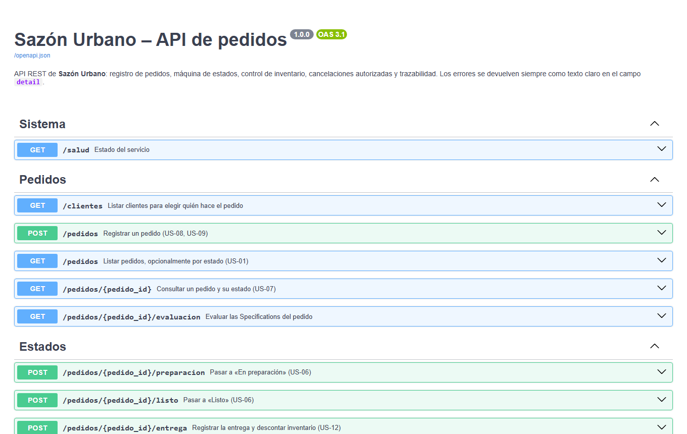
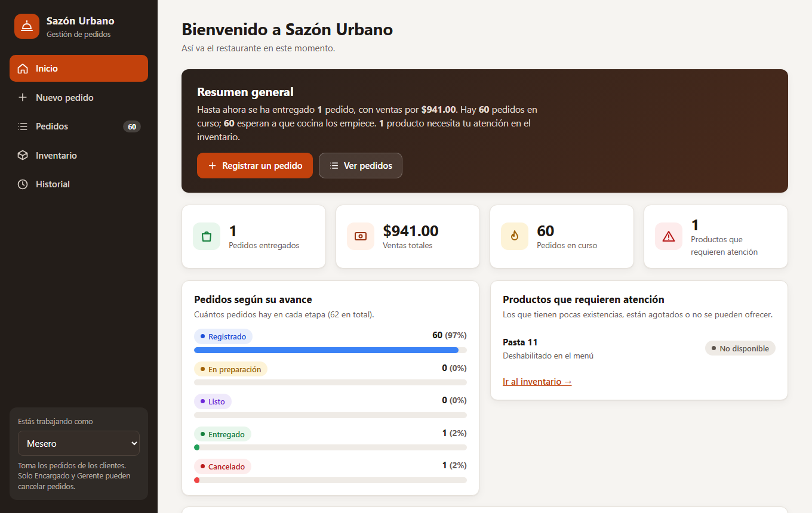
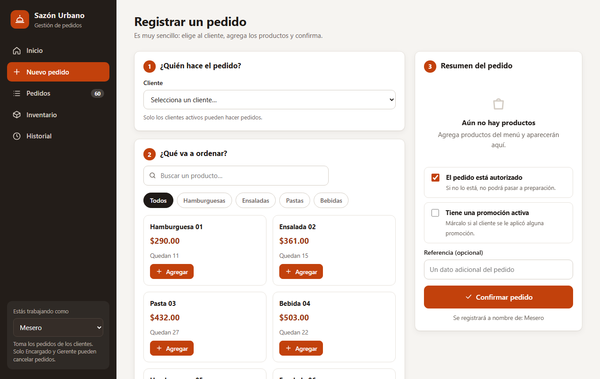
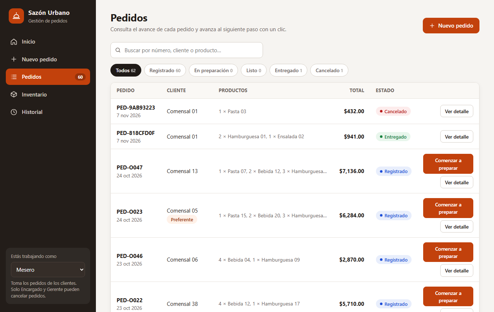
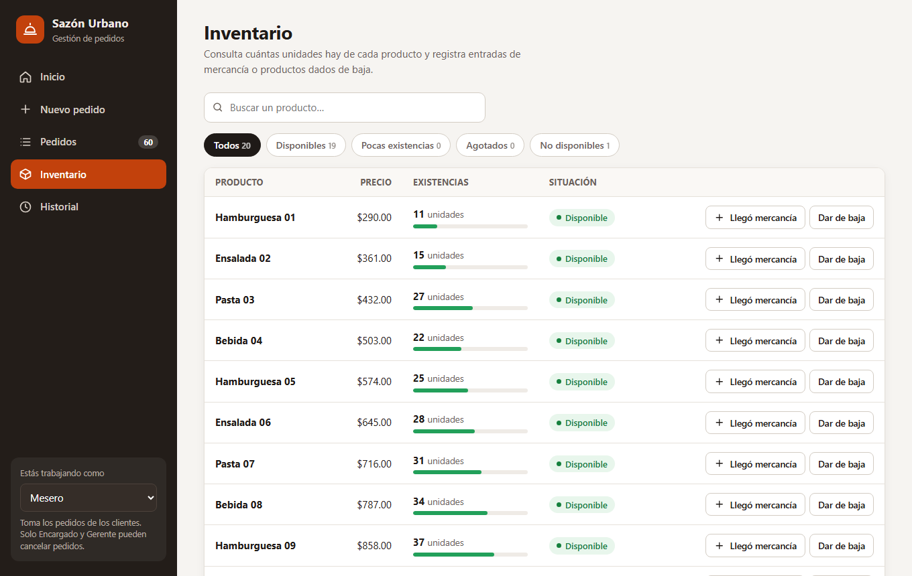
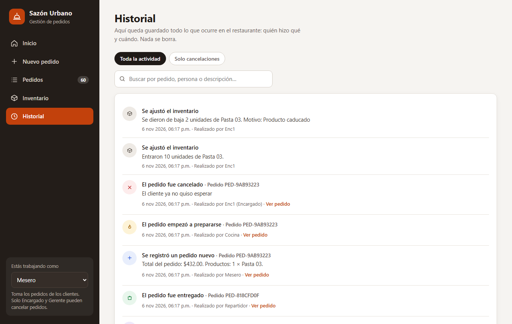

# 3. Implementación

## 3.1 Componentes obligatorios con evidencia

| Componente exigido | Dónde está | Evidencia verificada |
|---|---|---|
| **DDD** | `src/domain/` (agregados, Value Objects, eventos), `src/application/` (casos de uso y puertos), `src/infrastructure/` (adaptadores) | §2.1; 91 pruebas aprobadas; capas verificadas por imports |
| **Specification** | `src/domain/specifications.py:16-191` con operadores `&`, `\|`, `~`, explicación de resultados y motivos de falla | 11 pruebas en `tests/unit/test_specifications.py`; 120 casos del paquete ejecutados (56 CUMPLE, 64 NO CUMPLE) |
| **State Machine** | `src/domain/maquina_estados.py:5-46` | 31 pruebas en `tests/unit/test_dominio.py` (6 transiciones válidas y 7 inválidas parametrizadas); 20 transiciones del paquete (11 OK, 9 RECHAZADO); en vivo: 409 al saltar de *Registrado* a *Entregado* |
| **API REST** | `src/api/rutas.py:32-128` (15 operaciones) | 13 pruebas de integración con `TestClient`; ejecución real con `uvicorn` (Anexo C.8) |

### Reglas de ejemplo ejecutadas en vivo

La evaluación de las Specifications de un pedido real (`GET /pedidos/PED-818CFD0F/evaluacion`) devolvió:

```json
{"puede_procesarse": true, "beneficio_referencia": false,
 "motivos_beneficio_referencia": ["el cliente no es preferente", "el total es menor a 1500.00 MXN"]}
```

El pedido no recibe el beneficio porque el cliente `PED-C001` no es preferente y el total es 941.00 MXN, menor al mínimo de 1 500 MXN (`specifications.py:175`).

## 3.2 Persistencia

- **SQLAlchemy 2** con modelos declarativos en `src/infrastructure/modelos.py:11-70`: tablas `actores`, `platillos`, `pedidos`, `lineas_pedido` y `auditoria` (diagrama en §2.2).
- **Motor** (`src/infrastructure/db.py:11-17`): SQLite recibe `check_same_thread=False` y, si es en memoria, `StaticPool`; para otras bases se usa `pool_pre_ping=True`.
- **Tablas**: `crear_tablas` las crea al arrancar (`db.py:24-27`). No hay migraciones; el esquema se crea con `create_all`.
- **Datos iniciales**: con `SEED_ON_START=true`, `cargar_datos` carga los CSV de `data/` y es **idempotente** (si ya hay actores no recarga) (`src/infrastructure/seed.py:17-21`, `main.py:39-41`). Lee con `utf-8-sig` y rutas relativas a `DATA_DIR` (por defecto `data`).
- **Configuración** (`src/infrastructure/config.py`): `Configuracion.desde_entorno()` lee `DATABASE_URL`, `STOCK_CRITICO`, `SEED_ON_START` y `DATA_DIR`. `normalizar_url` convierte `postgres://` y `postgresql://` (formato de Render y Railway) en `postgresql+psycopg2://`.
- **Local**: `sqlite:///./sazon.db`. **Docker Compose y Render**: PostgreSQL.

## 3.3 Documentación OpenAPI y Swagger

FastAPI genera OpenAPI 3.1 (título «Sazón Urbano – API de pedidos», versión 1.0.0). Swagger UI queda activo en `/docs` y la especificación en `/openapi.json`; no hay configuración que los desactive, por lo que también estarán activos en producción (`main.py:42`). Las operaciones se organizan en **seis etiquetas**: *Sistema* (1 operación), *Pedidos* (5), *Estados* (4), *Inventario* (2), *Trazabilidad* (2) y *Reportes* (1), según `docs/api/openapi.json`. Cada operación indica su historia de usuario en el resumen y declara los errores 403, 404, 409 y 422 con el esquema `ErrorOut` (`rutas.py:20-25`).

La especificación se exporta sin base de datos con `python scripts/exportar_openapi.py`, que construye la aplicación con almacenamiento en memoria (`scripts/exportar_openapi.py:13-16`). El listado completo de operaciones y esquemas está en el **Anexo B**.

{ .captura }

Traducción de errores de negocio a HTTP (`src/api/errores.py:11-19`):

| Error de dominio | Código HTTP | Código en el cuerpo |
|---|---|---|
| `DatosInvalidos` y validación de Pydantic | 422 | `DATOS_INVALIDOS` |
| `ReglaNoCumplida`, `TransicionInvalida`, `ProductoNoDisponible`, `StockInsuficiente` | 409 | `REGLA_NO_CUMPLIDA`, `TRANSICION_INVALIDA`, `PRODUCTO_NO_DISPONIBLE`, `STOCK_INSUFICIENTE` |
| `AccesoDenegado` | 403 | `ACCESO_DENEGADO` |
| `NoEncontrado` | 404 | `NO_ENCONTRADO` |
| Error inesperado | 500 | `ERROR_INTERNO` (mensaje genérico) |

## 3.4 Casos de uso principales, ejecutados en vivo

Se arrancó el servidor real con `uvicorn` sobre una base SQLite nueva con `SEED_ON_START=true` y se ejecutó un guion con `httpx` (Anexo C.8). Resultados verificados:

| Caso de uso | Solicitud | Resultado observado |
|---|---|---|
| Registrar pedido | `POST /pedidos` (2 × PED-P001, 1 × PED-P002) | 201, `Registrado`, total **941.00** |
| Avanzar estados | `/preparacion`, `/listo`, `/entrega` | 200 con `En preparación`, `Listo`, `Entregado` |
| Descontar inventario | Stock de PED-P001 antes y después de entregar | **13 → 11** (2 vendidas) |
| Saltar estado | Entregar un pedido *Registrado* | 409 «No es posible entregar un pedido que está «Registrado».» |
| Repetir acción | Iniciar preparación dos veces | 409 «El pedido ya está «En preparación».» |
| Cancelar sin autoridad | Rol `Mesero` | 403 «Solo el Encargado o el Gerente pueden autorizar la cancelación de un pedido.» |
| Cancelar sin motivo | Rol `Encargado` y motivo vacío | 422 «Para cancelar un pedido debes indicar el motivo.» |
| Cancelar con autoridad | Rol `Encargado` y motivo | 200, `Cancelado` |
| Cancelar dos veces / entregado | — | 409 «El pedido ya fue cancelado anteriormente.» y «Un pedido entregado ya no se puede cancelar.» |
| Cliente inactivo | `PED-C007` | 409 «El cliente no está activo y no puede realizar pedidos.» |
| Stock insuficiente | 9 999 unidades | 409 «Solo quedan 11 unidades de «Hamburguesa 01».» |
| Platillo inexistente | `NO-EXISTE` | 404 «El platillo «NO-EXISTE» no existe.» |
| Datos inválidos | Cantidad 0; pedido sin productos | 422 con mensajes claros |
| Inventario | Entrada de 10; merma sin motivo; merma de 2 con motivo | stock 29; 422; stock 27 |
| Bitácora | `GET /auditoria?pedido_id=...` | 4 registros: REGISTRAR_PEDIDO, INICIAR_PREPARACION, MARCAR_LISTO, ENTREGAR_PEDIDO |
| Cancelaciones | `GET /cancelaciones` | 1 registro con rol `Encargado` y su motivo |
| Resumen | `GET /reportes/resumen` | 1 entregado por **941.00 MXN**; 60 registrados; 1 cancelado; PED-P001 con 2 unidades vendidas y stock 11 |

## 3.5 Interfaz web para el personal

`src/web/` contiene una aplicación de una sola página (`index.html`, `app.js`, `estilos.css`) sin dependencias ni compilación, servida por la propia API (`main.py:45-49`). Está pensada para personas sin conocimientos técnicos: usa nombres en lugar de claves, fechas y pesos legibles y explica los errores. El selector «Estás trabajando como» define el rol (Mesero, Cocina, Encargado o Gerente); solo Encargado y Gerente pueden cancelar (`app.js`: `ROLES_QUE_CANCELAN`).

| Sección | Qué permite hacer |
|---|---|
| Inicio | Resumen en texto de ventas, pedidos por etapa y productos que requieren atención |
| Nuevo pedido | Elegir cliente, agregar productos al carrito, indicaciones y confirmar |
| Pedidos | Buscar, filtrar por estado, avanzar al siguiente paso, ver detalle y cancelar |
| Inventario | Ver existencias, registrar entradas y dar de baja productos (merma) |
| Historial | Bitácora de lo ocurrido y consulta de cancelaciones |

{ .captura }

{ .captura }

{ .captura }

{ .captura }

{ .captura }

*Las capturas se tomaron con Edge en modo headless contra el servidor real, sobre la base de datos de la ejecución en vivo (1 pedido entregado, 1 cancelado).*

*Trazabilidad con la rúbrica:* §3.1 cubre «Implementación 1» (DDD, Specification, State Machine y API REST); §3.2 a §3.4 cubren «Implementación 2» (persistencia, OpenAPI y funcionamiento de los casos de uso principales).

# 4. Calidad y pruebas

## 4.1 Suite de pruebas y cobertura

Comando ejecutado: `pytest -v --cov=src --cov-report=term-missing --cov-fail-under=80`, con Python 3.15.2, pytest 9.2.0 y pytest-cov 7.1.0. La suite usa SQLite en memoria; con `TEST_DATABASE_URL` puede apuntar a PostgreSQL (`tests/conftest.py:10`).

**Resultado: 91 pruebas aprobadas, 0 fallidas. Cobertura total 97,29 % (1 144 sentencias, 31 sin cubrir). El mínimo exigido (80 %) se cumple.**

| Archivo de pruebas | Tipo | Pruebas | Qué verifica |
|---|---|---|---|
| `tests/unit/test_dominio.py` | Unitaria | 31 | `Dinero`, agregados `Pedido` y `Platillo`, transiciones válidas e inválidas, eventos |
| `tests/unit/test_specifications.py` | Unitaria | 11 | Hojas, composiciones `&` `\|` `~`, límite de 1 500 MXN, explicación de reglas |
| `tests/unit/test_casos_uso.py` | Unitaria | 23 | Casos de uso con memoria: registro y sus rechazos, RBAC, cancelación, inventario, bitácora, aislamiento de fallas |
| `tests/unit/test_config.py` | Unitaria | 2 | Variables de entorno y normalización de URL |
| `tests/unit/test_paquete_csv.py` | Unitaria | 5 | Carga del paquete, 120 casos, 20 transiciones |
| `tests/integration/test_api.py` | Integración | 13 | API completa con base de datos: flujos, errores, interfaz web |
| `tests/integration/test_persistencia.py` | Integración | 6 | Repositorios SQL, UoW con rollback, idempotencia de la carga |
| **Total** | | **91** | 72 unitarias y 19 de integración |

Cobertura por módulo (salida de `pytest --cov`; solo se detallan los que no están al 100 %):

| Módulo | Cobertura | Líneas sin cubrir | Explicación |
|---|---|---|---|
| `src/api/main.py` | 75 % | 31-41 | Rama de arranque con base de datos real y carga inicial; las pruebas inyectan `uow_factory`. **Sí se ejercitó en la ejecución en vivo** (Anexo C.8), pero no en las pruebas |
| `src/application/puertos.py` | 0 % | 2-31 | Solo declara `Protocol` (sin comportamiento) |
| `src/application/handlers.py` | 94 % | 39, 51, 71 | Ramas defensivas |
| `src/domain/specifications.py` | 99 % | 80 | `explicar` de `EspecificacionO` |
| `src/infrastructure/db.py` | 86 % | 17, 25-27 | Rama de bases no SQLite y `crear_tablas` (usado en la ejecución en vivo) |
| `src/infrastructure/evidencias.py` | 89 % | 30, 59, 88-93 | Ramas de error y escritura de CSV (usadas por el script) |
| `src/infrastructure/repositorios_sql.py` | 99 % | 171 | `rollback` explícito |

Las pruebas relevantes para la defensa incluyen `test_descuento_fallido_no_revierte_el_pedido_y_deja_incidencia` (compensación de ADR-002), `test_despachador_aisla_las_fallas_de_los_manejadores`, `test_cancelar_requiere_encargado_o_gerente`, `test_beneficio_en_el_limite_de_1500` (1 499.99, 1 500 y 1 500.01), `test_sin_commit_todo_se_revierte` y `test_un_error_inesperado_no_expone_detalles_tecnicos`.

**Análisis estático:** `ruff check src tests scripts` → «All checks passed!» (Anexo C.3; reglas E4, E7, E9 y F, línea máxima de 110, en `pyproject.toml`).

**Advertencia de la ejecución:** `StarletteDeprecationWarning` indica que `starlette.testclient` con `httpx` está obsoleto (se sugiere `httpx2`). No afecta los resultados.

## 4.2 Resultados de los scripts del paquete del PIA

`python scripts/ejecutar_casos.py` ejecutó los casos con las Specifications reales y escribió dos CSV en `evidencias/`:

```text
Casos: 120 {'CUMPLE': 56, 'NO CUMPLE': 64}
Transiciones: 20 {'OK': 11, 'RECHAZADO': 9}
```

**120 casos** (`evidencias/casos_prueba_resultados.csv`):

| Tipo de prueba | Casos | CUMPLE | NO CUMPLE | Specification |
|---|---|---|---|---|
| `validar_operacion` (`PED-T001` a `PED-T060`) | 60 | 47 | 13 | `puede_procesarse` |
| `evaluar_beneficio` (`PED-B001` a `PED-B060`) | 60 | 9 | 51 | `beneficio_referencia` |
| **Total** | **120** | **56** | **64** | |

Motivos de los 13 rechazos de `validar_operacion`: pedido no autorizado (6), cliente inactivo (4), pedido sin productos (2) y cliente inactivo más no autorizado (1). Los 9 casos de beneficio que cumplen corresponden a los pedidos `PED-O008`, `O023`, `O028`, `O033`, `O038`, `O043`, `O048`, `O053` y `O058` (cliente preferente, total de al menos 1 500 MXN y sin promoción). En los 51 que no cumplen, la falta de condición de cliente preferente aparece en 48, el total menor a 1 500 MXN en 8 y la promoción activa en 6; algunos casos fallan por más de un motivo.

**20 transiciones** (`evidencias/transiciones_prueba_resultados.csv`):

| Acción sugerida | Casos | Resultado | Estado final observado |
|---|---|---|---|
| `aprobar` | 4 | 4 OK | En preparación |
| `completar` | 4 | 3 OK, 1 RECHAZADO (`PED-S016`: pedido no autorizado) | Entregado (3) o Registrado (1) |
| `cancelar` | 4 | 4 OK | Cancelado |
| `repetir_aprobacion` | 4 | 4 RECHAZADO (2 `TransicionInvalida` y 2 `ReglaNoCumplida`) | En preparación (2) o Registrado (2) |
| `saltar_estado` | 4 | 4 RECHAZADO (`TransicionInvalida`) | Registrado |

Excepciones observadas: `TransicionInvalida` 6, `ReglaNoCumplida` 3 y ninguna en los 11 casos exitosos. Cada fila registra la secuencia de eventos (por ejemplo `PedidoEnPreparacion > PedidoListo > PedidoEntregado`). La suite verifica estos resultados en `tests/unit/test_paquete_csv.py`.

## 4.3 Pipeline CI/CD (`.github/workflows/ci.yml`)

- **Disparador:** `on: [push, pull_request]`.
- **Job `calidad-y-pruebas`** (`ubuntu-latest`): `actions/checkout@v4`; `actions/setup-python@v5` con Python **3.11** y caché de pip; `pip install -r requirements.txt`; `ruff check src tests scripts`; `pytest -v --cov=src --cov-report=term-missing --cov-report=xml --cov-fail-under=80` (falla si la cobertura baja de 80 %); `python scripts/ejecutar_casos.py`; `python scripts/exportar_openapi.py`; y `actions/upload-artifact@v4` con `coverage.xml`, `evidencias/` y `docs/api/openapi.json`.
- **Job `docker-compose`** (necesita al anterior): `docker compose --profile tests run --rm tests` (pruebas contra PostgreSQL) y, siempre, `docker compose down -v`.
- **Alcance:** es un flujo de **integración continua**. No hay un paso de despliegue en el workflow: el despliegue dependería de conectar Render con el repositorio (**PENDIENTE**).

> **Estado:** el pipeline se ejecutó dos veces en GitHub Actions (consulta a la API pública de GitHub, Anexo C.7). La [primera ejecución](https://github.com/Tera2332/PIA_Unidad6_CLN/actions/runs/42314619829) (commit `9731206`) **falló** en el paso «Análisis estático (ruff)» y el job `docker-compose` se omitió. La [segunda](https://github.com/Tera2332/PIA_Unidad6_CLN/actions/runs/42320505624) (commit `87cd8e7`) terminó con éxito. No se revisó el registro de la ejecución fallida, por lo que su causa exacta queda **PENDIENTE DE EVIDENCIA** (B-07). Las pruebas de este reporte se ejecutaron en local con Python 3.15.2, mientras que el pipeline y el Dockerfile usan Python 3.11 (B-15).

## 4.4 Docker Compose para DB, App y Tests

`docker-compose.yml` define:

| Servicio | Imagen o construcción | Puntos clave |
|---|---|---|
| `db` | `postgres:16-alpine` | Credenciales por variables con valores por defecto; volumen `pgdata`; `init-db.sql` crea `sazon_test`; *healthcheck* con `pg_isready` (5 s, 12 reintentos) |
| `app` | `build: .` | `DATABASE_URL` hacia `db`, `SEED_ON_START` y `STOCK_CRITICO`; puerto `8000:8000`; arranca cuando `db` está saludable |
| `tests` | `build: .` con perfil `tests` | `TEST_DATABASE_URL` hacia `sazon_test`; comando `pytest --cov=src --cov-report=term-missing --cov-fail-under=80`; arranca cuando `db` está saludable |

Uso: `docker compose up --build` (base de datos y API) y `docker compose --profile tests run --rm tests` (pruebas contra PostgreSQL).

> **PENDIENTE DE EVIDENCIA.** Docker no está instalado en la máquina donde se preparó este reporte, por lo que no se pudo ejecutar `docker compose config` ni `docker compose up --build`. El error textual registrado fue: `docker : El término 'docker' no se reconoce como nombre de un cmdlet, función, archivo de script o programa ejecutable.` El archivo se revisó de forma estática. Antes de la defensa hay que ejecutar ambos comandos en una máquina con Docker y guardar la salida (B-08).

## 4.5 Variables de entorno y 12-Factor App

La configuración se separa del código con variables de entorno (factor III de 12-Factor App). `.env.example` incluye solo marcadores, sin secretos reales (`POSTGRES_PASSWORD=cambia-esta-contrasena`), y `.gitignore` y `.dockerignore` excluyen `.env`, `*.db` y `.venv`.

| Variable | Valor por defecto | Quién la usa |
|---|---|---|
| `DATABASE_URL` | `sqlite:///./sazon.db` | `config.py:14-16`; Compose y Render la fijan hacia PostgreSQL |
| `SEED_ON_START` | `false` en el código; `true` en `.env.example`, Compose y Render | Carga los CSV al arrancar |
| `STOCK_CRITICO` | `5` | Umbral de alerta de stock |
| `DATA_DIR` | `data` | Carpeta de los CSV |
| `POSTGRES_USER`, `POSTGRES_PASSWORD`, `POSTGRES_DB` | `sazon` en `docker-compose.yml` | Servicio `db` |
| `TEST_DATABASE_URL` | SQLite en memoria | `tests/conftest.py:10` |
| `PORT` | `8000` | El `CMD` del Dockerfile lo respeta para Render |

Otros factores: procesos sin estado (el estado vive en la base de datos), registros hacia salida estándar (uvicorn) y construcción reproducible con Docker.

*Trazabilidad con la rúbrica:* §4.1 a §4.5 cubren los seis puntos de «Calidad + defensa» salvo la demostración y defensa (Anexo D.2). Los puntos no verificables están en la sección 7.

# 5. Producción y despliegue

## 5.1 Dockerfile

`Dockerfile` (13 líneas): imagen `python:3.11-slim`; `PYTHONDONTWRITEBYTECODE=1` y `PYTHONUNBUFFERED=1`; copia `requirements.txt` antes del código para aprovechar la caché de capas; expone el 8000; y arranca con:

```text
CMD ["sh", "-c", "uvicorn src.api.main:crear_app --factory --host 0.0.0.0 --port ${PORT:-8000}"]
```

`${PORT:-8000}` respeta el puerto que asigna Render y usa 8000 en local (`Dockerfile:12-13`).

## 5.2 Render y plataformas equivalentes

`render.yaml` es un *Blueprint* que declara un servicio web con `runtime: docker` en plan gratuito, `healthCheckPath: /salud`, `DATABASE_URL` tomada de la base `sazon-db` (`fromDatabase`), `SEED_ON_START=true` y `STOCK_CRITICO=5`, y una base PostgreSQL gratuita (`databaseName: sazon`). El `normalizar_url` del código adapta la cadena de conexión que entrega Render. El endpoint `/salud` devuelve `{"estado": "ok"}` y se probó en vivo (200).

**Pasos de despliegue previstos:** el repositorio ya está en GitHub; en Render, *New → Blueprint* y elegir el repositorio; esperar la construcción; y abrir `<URL DEL DESPLIEGUE>/docs` para la demostración con Swagger UI. **Viabilidad:** el despliegue es técnicamente posible con lo que hay en el repositorio (`Dockerfile`, `render.yaml`, `psycopg2-binary` en `requirements.txt`, `normalizar_url` y `${PORT:-8000}`), pero no se ha probado.

> **PENDIENTE DE EVIDENCIA.** No hay URL ni captura de un despliegue activo. El plan gratuito de Render duerme el servicio tras un periodo sin tráfico, por lo que conviene abrirlo antes de la presentación (B-09).

## 5.3 Ejecución local en otra PC con `iniciar.bat`

El proyecto incluye un lanzador `iniciar.bat` para equipos Windows sin Docker:

1. **Requisito:** Python 3.11 o superior instalado con «Add python.exe to PATH» (verificar con `python --version`).
2. **Extraer** el ZIP en una ruta corta, sin acentos ni espacios (por ejemplo `C:\pia`). `iniciar.bat`, `requirements.txt`, `data\` y `src\` deben quedar en la misma carpeta.
3. **Doble clic en `iniciar.bat`.** La primera vez crea `.venv`, instala las dependencias y abre el navegador en `http://localhost:8000`. Las siguientes veces arranca en segundos. La ventana de comandos es el servidor: cerrarla o pulsar Ctrl+C lo detiene.
4. **Verificar los datos:** `Invoke-RestMethod http://localhost:8000/reportes/resumen` debe devolver los números del resumen. Si la interfaz sale vacía, la carpeta `data\` no llegó o quedó anidada.
5. **Acceso desde otro dispositivo en la red:** el servidor escucha en `0.0.0.0:8000`; se entra con `http://<IP-DE-LA-PC>:8000`. La primera vez Windows pregunta por el firewall: permitir en redes **privadas**.
6. **Datos locales:** cada PC tiene su propio `sazon.db`; para compartir datos hay que usar PostgreSQL (Compose o `DATABASE_URL`).

Verificación realizada: se copió el proyecto **sin `.venv` ni `sazon.db`** a una carpeta temporal y se ejecutó `iniciar.bat`. Creó el entorno, instaló las dependencias, arrancó, cargó los 40 clientes y 20 platillos y respondió `/reportes/resumen` con los datos. En esa verificación se corrigió un error del lanzador: `%PY%` se expandía antes de asignarse dentro de un bloque `if (...)`. Se reestructuró con `goto`, y el script también reinstala si encuentra un `.venv` incompleto.

## 5.4 Placeholders para entrega

| Dato | Valor |
|---|---|
| URL del repositorio GitHub | https://github.com/Tera2332/PIA_Unidad6_CLN |
| URL del despliegue | `<URL DEL DESPLIEGUE>` |
| Swagger UI en producción | `<URL DEL DESPLIEGUE>/docs` |

# 6. Matriz de trazabilidad

La matriz enlaza cada regla con su historia, el artefacto de análisis, el componente de dominio, el caso de uso, el endpoint y la prueba que la verifica. Las referencias de análisis apuntan a las secciones de este reporte (Gherkin en §1.2 y BPMN en §1.3; reglas `RN-xx` en §1.1). Las pruebas se citan como `archivo::prueba`.

| Regla o requisito | Historia | Análisis | Dominio (`archivo:línea`) | Caso de uso (`casos_uso.py`) | Endpoint | Prueba |
|---|---|---|---|---|---|---|
| RN-02, RN-04 · Registrar un pedido con total | US-08 | Gherkin US-08; BPMN: «Registrar pedido» | `pedido.py:50-71`, `valores.py:12-39` | `RegistrarPedido` (49-79) | `POST /pedidos` | `test_casos_uso::test_registrar_pedido_guarda_audita_y_calcula_total`; `test_api::test_registrar_pedido_devuelve_201_y_total` |
| RN-01 · Cliente activo | US-08 | Gherkin US-08 (cliente inactivo) | `specifications.py:101-106` | `RegistrarPedido` (60-61) | `POST /pedidos` | `test_casos_uso::test_registrar_pedido_rechazos_con_mensaje_claro[C3-...]`; `test_api::test_reglas_de_registro_con_mensajes_claros` |
| RN-02 · Cantidades y pedido sin líneas | US-08 | Gherkin US-08 (datos inválidos) | `pedido.py:53-60` | `RegistrarPedido` | `POST /pedidos` | `test_dominio::test_registrar_rechaza_cantidades_invalidas[0, -1, 1.5, True]`; `test_registrar_rechaza_pedido_sin_productos` |
| Modificaciones por línea | US-09 † | Gherkin US-09 | `pedido.py:18-26,63-67` | `RegistrarPedido` (70-72) | `POST /pedidos` | `test_casos_uso::test_registrar_guarda_modificaciones_en_la_bitacora` |
| RN-03 · Producto agotado o stock insuficiente | US-05 | Gherkin US-05 | `catalogo.py:6,19-31` | `RegistrarPedido` (69) | `POST /pedidos` | `test_dominio::test_platillo_agotado_o_deshabilitado_usa_el_mensaje_de_la_historia_us05`; `test_platillo_stock_insuficiente` |
| Listar pedidos por estado | US-01 | Gherkin US-01 | `valores.py:42-47` | `ListarPedidos` (167-170) | `GET /pedidos` | `test_api::test_consultas_filtros_y_evaluacion`; `test_casos_uso::test_parsear_estado` |
| Consultar un pedido | US-07 | Gherkin US-07 | `pedido.py:29-42` | `ConsultarPedido` (161-164) | `GET /pedidos/{id}` | `test_api::test_consultas_filtros_y_evaluacion` |
| RN-05 · Máquina de estados | US-06, US-12 | BPMN completo; diagrama de estados | `maquina_estados.py:5-46`, `pedido.py:80-99` | `_CambioDeEstado` (82-96) | `POST /pedidos/{id}/preparacion`, `/listo`, `/entrega` | `test_dominio::test_transiciones_validas[6]`, `test_transiciones_invalidas_con_mensaje_para_el_cliente[7]`; `test_api::test_transiciones_invalidas_responden_409` |
| RN-06 · `puede_procesarse` | US-06 | Gherkin US-06 (pedido no procesable) | `specifications.py:178-179` | `IniciarPreparacion` (99-107) | `POST /pedidos/{id}/preparacion` | `test_specifications::test_puede_procesarse_es_un_and_de_tres_reglas`; `test_api::test_iniciar_preparacion_aplica_las_specifications`; 60 casos `validar_operacion` |
| RN-11 · `beneficio_referencia` | (paquete PIA) | Casos `PED-Bxxx` | `specifications.py:175,182-183` | `EvaluarPedido` (173-186) | `GET /pedidos/{id}/evaluacion` | `test_specifications::test_beneficio_en_el_limite_de_1500[3]`, `test_beneficio_usa_not_promocion_y_and_preferente`; 60 casos `evaluar_beneficio` |
| RN-07 · Cancelación con rol y motivo | US-10 | Gherkin US-10; BPMN: carril Encargado | `specifications.py:186-187`, `pedido.py:93-99` | `CancelarPedido` (118-131); `seguridad.py:6-13` | `POST /pedidos/{id}/cancelacion` | `test_casos_uso::test_cancelar_requiere_encargado_o_gerente`, `test_cancelar_exige_motivo_y_no_aplica_a_entregados`; `test_api::test_cancelacion_solo_para_encargado_o_gerente`; 4 transiciones `cancelar` |
| Consultar cancelaciones | US-11 | Gherkin US-11 | `auditoria.py:6-14` | `ConsultarCancelaciones` (206-209) | `GET /cancelaciones` | `test_casos_uso::test_consultas`; `test_api::test_cancelacion_solo_para_encargado_o_gerente` |
| RN-08, NB-07 · Entrega y descuento de inventario | US-12 | Gherkin US-12; BPMN: «Descontar inventario» | `pedido.py:88-91`, `eventos.py:37-41`, `catalogo.py:33-45` | `EntregarPedido`; `DescuentoDeInventario` (`handlers.py:57-86`) | `POST /pedidos/{id}/entrega` | `test_casos_uso::test_flujo_completo_descuenta_inventario_y_deja_bitacora`, `test_descuento_fallido_no_revierte_el_pedido_y_deja_incidencia`; `test_api::test_flujo_completo_descuenta_inventario_y_deja_bitacora` |
| RN-09 · Stock crítico | US-04 † | Gherkin US-04 | `catalogo.py:23-25,41-42`, `eventos.py:54-58` | `DescuentoDeInventario` | `GET /platillos` (campo `stock_critico`) | `test_casos_uso::test_alerta_de_stock_critico_queda_en_la_bitacora`; `test_dominio::test_descontar_alerta_cuando_el_stock_llega_al_critico` |
| RN-10 · Entradas y mermas | US-03 | Gherkin US-03 | `catalogo.py:47-59` | `AjustarInventario` (134-152) | `POST /inventario/ajustes` | `test_dominio::test_entrada_y_merma`; `test_casos_uso::test_ajustes_de_inventario_y_bitacora`; `test_api::test_ajustes_de_inventario_y_reporte` |
| Disponibilidad de platillos | US-02 | Gherkin US-02 | `catalogo.py:19-25` | `ConsultarDisponibilidad` (189-195) | `GET /platillos` | `test_api::test_consultas_filtros_y_evaluacion` |
| RN-12, NB-04/05 · Bitácora de solo anexado | US-13 | Gherkin US-13 | `auditoria.py:6-14` | `RegistroDeAuditoria` (`handlers.py:42-54`); `ConsultarAuditoria` (212-215) | `GET /auditoria` | `test_persistencia::test_auditoria_solo_agrega_y_filtra`; `test_casos_uso::test_registrar_pedido_guarda_audita_y_calcula_total` |
| Reporte de ventas contra inventario | US-14, US-15 | Gherkin US-14 y US-15 | `valores.py:12-39` | `ReporteResumen` (218-243) | `GET /reportes/resumen` | `test_casos_uso::test_reporte_resumen_compara_ventas_con_inventario`; `test_api::test_ajustes_de_inventario_y_reporte` |
| ADR-001 · Una transacción por agregado | — | ADR-001 | `base.py:8-22` | Todos los comandos (`with uow_factory()`) | — | `test_persistencia::test_sin_commit_todo_se_revierte`; `test_casos_uso::test_unit_of_work_restaura_el_estado_si_hay_error_o_falta_commit` |
| ADR-002 · Consistencia eventual | — | ADR-002 | `eventos.py:1-68` | `_CasoDeUso._publicar` (43-45); `despachador.py:7-27` | — | `test_casos_uso::test_despachador_aisla_las_fallas_de_los_manejadores` |
| RN-13, ADR-009 · Errores claros | US-05, US-10 | ADR-009 | `errores.py:4-33` | — | Todos | `test_api::test_validacion_de_datos_responde_en_espanol`, `test_un_error_inesperado_no_expone_detalles_tecnicos` |
| Persistencia y configuración | — | ADR-006 | `config.py:6-30`, `modelos.py`, `repositorios_sql.py` | `seed.py:17-52` | — | `test_persistencia::test_carga_del_paquete_es_idempotente`, `test_guardar_y_recuperar_un_pedido_conserva_todo`; `test_config::test_normaliza_las_urls_de_postgres` |
| Interfaz web | — | §3.5 | — | — | `GET /`, `GET /clientes`, `/interfaz/*` | `test_api::test_interfaz_web_se_sirve_en_la_raiz`, `test_listar_clientes_para_la_interfaz` |
| Paquete de datos del PIA | — | §1.5 y §4.2 | `specifications.py` | `evidencias.py:21-84` | — | `test_paquete_csv::test_los_120_casos_producen_resultado_y_evidencia`, `test_las_20_transiciones_se_ejecutan_con_el_resultado_esperado` |

Las pruebas marcadas con `[n]` son parametrizadas (por ejemplo `[6]` indica seis variantes). † indica historia con asignación inferida.

*Trazabilidad con la rúbrica:* esta matriz atiende la trazabilidad obligatoria del PDF («análisis, arquitectura, código y pruebas»). Su limitación es que las historias y reglas del análisis se reconstruyeron en este reporte, por lo que debe validarse que coincidan con el BRD y las historias originales de las Unidades 2 y 3 (B-01 y B-02).

# 7. Brechas detectadas

Requisitos de la rúbrica que el proyecto **no cumple hoy** o que no se pudieron verificar, ordenados por impacto. No se maquilló ninguno.

| ID | Brecha | Criterio afectado | Impacto | Acción para cerrarla |
|---|---|---|---|---|
| **B‑06** | **Historial de commits mínimo y de un solo autor.** El repositorio de GitHub tiene 2 commits (`PROYECTO` y `Reemplazado`), ambos de la cuenta `Tera2332`. La carpeta de trabajo evaluada no es un repositorio git (`git log --oneline` falla). Además, el contenido de GitHub **no incluye** `src/web/` (interfaz), `iniciar.bat`, `docs/` ni `docs/api/openapi.json`, que sí existen en la carpeta local | Requisito de arquitectura 12; entregable «Repositorio GitHub» | **Alto**: el PDF indica que no se acepta un programa aislado sin historial del equipo | Clonar el repositorio, copiar encima la versión actual, y subir commits separados por integrante y por avance antes de la entrega |
| **B‑07** | El pipeline CI/CD se ejecutó 2 veces: la primera **falló** en `ruff` y la segunda pasó. Solo se verificó con la API de GitHub, sin captura del equipo | Calidad 2 | Medio | Guardar la captura de la ejecución exitosa y volver a verificarla tras subir la versión completa |
| **B‑08** | Docker Compose no se pudo validar: Docker no está instalado en la máquina de verificación. La suite tampoco se ejecutó contra PostgreSQL | Calidad 3 | Alto | Ejecutar `docker compose config`, `docker compose up --build` y `docker compose --profile tests run --rm tests` en una máquina con Docker y guardar la salida |
| **B‑09** | No hay despliegue activo ni URL; Swagger UI en producción sin verificar | Calidad 4 | Alto | Desplegar en Render con `render.yaml`, probar `/salud` y `/docs`, y completar las URLs |
| **B‑10** | Falta la presentación de apoyo para la defensa | Entregables | Medio | Elaborarla con los Anexos C y D y las capturas |
| **B‑01** | No existe `docs/BRD.md`; el BRD está solo en este reporte y fue reconstruido del código | Análisis 1 (1,50 pts) | Medio a alto | Cotejar §1.1 con el BRD de las Unidades 2 y 3 y guardarlo en `docs/BRD.md` |
| **B‑02** | Las historias de usuario y el Gherkin no están como archivo del repositorio; los textos originales no están a la vista. Las asignaciones de US-04 y US-09 están inferidas, y US-14 y US-15 comparten un mismo endpoint | Análisis 2 (4,75 pts) | Medio a alto | Cotejar con las originales y guardarlas en `docs/` (por ejemplo `docs/historias-usuario.md` y archivos `.feature`) |
| **B‑03** | No hay un BPMN 2.0 como archivo; solo el diagrama Mermaid de §1.3 | Análisis 2 | Medio | Modelarlo en Camunda Modeler o bpmn.io y guardarlo en `docs/` |
| **B‑04** | Los diagramas UML y de arquitectura no existen como archivos en `docs/architecture/` | Arquitectura 2 (1,25 pts) y requisito 7 | Medio | Guardar los diagramas de §2.2 en `docs/architecture/` |
| **B‑05** | Los ADR solo existen como comentarios en el código (ADR-002 a ADR-005); no hay archivos | Arquitectura 5 (1,25 pts) | Medio | Crear `docs/architecture/adr/ADR-001.md` y siguientes con el contenido de §2.5, confirmadas por el equipo |
| **B‑11** | No hay autenticación: el rol llega en el cuerpo de la solicitud y el usuario en el parámetro `usuario`. El RBAC no es un control de seguridad real | Calidad / defensa técnica | Medio | Documentarlo como limitación de alcance (ADR-004) o incorporar autenticación con tokens |
| **B‑12** | Riesgos de consistencia: el stock se valida al registrar pero se descuenta al entregar (dos pedidos pueden aceptarse con el mismo stock), y un cierre del proceso entre el commit y el despacho pierde el evento (no hay *outbox*) | Defensa técnica | Bajo a medio | Documentarlo como consecuencia de ADR-002; opcionalmente reservar stock al registrar |
| **B‑13** | La Specification `puede_venderse` está definida y probada, pero no está conectada a ningún caso de uso; la validación de existencias usa `Platillo.verificar_disponible` | Coherencia diseño-código | Bajo | Conectarla en `RegistrarPedido` o retirarla del diseño para evitar preguntas en la defensa |
| **B‑14** | El README remite a `docs/` para los pasos de despliegue, y esa carpeta no los contiene; faltan las URLs del repositorio y del despliegue | Requisito 9 | Bajo | Completar el README con los pasos y las URLs |
| **B‑15** | Entorno de verificación distinto del de CI y Docker: las pruebas se ejecutaron con Python 3.15.2, mientras que el workflow y el Dockerfile usan 3.11. Además, `tests/` no estaba en la carpeta de trabajo y se restauró desde un ZIP previo, con dos pruebas reescritas | Calidad 1 | Bajo a medio | Confirmar que la ejecución exitosa de GitHub Actions usa Python 3.11 y registrar la restauración de `tests/` en el historial de git |
| **B‑16** | Cobertura no total: `puertos.py` 0 % (solo `Protocol`) y la rama de arranque de `main.py` (31-41) sin prueba automatizada; Swagger UI carga sus recursos desde un CDN, por lo que `/docs` requiere internet | Calidad 1 | Bajo | Agregar una prueba de arranque con `SEED_ON_START` y una base temporal; si se requiere operación sin internet, servir los recursos de Swagger localmente |

*Trazabilidad con la rúbrica:* los renglones de la tabla se corresponden con los criterios «Análisis 1 y 2», «Arquitectura 2, 5, 6, 7, 9, 12», «Calidad 2, 3 y 4» y con los entregables listados al final del PDF.

# 8. Conclusiones

1. **El dominio quedó aislado y verificable.** `domain` solo importa de sí mismo y `application` solo de `application` y `domain` (§2.1). Por eso 72 de las 91 pruebas son unitarias, no necesitan base de datos y cubren el dominio al 99-100 %.
2. **Specification y la máquina de estados concentran las reglas.** Con ellas se explican los 120 casos y las 20 transiciones del paquete (56/64 y 11/9) y los mensajes de rechazo llegan sin cambios hasta la API (§4.2, §3.4). Esto simplifica la defensa: cada regla tiene un único lugar donde vive.
3. **La consistencia eventual funcionó y tiene costo conocido.** Entregar un pedido bajó el stock de 13 a 11 en otra transacción, y la prueba de fallo del descuento confirma que no se pierde el pedido (§3.4, ADR-002). A cambio se aceptan los riesgos de B-12, que deben presentarse como decisión consciente y no como defecto oculto.
4. **La bitácora de solo anexado da trazabilidad sencilla.** Cuatro registros reconstruyeron la vida de un pedido con usuario y fecha (§3.4) sin columnas de auditoría en cada tabla (ADR-005).
5. **La separación de configuración permitió ejecutar el mismo código en SQLite, en memoria y, por diseño, en PostgreSQL.** La misma fábrica `crear_app` sirvió para pruebas, para exportar OpenAPI y para producción (§2.3, ADR-006 y ADR-008).
6. **La calidad medida supera el mínimo, pero la evidencia de proceso es la parte débil.** La cobertura (97,29 %) y el análisis estático están en regla; lo que falta son los artefactos que se verifican fuera del código: repositorio con historial, pipeline ejecutado, Docker validado, despliegue y presentación (sección 7).

**Limitaciones conocidas:** sin autenticación real (B-11), sin migraciones de esquema (se usa `create_all`), sin pagos ni facturación (§1.1), datos locales por equipo cuando se usa SQLite y `/docs` dependiente de un CDN (B-16).

**Trabajo futuro, por prioridad:** (1) subir a GitHub la versión completa con commits por integrante; (2) ejecutar CI y Docker Compose y guardar las evidencias; (3) desplegar en Render; (4) convertir los anexos en archivos de `docs/` (BRD, historias, BPMN, ADRs, UML); (5) autenticación con tokens y reserva de stock al registrar; (6) migraciones con Alembic.

*Trazabilidad con la rúbrica:* las conclusiones se apoyan en las secciones 2, 3, 4 y 7; no introducen datos nuevos.

# Paquete de entrega

El PDF del PIA pide subir los entregables en la plataforma antes de agendar la defensa. Si la plataforma solicita un archivo comprimido, se incluye en ZIP o RAR y se coloca en el README la URL del repositorio y del sistema desplegado.

| Entregable | Estado | Ubicación |
|---|---|---|
| Reporte final PDF (este documento) | Listo | `docs/reporte/Reporte_Final_PIA.pdf` |
| Repositorio GitHub (código, docs, tests, CI/CD, Docker, README) | **Parcial** (B-06) | https://github.com/Tera2332/PIA_Unidad6_CLN |
| URL del despliegue funcional | **Pendiente** (B-09) | `<URL DEL DESPLIEGUE>` |
| Presentación de apoyo para la defensa | **Pendiente** (B-10) | `<ARCHIVO DE LA PRESENTACIÓN>` |
| Acceso al repositorio para el docente | Repositorio público (`private=False` según la API de GitHub) | Docente: Miguel Ángel Gómez Marroquín |

**Historial de commits (GitHub API, consultada el 6 de noviembre de 2026):**

```text
87cd8e7 Tera2332 Reemplazado
9731206 Tera2332 PROYECTO
```

En la carpeta local, `git log --oneline` devuelve «fatal: not a git repository».

**Fechas:** entrega de documentos y repositorio el **06 de noviembre de 2026**; presentación y defensa del **9 al 20 de noviembre de 2026**. El PDF indica que no se aceptan proyectos después de la fecha de entrega.

# Anexo A. Glosario de dominio

Extraído de `src/domain/` y de los encabezados de `data/*.csv`.

| Término | Definición | Fuente |
|---|---|---|
| **Pedido** | Solicitud de un cliente con una o más líneas y un estado. Es un Aggregate Root | `pedido.py:29` |
| **Línea de pedido** | Platillo, cantidad, precio unitario y modificaciones. Su subtotal es precio por cantidad | `pedido.py:18` |
| **Platillo** | Producto del menú con precio, existencias y habilitación. Es un Aggregate Root | `catalogo.py:9` |
| **Actor / Cliente** | Persona que pide; puede ser *preferente* o *inactivo* | `actor.py:5` |
| **Dinero** | Importe en MXN con dos decimales, no negativo e inmutable | `valores.py:12` |
| **Estado del pedido** | Registrado, En preparación, Listo, Entregado o Cancelado | `valores.py:42` |
| **Máquina de estados** | Regla única de las transiciones válidas del pedido | `maquina_estados.py:26` |
| **Specification (Especificación)** | Regla de negocio combinable con Y, O y NO que explica su resultado | `specifications.py:16` |
| **Contexto** | Datos (pedido, cliente, catálogo, rol) con los que se evalúa una Specification | `specifications.py:9` |
| **Aggregate Root (Raíz de agregado)** | Entidad que protege la consistencia de su grupo y publica eventos | `base.py:8` |
| **Domain Event (Evento de dominio)** | Hecho ocurrido en el negocio, inmutable (por ejemplo `PedidoEntregado`) | `eventos.py:6-68` |
| **Despachador de eventos** | Entrega los eventos a sus manejadores después del commit | `despachador.py:7` |
| **Manejador de evento** | Reacciona a un evento en su propia transacción (auditoría, descuento) | `handlers.py:42,57` |
| **Unit of Work** | Una transacción por bloque `with`; sin commit se revierte | `repositorios_sql.py:146` |
| **Repositorio** | Acceso a los agregados sin exponer la base de datos | `puertos.py:5-28` |
| **Puerto** | Interfaz (`Protocol`) que la aplicación exige y la infraestructura implementa | `puertos.py:1` |
| **Caso de uso** | Operación del sistema que orquesta repositorios y dominio | `casos_uso.py` |
| **RBAC** | Control de acceso por rol; solo Encargado y Gerente cancelan | `seguridad.py:6` |
| **Encargado / Gerente** | Roles con autoridad para cancelar pedidos | `specifications.py:186-187` |
| **Mesero, Cocina, Repartidor** | Roles operativos (usuarios por defecto en la API) | `rutas.py:45,73,85` |
| **Auditoría (bitácora)** | Registro de solo anexado de quién hizo qué y cuándo | `auditoria.py:6` |
| **Stock crítico** | Existencias iguales o menores al umbral (`STOCK_CRITICO`, 5 por defecto) | `catalogo.py:23-25` |
| **Merma** | Baja de producto por pérdida o caducidad; exige motivo | `catalogo.py:53-59` |
| **Entrada** | Ingreso de mercancía al inventario | `catalogo.py:47-51` |
| **Beneficio de referencia** | Regla: cliente preferente, total de al menos 1 500 MXN y sin promoción | `specifications.py:182-183` |
| **Promoción activa** | Indicador del pedido que excluye el beneficio de referencia | `pedido.py:30` |
| **Consistencia eventual** | Los efectos secundarios ocurren tras el commit, en otra transacción (ADR-002) | `handlers.py:1` |
| **Factory (`crear_app`)** | Función que construye la aplicación con sus dependencias | `main.py:28` |
| **`operacion_id`, `actor_id`, `recurso_id`** | Identificadores del paquete del PIA: pedido, cliente y platillo | `data/*.csv` |
| **`capacidad_o_stock`** | Existencias iniciales del platillo en el paquete | `data/catalogo.csv` |
| **`es_preferente`, `activo`** | Banderas del cliente (1 o 0) | `data/actores.csv` |
| **`promocion_activa`, `autorizado`** | Banderas del pedido (1 o 0) | `data/operaciones.csv` |
| **`CREADO`** | Estado inicial del paquete; equivale a *Registrado* | `seed.py:44` |
| **`tipo_prueba`** | `validar_operacion` o `evaluar_beneficio` en `casos_prueba.csv` | `data/casos_prueba.csv` |
| **`accion_sugerida`** | Acción de `transiciones_prueba.csv`: aprobar, completar, cancelar, repetir_aprobacion, saltar_estado | `data/transiciones_prueba.csv` |
| **MXN** | Pesos mexicanos, la única moneda del sistema | `valores.py:11-39` |

# Anexo B. Especificación OpenAPI

Generada con `python scripts/exportar_openapi.py` en `docs/api/openapi.json` (OpenAPI 3.1, título «Sazón Urbano – API de pedidos», versión 1.0.0).

{{OPENAPI_TABLE}}

# Anexo C. Evidencias: salidas de comandos y capturas

Las salidas se pegan sin modificar. Fecha de ejecución: 6 de noviembre de 2026.

## C.1 Entorno

```text
{{INCLUDE:entorno.txt}}
```

Entorno del contenedor (Dockerfile línea 1): `python:3.11-slim`. Python 3.11 es también la versión del workflow de CI.

## C.2 `pytest -v --cov=src --cov-report=term-missing --cov-fail-under=80`

```text
{{INCLUDE:pytest.txt}}
```

## C.3 `ruff check src tests scripts`

```text
{{INCLUDE:ruff.txt}}
```

## C.4 `python scripts/ejecutar_casos.py`

```text
{{INCLUDE:casos.txt}}
```

Resultados completos en `evidencias/casos_prueba_resultados.csv` (120 filas) y `evidencias/transiciones_prueba_resultados.csv` (20 filas); resumen en §4.2.

## C.5 `python scripts/exportar_openapi.py`

```text
{{INCLUDE:openapi.txt}}
```

## C.6 `docker compose config`

```text
docker : El término 'docker' no se reconoce como nombre de un cmdlet, función, archivo de script o programa ejecutable.
Compruebe si escribió correctamente el nombre o, si incluyó una ruta de acceso, compruebe que dicha ruta es correcta
e inténtelo de nuevo.
    + CategoryInfo          : ObjectNotFound: (docker:String) [], CommandNotFoundException
    + FullyQualifiedErrorId : CommandNotFoundException
```

`docker compose up --build` no se pudo ejecutar por la misma causa (B-08).

## C.7 Historial y CI en GitHub

Carpeta local, `git log --oneline`:

```text
fatal: not a git repository (or any of the parent directories): .git
```

Repositorio https://github.com/Tera2332/PIA_Unidad6_CLN, consulta a `api.github.com` (repositorio público, `private=False`):

```text
commits (2):
87cd8e7 Tera2332 Reemplazado   2026-11-07T00:48:40Z
9731206 Tera2332 PROYECTO      2026-11-06T23:51:28Z

GitHub Actions, workflow CI (2 ejecuciones):
42320505624  commit 87cd8e7  success
42314619829  commit 9731206  failure
  job calidad-y-pruebas => failure (paso fallido: Análisis estático (ruff))
  job docker-compose    => skipped
```

Las horas están en UTC (23:51Z equivale a las 17:51 de la Ciudad de México y Monterrey). El árbol del repositorio incluye `src/`, `tests/`, `data/`, `Dockerfile`, `docker-compose.yml`, `render.yaml` y `.github/workflows/ci.yml`; no incluye `src/web/`, `iniciar.bat` ni `docs/`.

## C.8 Ejecución en vivo de la API

Servidor: `uvicorn src.api.main:crear_app --factory` con `DATABASE_URL` hacia una base SQLite nueva, `SEED_ON_START=true` y `STOCK_CRITICO=5`, en el puerto 8010. Guion con `httpx` contra ese servidor:

```text
{{INCLUDE:demo.txt}}
```

Arranque del servidor (salida de uvicorn):

```text
{{INCLUDE:uvicorn.log}}
```

Verificación con PowerShell, como se pide en la guía de ejecución:

```text
PS> Invoke-RestMethod http://localhost:8000/reportes/resumen
```

El resumen devolvió `ventas`, `pedidos_por_estado` y el `inventario` de los 20 platillos; el fragmento de ventas de la ejecución en vivo fue `{"pedidos_entregados":1,"total_mxn":"941.00"}`.

## C.9 Capturas

Las capturas de Swagger UI y de las cinco pantallas de la interfaz están en §3.3 y §3.5 (archivos en `docs/reporte/img/`).

# Anexo D. Instrucciones de reproducción

## D.1 Paso a paso

**Opción 1: Windows sin Docker (`iniciar.bat`).** Ver §5.3.

**Opción 2: manual con SQLite.**

```text
python -m venv .venv
.venv\Scripts\activate
pip install -r requirements.txt
set SEED_ON_START=true
uvicorn src.api.main:crear_app --factory
```

Abrir `http://localhost:8000` (interfaz) y `http://localhost:8000/docs` (Swagger).

**Opción 3: Docker Compose con PostgreSQL** (requiere Docker; no verificada en este reporte, B-08).

```text
copy .env.example .env
docker compose up --build
docker compose --profile tests run --rm tests
docker compose down -v
```

**Pruebas, calidad y evidencias:**

```text
pytest -v --cov=src --cov-report=term-missing --cov-fail-under=80
ruff check src tests scripts
python scripts/ejecutar_casos.py
python scripts/exportar_openapi.py
```

## D.2 Guion sugerido para la demostración en vivo

1. Abrir la interfaz en `/`, mostrar el resumen de Inicio y el rol «Mesero».
2. **Registrar un pedido** (2 × Hamburguesa 01 y 1 × Ensalada 02, con la nota «sin cebolla»): total 941.00.
3. Mostrar en Swagger `GET /pedidos/{id}/evaluacion`: `puede_procesarse` verdadero y `beneficio_referencia` falso con sus motivos (Specifications).
4. Hacer avanzar el pedido: preparación, listo y entrega; mostrar que el stock de Hamburguesa 01 baja de 13 a 11 (consistencia eventual).
5. **Mostrar las reglas:** entregar un pedido *Registrado* (409), repetir la preparación (409) y cancelar con rol Mesero (403) frente a Encargado (200).
6. Pedir con un cliente inactivo (`PED-C007`) y con más unidades que el stock (409).
7. Abrir Historial: la bitácora de solo anexado y las cancelaciones.
8. Cerrar con `GET /reportes/resumen` y con la ejecución de `pytest` (91 pruebas, 97,29 %) y de `scripts/ejecutar_casos.py` (120 casos y 20 transiciones).

**Preguntas técnicas previsibles de la defensa y dónde están las respuestas:** por qué una transacción por agregado (ADR-001); qué pasa si falla el descuento de inventario (ADR-002, prueba `test_descuento_fallido_no_revierte_el_pedido_y_deja_incidencia`); por qué el rol viaja en la solicitud (ADR-004, B-11); qué diferencia hay entre Specification y un `if` (§2.3); cómo se evita sobreventa (B-12); y cómo se conectan SQLite y PostgreSQL (ADR-006).
